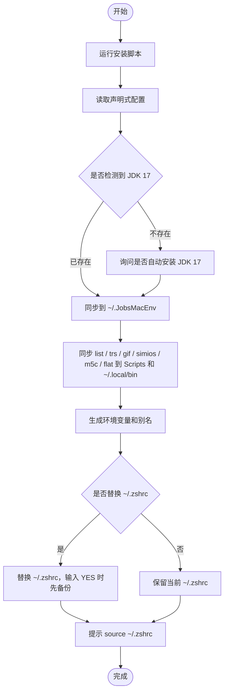

# 🌍 [**JobsMacEnvVarConfig**](https://github.com/JobsKits/JobsMacEnvVarConfig)


<!-- jobs-toc:start -->
<!-- jobs-toc:source {"v":2,"token":"[toc]"} -->
<details>
<summary>📚 目录（点击展开 / 收起）</summary>

- [🔥 前言](#jobs-toc-heading-1)
- [一、适合解决什么问题](#jobs-toc-heading-2)
- [二、目录结构](#jobs-toc-heading-3)
- [三、安装方式](#jobs-toc-heading-4)
- [四、安装流程](#jobs-toc-heading-5)
- [五、配置入口](#jobs-toc-heading-6)
  - [1、声明式环境配置](#jobs-toc-heading-7)
  - [2、个人终端函数集合](#jobs-toc-heading-8)
- [六、已支持的环境](#jobs-toc-heading-9)
- [七、常用能力](#jobs-toc-heading-10)
  - [1、轻量 zsh 主入口](#jobs-toc-heading-11)
  - [2、macOS 路径拖入解析](#jobs-toc-heading-12)
  - [3、终端相关自定义函数重点说明](#jobs-toc-heading-13)
    - [3.0 list：功能菜单总入口](#jobs-toc-heading-14)
    - [3.1 m5c：MD5 文件一致性比较](#jobs-toc-heading-15)
    - [3.2 flat：URL 编码去乱码 / 解码](#jobs-toc-heading-16)
    - [3.3 clean：清除终端历史、用户缓存 + Command+K 式清屏](#jobs-toc-heading-17)
    - [3.4 clr：清空 Chrome 下载记录](#jobs-toc-heading-18)
    - [3.4.1 dq：修复新装 App 打不开 / 废纸篓提示](#jobs-toc-heading-19)
    - [3.5 zz \<路径\>：跳转到真实目录](#jobs-toc-heading-20)
    - [3.5 x \<脚本文件\>：给脚本加执行权限并立即执行](#jobs-toc-heading-21)
    - [3.6 cor：颜色格式转换器](#jobs-toc-heading-22)
    - [3.7 shell：用 fzf 选择并切换默认 Shell](#jobs-toc-heading-23)
    - [3.8 download \<url\>：媒体下载，yt-dlp 优先并可兜底 cobalt](#jobs-toc-heading-24)
    - [3.9 Ctrl + G：把命令行最后一个路径参数解析成真实路径](#jobs-toc-heading-25)
    - [3.10 shell\_behavior.zsh：交互式终端默认行为](#jobs-toc-heading-26)
    - [3.10.1 git\_behavior.zsh：Git 路径显示修正与推送网络入口挂载](#jobs-toc-heading-27)
    - [3.11 trs：macOS 原生翻译入口](#jobs-toc-heading-28)
    - [3.12 gif：终端 / 全屏录制并转为高质量 GIF / MP4](#jobs-toc-heading-29)
    - [3.13 simios：Xcode iOS Simulator Runtime 下载 / 补齐](#jobs-toc-heading-30)
    - [3.14 local.zsh：Scripts 模块加载器](#jobs-toc-heading-31)
- [八、更新配置](#jobs-toc-heading-32)
- [九、注意事项](#jobs-toc-heading-33)
- [10、推荐维护方式](#jobs-toc-heading-34)
- [十一、当前源码目录结构](#repository-layout)
- [十二、本仓脚本流程](#repository-script-flows)
  - [install.command](#jobs-toc-heading-37)
  - [install.command](#jobs-toc-heading-38)
  - [update.command](#jobs-toc-heading-39)
  - [install\_jdk17.command](#jobs-toc-heading-40)
  - [list.command](#jobs-toc-heading-41)
  - [a.command](#jobs-toc-heading-42)
  - [b.command](#jobs-toc-heading-43)
  - [i.command](#jobs-toc-heading-44)
  - [rb.command](#jobs-toc-heading-45)
  - [save.command](#jobs-toc-heading-46)
  - [x.command](#jobs-toc-heading-47)
  - [zz.command](#jobs-toc-heading-48)
  - [shell.command](#jobs-toc-heading-49)
  - [d.command](#jobs-toc-heading-50)
  - [check1.command](#jobs-toc-heading-51)
  - [check.command](#jobs-toc-heading-52)
  - [c.command](#jobs-toc-heading-53)
  - [fixfvm.command](#jobs-toc-heading-54)
  - [buildCheck.command](#jobs-toc-heading-55)
  - [apk.command](#jobs-toc-heading-56)
  - [ipa.command](#jobs-toc-heading-57)
  - [config.command](#jobs-toc-heading-58)
  - [code.command](#jobs-toc-heading-59)
  - [codemap.command](#jobs-toc-heading-60)
  - [clean.command](#jobs-toc-heading-61)
  - [clr.command](#jobs-toc-heading-62)
  - [dq.command](#jobs-toc-heading-63)
  - [df.command](#jobs-toc-heading-64)
  - [download.command](#jobs-toc-heading-65)
  - [to.command](#jobs-toc-heading-66)
  - [gif.command](#jobs-toc-heading-67)
  - [m5c.command](#jobs-toc-heading-68)
  - [flat.command](#jobs-toc-heading-69)
  - [decode.command](#jobs-toc-heading-70)
  - [cor.command](#jobs-toc-heading-71)
  - [ts.command](#jobs-toc-heading-72)
  - [trs.command](#jobs-toc-heading-73)
  - [tts.command](#jobs-toc-heading-74)
  - [simios.command](#jobs-toc-heading-75)
  - [pods.command](#jobs-toc-heading-76)
  - [repair\_gem\_extensions.command](#jobs-toc-heading-77)
  - [cocoapods\_network\_tests.zsh](#jobs-toc-heading-78)
  - [update\_integration\_test.zsh](#jobs-toc-heading-79)
- [启动提示修复](#jobs-toc-heading-80)
- [2026-05-12 修复说明：Scripts 模块化加载](#jobs-toc-heading-81)
- [Scripts 模块加载说明](#jobs-toc-heading-82)
- [list 菜单入口调整说明](#jobs-toc-heading-83)
- [JobsMacEnv 自定义命令收口规则](#jobs-toc-heading-84)
- [2026-05-17 新增说明：FFmpeg 通用媒体格式转换](#jobs-toc-heading-85)
- [clr：清空 Chrome 下载历史](#jobs-toc-heading-86)

</details>
<!-- jobs-toc:end -->

[当前源码目录结构](#repository-layout) · [本仓脚本流程](#repository-script-flows)

## <span id="jobs-toc-heading-1" data-jobs-toc="v2">🔥 <font id=前言>前言</font></span><!-- jobs-toc:heading-end -->

- 这是一个面向 **MacOS** 的个人开发环境配置同步项目。

- 它把零散堆在 `~/.zshrc`、`~/.bash_profile` 里的环境变量、PATH、别名和个人命令拆分成模块，并通过 `install.command` 同步到用户目录 `~/.JobsMacEnv`。

## <span id="jobs-toc-heading-2" data-jobs-toc="v2">一、适合解决什么问题 <a href="#前言" style="font-size:17px; color:green;"><b>🔼</b></a> <a href="#🔚" style="font-size:17px; color:green;"><b>🔽</b></a></span><!-- jobs-toc:heading-end -->

- 新 Mac 初始化开发环境时，快速恢复常用 Shell 配置。
- 避免把所有配置都塞进一个巨大的 `~/.zshrc`。
- 统一管理 **Java**、**Android**、**Flutter**、**Node**、**Rust**、**Python**、**Ruby**、**Go** 等开发环境入口。
- 让系统级 `~/.zshrc` 保持轻量，只负责加载 `~/.JobsMacEnv`。
- 支持本机私有配置和公共配置分离。

- `codemap`：为当前目录或手工输入、拖入的一个或多个目录构建 [**CodeGraph**](https://github.com/colbymchenry/codegraph) 代码地图，详见 [使用说明](./scripts/codemap.command/README.md)。配置同步会注册此命令；引擎由独立安装器安装。

## <span id="jobs-toc-heading-3" data-jobs-toc="v2">二、目录结构 <a href="#前言" style="font-size:17px; color:green;"><b>🔼</b></a> <a href="#🔚" style="font-size:17px; color:green;"><b>🔽</b></a></span><!-- jobs-toc:heading-end -->

```text
.
├── install.command/
│   ├── install.command             # 主安装 / 同步脚本
│   └── README.md                   # 安装入口说明
├── sync_env.txt                    # 声明式环境配置
├── icon.png                        # 项目图标
├── Sys/
│   ├── .zshrc                      # 轻量 zsh 主入口模板
│   ├── .zprofile
│   ├── .zshenv
│   ├── .zlogin
│   ├── .zlogout
│   ├── .bashrc
│   └── .bash_profile
├── Scripts/
│   ├── install_jdk17.command/
│   │   ├── install_jdk17.command   # JDK 17 安装脚本，保持原版脚本位置
│   │   └── README.md               # 对应自述与流程图
│   ├── trs.command/
│   │   ├── trs.command             # macOS 原生翻译入口脚本
│   │   └── README.md
│   ├── tts.command/
│   │   ├── tts.command # Supertonic 本地 TTS 朗读入口
│   │   └── README.md
│   ├── gif.command/
│   │   ├── gif.command             # 终端 / 全屏录制并转 GIF 脚本
│   │   └── README.md
│   ├── simios.command/
│   │   ├── simios.command          # Xcode iOS Simulator Runtime 下载 / 补齐脚本
│   │   └── README.md
│   ├── list.command/
│   │   ├── list.command            # fzf 功能菜单总入口
│   ├── code.command/
│   │   ├── code.command            # VS Code 命令行入口包装脚本
│   ├── codemap.command/
│   │   ├── codemap.command         # 当前目录或指定目录的 .codegraph 构建入口
│   │   └── README.md
│   ├── pods.command/
│   │   ├── pods.command            # 本地 CocoaPods Pod 编译 / podspec lint 自检入口
│   │   └── README.md
│   ├── m5c.command/
│   │   ├── m5c.command             # MD5 文件一致性比较工具
│   │   └── README.md
│   ├── flat.command/
│   │   ├── flat.command  # URL 编码去乱码 / 解码工具
│   │   └── README.md
│   ├── dq.command/
│   │   ├── dq.command              # 修复新装 App 打不开 / 废纸篓提示
│   │   └── README.md
│   ├── df.command/
│   │   ├── df.command             # dufs + Caddy 局域网目录共享入口
│   │   └── README.md
│   └── *.command/                  # 其余模块均按“脚本全名文件夹 + 脚本 + README”管理
└── zsh/
    ├── bootstrap.zsh               # 启动层：交互式环境、Oh My Zsh、Homebrew
    ├── env_methods.zsh             # 环境变量 / PATH 工具方法
    ├── aliases.zsh                 # 自动生成的别名文件
    ├── user_mounts.zsh             # 自定义模块挂载入口
    └── custom/
        ├── shell_behavior.zsh      # 交互式终端行为：默认 cd 桌面、clean 清屏清历史
        ├── git_behavior.zsh        # Git 路径显示修正与推送网络入口挂载
        ├── path_drag_resolver.zsh  # macOS 拖入路径解析
        └── local.zsh               # Scripts 模块加载器
```

安装后会同步到：

```text
~/.JobsMacEnv
├── .zshrc
├── install.command
├── sync_env.txt
├── README.md
├── Scripts/
│   ├── install_jdk17.command/install_jdk17.command
│   ├── trs.command/trs.command
│   ├── tts.command/tts.command
│   ├── gif.command/gif.command
│   ├── simios.command/simios.command
│   ├── list.command/list.command
│   ├── m5c.command/m5c.command
│   ├── flat.command/flat.command
│   ├── dq.command/dq.command
│   ├── df.command/df.command
│   └── *.command/*.command
└── zsh/
```

## <span id="jobs-toc-heading-4" data-jobs-toc="v2">三、安装方式 <a href="#前言" style="font-size:17px; color:green;"><b>🔼</b></a> <a href="#🔚" style="font-size:17px; color:green;"><b>🔽</b></a></span><!-- jobs-toc:heading-end -->

进入项目目录后执行：

```bash
chmod +x install.command/install.command
./install.command/install.command
```

也可以在 **Finder** 中双击 `install.command` 执行。

安装过程中会询问：

1. 是否继续安装
2. 是否自动安装 JDK 17
3. 是否替换当前系统 `~/.zshrc`
4. `list` 可打开 fzf 功能菜单，集中展示可执行能力
5. `m5c` 可比较两个文件的 MD5，判断文件字节内容是否一致
6. `flat` 可对 URL 编码文本执行去乱码 / 解码，并自动复制结果到剪贴板
7. `trs` 首次使用时会对 `fzf` / `translate-cli` 这类必需依赖执行补齐流程
8. `tts` 会调用 `tts.command`，输入文本后通过本地 Supertonic 服务生成并播放语音
9. `gif` 首次使用时会检测 Homebrew / asciinema / agg / ffmpeg；启动时按回车默认录制当前终端，进入设置菜单可选择全屏录制
9. `simios` 会先检测完整 Xcode / xcode-select / xcodebuild / Xcode license / 首次启动组件，再执行 iOS Simulator Runtime 下载

替换 `~/.zshrc` 的三种输入：

```text
直接回车              立即替换（不备份）
大写 YES + 回车        先备份再替换
其它任意字符 + 回车     跳过替换
```

选择备份时，旧文件会保存为：

```text
~/.zshrc.backup.YYYYMMDDHHMMSS
```

安装完成后，立即生效：

```bash
source ~/.zshrc
```

## <span id="jobs-toc-heading-5" data-jobs-toc="v2">四、安装流程 <a href="#前言" style="font-size:17px; color:green;"><b>🔼</b></a> <a href="#🔚" style="font-size:17px; color:green;"><b>🔽</b></a></span><!-- jobs-toc:heading-end -->



## <span id="jobs-toc-heading-6" data-jobs-toc="v2">五、配置入口 <a href="#前言" style="font-size:17px; color:green;"><b>🔼</b></a> <a href="#🔚" style="font-size:17px; color:green;"><b>🔽</b></a></span><!-- jobs-toc:heading-end -->

### <span id="jobs-toc-heading-7" data-jobs-toc="v2">1、声明式环境配置 <a href="#前言" style="font-size:17px; color:green;"><b>🔼</b></a> <a href="#🔚" style="font-size:17px; color:green;"><b>🔽</b></a></span><!-- jobs-toc:heading-end -->

主要修改：

```text
sync_env.txt
```

示例：

```ini
[JAVA]
JAVA_VERSION=17
JAVA_CANDIDATES=temurin@17,zulu@17,openjdk@17

[ANDROID]
ANDROID_SDK_DEFAULT=$HOME/Library/Android/sdk

[FLUTTER]
# USE_FVM=true：PATH 兜底 + 交互式 shell 挂载按 .fvmrc 解析版本的 flutter()/dart()
# FLUTTER_CANDIDATES：逗号分隔，按顺序取第一个真实存在的目录挂到 PATH
USE_FVM=true
FLUTTER_CANDIDATES=$HOME/fvm/default/bin,$HOME/development/flutter/bin

[NODE]
ENABLE_PNPM=true
ENABLE_COREPACK=true
NVM_DIR=$HOME/.nvm

[PATH]
$HOME/bin
$HOME/.local/bin
$HOME/.pub-cache/bin
$HOME/.cargo/bin
$HOME/go/bin

[ALIASES]
ll=ls -alF
gs=git status
ga=git add .
gc=git commit
gp=git push
gl=git pull
```

执行安装脚本后，会根据 `sync_env.txt` 生成：

```text
~/.JobsMacEnv/zsh/env.zsh
~/.JobsMacEnv/zsh/aliases.zsh
```

因此不要直接长期手改这两个生成文件。需要变更时，优先改 `sync_env.txt`。

### <span id="jobs-toc-heading-8" data-jobs-toc="v2">2、个人终端函数集合 <a href="#前言" style="font-size:17px; color:green;"><b>🔼</b></a> <a href="#🔚" style="font-size:17px; color:green;"><b>🔽</b></a></span><!-- jobs-toc:heading-end -->

个人终端函数和本机专属内容统一放这里：

```text
zsh/custom/local.zsh
```

适合放：

- 个人项目路径
- 私有别名
- 常用 zsh 函数
- 终端快捷命令
- 临时开关

例如开启拖入路径自动解析：

```zsh
export JOBS_ALIAS_DRAG_AUTO_RESOLVE=true
```

个人命令按功能拆到 `Scripts/<脚本全名>/<脚本全名>`，每个脚本文件夹都带独立 `README.md` 和 Mermaid 流程图，`local.zsh` 只负责加载这些模块。

## <span id="jobs-toc-heading-9" data-jobs-toc="v2">六、已支持的环境 <a href="#前言" style="font-size:17px; color:green;"><b>🔼</b></a> <a href="#🔚" style="font-size:17px; color:green;"><b>🔽</b></a></span><!-- jobs-toc:heading-end -->

| 类型 | 说明 |
|---|---|
| Java | 自动解析 JDK 版本，默认 JDK 17 |
| Android | 配置 Android SDK、platform-tools、emulator 等路径 |
| Flutter | 支持 FVM 优先，也支持普通 Flutter SDK 路径 |
| Node | 支持 NVM、Corepack、PNPM |
| Rust | 支持 Cargo 路径 |
| Python | 支持 pyenv |
| Ruby | 支持 rbenv |
| Go | 支持 GOPATH 和 Go bin 路径 |
| Homebrew | 自动兼容 Apple Silicon 和 Intel 路径 |
| trs | macOS 原生翻译入口，中文固定为一端，fzf 选择对方语言 |
| gif | 终端 / 全屏录制入口，基于 asciinema + agg / screencapture + ffmpeg 生成高质量 GIF / MP4 |
| simios | 检测完整 Xcode 环境并下载 / 补齐 iOS Simulator Runtime |
| list | fzf 功能菜单总入口，展示可执行能力并分发到具体脚本 |
| code | VS Code 命令行入口包装脚本，支持 `code .` 打开当前目录 |
| m5c | MD5 文件一致性比较工具，支持输入或拖入两个文件路径 |
| flat | URL 编码去乱码 / 解码工具，支持普通 URL Decode 和 `--plus` 表单编码模式 |
| clr | 清空 Google Chrome 下载记录，不删除真实下载文件 |
| dq | 解决新装 App 无法打开、被系统建议移到废纸篓的问题（清理 macOS quarantine 隔离标记） |

## <span id="jobs-toc-heading-10" data-jobs-toc="v2">七、常用能力 <a href="#前言" style="font-size:17px; color:green;"><b>🔼</b></a> <a href="#🔚" style="font-size:17px; color:green;"><b>🔽</b></a></span><!-- jobs-toc:heading-end -->

### <span id="jobs-toc-heading-11" data-jobs-toc="v2">1、轻量 zsh 主入口 <a href="#前言" style="font-size:17px; color:green;"><b>🔼</b></a> <a href="#🔚" style="font-size:17px; color:green;"><b>🔽</b></a></span><!-- jobs-toc:heading-end -->

系统 `~/.zshrc` 只负责加载：

```zsh
export JOBS_MAC_ENV_HOME="$HOME/.JobsMacEnv"

jobs_source_if_exists "$JOBS_MAC_ENV_HOME/zsh/bootstrap.zsh"
jobs_source_if_exists "$JOBS_MAC_ENV_HOME/zsh/env_methods.zsh"
jobs_source_if_exists "$JOBS_MAC_ENV_HOME/zsh/env.zsh"
jobs_source_if_exists "$JOBS_MAC_ENV_HOME/zsh/aliases.zsh"
jobs_source_if_exists "$JOBS_MAC_ENV_HOME/zsh/user_mounts.zsh"
```

核心配置都在 `~/.JobsMacEnv` 下维护。

### <span id="jobs-toc-heading-12" data-jobs-toc="v2">2、macOS 路径拖入解析 <a href="#前言" style="font-size:17px; color:green;"><b>🔼</b></a> <a href="#🔚" style="font-size:17px; color:green;"><b>🔽</b></a></span><!-- jobs-toc:heading-end -->

`path_drag_resolver.zsh` 用来处理 Finder 拖入终端的路径。

默认快捷键：

```text
Ctrl + G
```

作用：把当前命令行最后一个路径参数解析成真实路径，支持：

- Finder 替身文件
- Unix 软链接
- 普通文件和目录
- 带空格、括号、转义字符的路径

### <span id="jobs-toc-heading-13" data-jobs-toc="v2">3、终端相关自定义函数重点说明 <a href="#前言" style="font-size:17px; color:green;"><b>🔼</b></a> <a href="#🔚" style="font-size:17px; color:green;"><b>🔽</b></a></span><!-- jobs-toc:heading-end -->

这些命令不是系统自带命令，而是本项目挂载到 zsh 里的个人终端能力。加载顺序在：

```zsh
zsh/user_mounts.zsh
```

默认顺序是：

```zsh
shell_behavior.zsh
git_behavior.zsh
path_drag_resolver.zsh
local.zsh
```

也就是说，`shell_behavior.zsh` 放终端默认行为，`git_behavior.zsh` 放 Git 中文路径 / emoji 路径显示修正和推送网络入口挂载，`path_drag_resolver.zsh` 放路径拖入解析，`local.zsh` 只加载 `Scripts/<脚本全名>/<脚本全名>` 模块，并兼容旧版平铺结构 `Scripts/*.command`。


#### <span id="jobs-toc-heading-14" data-jobs-toc="v2">3.0 `list`：功能菜单总入口 <a href="#前言" style="font-size:17px; color:green;"><b>🔼</b></a> <a href="#🔚" style="font-size:17px; color:green;"><b>🔽</b></a></span><!-- jobs-toc:heading-end -->

来源文件：

```text
Scripts/list.command/list.command
```

用法：

```zsh
list
```

行为：

- 启动后先显示脚本自述文件并等待回车。
- 对 Homebrew 执行健康体检。
- 对 Homebrew 安装的 `fzf` 执行健康体检。
- 使用 `fzf` 展示当前可执行功能。
- 选择功能后分发到对应脚本，例如 `m5c`、`flat`。

注意：

- `list` 命令名非常通用，存在和 alias、函数或第三方工具冲突的风险。
- 安装脚本会检测命令名冲突并给出警告，但不会静默覆盖其他路径里的命令。
- 涉及 Homebrew / fzf 更新时，统一规则是：回车跳过，输入任意字符后回车才执行更新流程。

#### <span id="jobs-toc-heading-15" data-jobs-toc="v2">3.1 `m5c`：MD5 文件一致性比较 <a href="#前言" style="font-size:17px; color:green;"><b>🔼</b></a> <a href="#🔚" style="font-size:17px; color:green;"><b>🔽</b></a></span><!-- jobs-toc:heading-end -->

来源文件：

```text
Scripts/m5c.command/m5c.command
```

用法：

```zsh
m5c
```

行为：

- 启动后先显示脚本自述文件并等待回车。
- 让用户输入或拖入第一个文件路径。
- 再让用户输入或拖入第二个文件路径。
- 分别计算两个文件的 MD5。
- 输出两个文件的字节内容是否一致。

注意：

- `m5c` 表示 MD5 Compare，命令名短，不覆盖 macOS 系统自带 `md5`。
- MD5 适合日常文件校验和去重，不适合密码、安全签名或强安全校验。

#### <span id="jobs-toc-heading-16" data-jobs-toc="v2">3.2 `flat`：URL 编码去乱码 / 解码 <a href="#前言" style="font-size:17px; color:green;"><b>🔼</b></a> <a href="#🔚" style="font-size:17px; color:green;"><b>🔽</b></a></span><!-- jobs-toc:heading-end -->

来源文件：

```text
Scripts/flat.command/flat.command
```

用法：

```zsh
flat
flat "%E4%BD%A0%E5%A5%BD"
flat --plus "hello+world%21"
```

行为：

- 启动后先显示脚本自述文件并等待回车。
- 无参数时进入交互输入，可连续解码多段 URL 编码文本。
- 带参数时逐个解码参数。
- 解码结果会自动复制到系统剪贴板。

注意：

- 默认模式只做标准 URL Decode。
- `--plus` 会把 `+` 解析为空格，适合表单编码内容。
- `flat` 作为去乱码入口，短、好输入，并通过 `list` 菜单展示用途，降低记忆成本。

#### <span id="jobs-toc-heading-17" data-jobs-toc="v2">3.3 `clean`：清除终端历史、用户缓存 + Command+K 式清屏 <a href="#前言" style="font-size:17px; color:green;"><b>🔼</b></a> <a href="#🔚" style="font-size:17px; color:green;"><b>🔽</b></a></span><!-- jobs-toc:heading-end -->

来源文件：

```text
scripts/clean.command/clean.command
```

用法：

```zsh
clean
```

执行效果：

- 清空当前 zsh 会话里的历史记录。
- 清空 `HISTFILE` 指向的历史文件，默认通常是 `~/.zsh_history`。
- 顺带清空 macOS `~/.zsh_sessions/*.history`、`~/.zsh_sessions/*.historynew` 里残留的会话历史。
- 如果检测到 Homebrew，顺手执行 `brew cleanup` 清理旧版本包和缓存。
- 删除当前用户 `Library/Caches` 内的文件、子目录和隐藏项，保留 `Caches` 目录本身。
- 清空当前终端可视区域。
- 清空终端滚动缓冲区，也就是往上滚动时看到的旧输出。
- 清屏效果按 Command+K 的目标处理：不是普通 `clear`，而是连 scrollback 一起清掉。
- 执行后恢复原来的 `HISTSIZE` / `SAVEHIST` / `HISTFILE` 设置，因此后续新输入的命令仍然会正常记录历史。

适合场景：

- 终端里刚输入过 token、密码、私有路径、临时命令，不希望留在历史里。
- 录屏、截图、演示前，希望终端画面和滚动缓冲都干净。
- 想要一次性清掉历史文件，而不是只执行普通 `clear`。

注意：

- `clean` 先展示清理范围，按回车继续，按 `Ctrl+C` 取消；非交互环境退出。
- 用户缓存直接删除，不经过废纸篓。缓存入口为符号链接时跳过；无权限删除的项目记录日志并继续，应用后续可能重新生成缓存。
- `brew cleanup` 只在检测到 `brew` 时执行；如果 Homebrew 不存在或清理失败，会跳过/忽略，不阻断清屏主流程。
- 旧历史一旦被清空，就不要指望通过方向键、`history`、`~/.zsh_history` 再找回来。
- `clear` 只清当前可视区域，不清滚动缓冲；`clean` 使用 ANSI scrollback 清理序列和 iTerm2 ClearScrollback 扩展，目标效果对齐 Command+K。
- 这里没有调用 `clear` 命令，因此不是普通 clear 的效果。

#### <span id="jobs-toc-heading-18" data-jobs-toc="v2">3.4 `clr`：清空 Chrome 下载记录 <a href="#前言" style="font-size:17px; color:green;"><b>🔼</b></a> <a href="#🔚" style="font-size:17px; color:green;"><b>🔽</b></a></span><!-- jobs-toc:heading-end -->

来源文件：

```text
Scripts/clr.command/clr.command
```

用法：

```zsh
clr
```

行为：

- 清空 Google Chrome 下载记录，效果对齐 `chrome://downloads/` 右上角「全部清除」。
- 不删除 `~/Downloads` 或其它目录里的真实文件。
- 不退出 Google Chrome。
- 不备份 Chrome `History` 数据库。
- 默认会打开 `chrome://downloads/`，然后通过自动化点击右上角「全部清除」。

可选参数：

```zsh
clr --open-only
clr --yes
clr --js-only
clr --ui-only
```

注意：

- 默认会停一下确认：直接按回车清理；输入任意字符后回车取消。
- `--open-only` 只打开 Chrome 下载记录页，不做清理。
- `--yes` 适合自动化调用，会跳过回车确认。
- `--js-only` 只尝试 Chrome JavaScript 点击。
- `--ui-only` 只尝试 macOS 辅助功能 UI 点击。

#### <span id="jobs-toc-heading-19" data-jobs-toc="v2">3.4.1 `dq`：修复新装 App 打不开 / 废纸篓提示 <a href="#前言" style="font-size:17px; color:green;"><b>🔼</b></a> <a href="#🔚" style="font-size:17px; color:green;"><b>🔽</b></a></span><!-- jobs-toc:heading-end -->

来源文件：

```text
Scripts/dq.command/dq.command
```

用法：

```zsh
dq
dq "~/Downloads/Otty (1).dmg"
dq ~/Downloads/Otty\ \(1\).dmg
dq --open $APPLICATIONS_DIR/Otty.app
dq --dry-run ~/Downloads/Otty.dmg
```

行为：

- 只对传入路径执行 `xattr -dr com.apple.quarantine`。
- 直接输入 `dq` 时，会循环询问文件路径；可以手动输入或从 Finder 拖入。
- 不执行 `spctl --master-disable`，不全局关闭 Gatekeeper。
- 支持拖入路径、带空格路径、DMG、zip、App 和目录。

#### <span id="jobs-toc-heading-20" data-jobs-toc="v2">3.5 `zz <路径>`：跳转到真实目录 <a href="#前言" style="font-size:17px; color:green;"><b>🔼</b></a> <a href="#🔚" style="font-size:17px; color:green;"><b>🔽</b></a></span><!-- jobs-toc:heading-end -->

来源文件：

```text
zsh/custom/local.zsh
```

用法：

```zsh
zz <路径>
```

行为：

- 支持直接把 Finder 里的文件或目录拖进终端。
- 自动处理路径里的转义空格，例如 `My\ Folder`。
- 支持 `~` 展开。
- 支持 macOS Finder 替身文件 alias。
- 支持 Unix 软链接 symlink。
- 如果目标是目录，进入该目录。
- 如果目标是文件，进入文件所在目录。
- 最后输出真实目录路径，方便确认当前位置。

示例：

```zsh
zz ~/Desktop
zz $APPLICATIONS_DIR/Xcode.app
zz ~/Downloads/demo.command
```

适合场景：拖文件、拖目录、点到 Finder 替身、遇到软链接时，不用手动 `cd`、`dirname`、`realpath`。

#### <span id="jobs-toc-heading-21" data-jobs-toc="v2">3.5 `x <脚本文件>`：给脚本加执行权限并立即执行 <a href="#前言" style="font-size:17px; color:green;"><b>🔼</b></a> <a href="#🔚" style="font-size:17px; color:green;"><b>🔽</b></a></span><!-- jobs-toc:heading-end -->

来源文件：

```text
zsh/custom/local.zsh
```

用法：

```zsh
x <脚本文件>
```

行为：

- 支持把 `.command`、`.sh` 或其他脚本文件直接拖进终端。
- 自动处理 Finder 拖入路径里的转义空格。
- 自动执行 `chmod +x <脚本文件>`。
- 立即执行目标脚本。
- 如果目标不存在或是目录，会直接报错并停止。

示例：

```zsh
x ./install.command
x ~/Downloads/test.sh
```

适合场景：下载了 `.command` / `.sh`，不想每次手动写 `chmod +x` 再执行。

#### <span id="jobs-toc-heading-22" data-jobs-toc="v2">3.6 `cor`：颜色格式转换器 <a href="#前言" style="font-size:17px; color:green;"><b>🔼</b></a> <a href="#🔚" style="font-size:17px; color:green;"><b>🔽</b></a></span><!-- jobs-toc:heading-end -->

来源文件：

```text
zsh/custom/local.zsh
```

用法：

```zsh
cor
cor '#D2D4DE'
cor '#D2D4DE80'
cor 'rgb(210,212,222)'
cor 'rgba(210,212,222,0.5)'
cor '0x80D2D4DE'
```

行为：

- 无参数执行 `cor` 时进入交互模式，可以连续输入颜色值，输入 `q` / `quit` / `exit` 退出。
- 支持 `#RRGGBB`、`#RRGGBBAA`、`rgb()`、`rgba()`、`0xAARRGGBB`。
- 输出不透明 HEX、带透明 HEX、RGB、RGBA、Flutter / Dart 常用的 `0xAARRGGBB`。
- 在支持 TrueColor 的终端里显示原色色块；不支持时自动退化到 xterm-256 色。
- 纯 Shell 实现，依赖系统自带的 `bash`、`awk`、`sed`、`printf`。

注意：

- 命令行参数里 `#`、括号、逗号容易被 shell 解释，建议直接用交互模式，或者给颜色值加引号。
- `0xAARRGGBB` 的透明度在最前面，例如 `0x80D2D4DE`。

#### <span id="jobs-toc-heading-23" data-jobs-toc="v2">3.7 `shell`：用 fzf 选择并切换默认 Shell <a href="#前言" style="font-size:17px; color:green;"><b>🔼</b></a> <a href="#🔚" style="font-size:17px; color:green;"><b>🔽</b></a></span><!-- jobs-toc:heading-end -->

来源文件：

```text
zsh/custom/local.zsh
```

用法：

```zsh
shell
```

行为：

- 运行时扫描当前电脑已有的可用 shell，不写死固定列表。
- 优先读取 `$SYSTEM_CONFIG_DIR/shells`，这是 macOS `chsh` 官方认可的 shell 来源。
- 继续扫描 `PATH`、`$(brew --prefix)/bin`、`$(brew --prefix)/bin`、`$MACPORTS_PREFIX/bin`、`$SYSTEM_BIN_DIR`、`$SYSTEM_USR_DIR/bin`，补充 `zsh`、`bash`、`fish`、`nu`、`pwsh`、`tcsh`、`csh`、`ksh`、`dash`、`elvish`、`xonsh` 等可执行文件。
- 如果检测到 `~/.oh-my-zsh` 或当前 `ZSH` 变量，会额外列出 `ohmyzsh / zsh + Oh My Zsh`。
- fzf 列表标题是 `目前可用的终端 / Shell：↑↓ 选择，Enter 切换，Esc 取消`。
- 选中后执行 `chsh -s <shell路径>`，修改当前 macOS 用户的默认登录 shell。
- 如果目标 shell 不在 `$SYSTEM_CONFIG_DIR/shells`，会提示是否用 `sudo` 追加。不同意就取消，不会强行切换。

依赖：

```zsh
brew install fzf
```

重要说明：

- `ohmyzsh` 不是一个独立登录 shell，它是 zsh 的配置框架。选择 `ohmyzsh / zsh + Oh My Zsh` 时，实际切换的仍然是 `zsh` 路径。
- `nu` / Nushell 如果是 Homebrew 安装，常见路径是 `$(brew --prefix)/bin/nu` 或 `$(brew --prefix)/bin/nu`。只要扫描到可执行文件，就会进列表；但作为默认登录 shell 前，macOS 仍要求它在 `$SYSTEM_CONFIG_DIR/shells` 里。
- 切换完成后，需要重新打开终端窗口才会完整生效。

#### <span id="jobs-toc-heading-24" data-jobs-toc="v2">3.8 `download <url>`：媒体下载，yt-dlp 优先并可兜底 cobalt <a href="#前言" style="font-size:17px; color:green;"><b>🔼</b></a> <a href="#🔚" style="font-size:17px; color:green;"><b>🔽</b></a></span><!-- jobs-toc:heading-end -->

来源文件：

```text
scripts/download.command/download.command
```

用法：

```zsh
download "https://www.youtube.com/shorts/xxxx?feature=share"
download --backend auto "https://example.com/video"
download --backend yt-dlp "https://example.com/video" -o "%(title)s.%(ext)s"
download --backend cobalt "https://example.com/video"
download --cobalt "https://example.com/video"
```

行为：

- 默认后端为 `auto`，先检查并调用 `yt-dlp`。
- 自动检测 macOS 默认浏览器。
- 支持识别 Chrome、Chrome Canary、Edge、Firefox、Safari。
- 调用 `yt-dlp --cookies-from-browser <browser> <url>` 下载。
- 默认浏览器识别失败时，回退使用 `chrome`。
- 如果 `yt-dlp` 失败，且已经配置 `JOBS_DOWNLOAD_COBALT_API`，自动切换到 [**cobalt**](https://github.com/imputnet/cobalt) API 兜底。
- `--backend cobalt` / `--cobalt` 可强制只使用 cobalt 后端。
- cobalt `picker` 多图、多视频场景默认全部保存，减少交互卡壳。

依赖：

```zsh
brew install yt-dlp
```

cobalt API 配置：

```zsh
export JOBS_DOWNLOAD_COBALT_API="https://your-cobalt-api.example/"
export JOBS_DOWNLOAD_COBALT_KEY="可选 Api-Key"
```

适合场景：需要登录态 cookies 的媒体优先走 `yt-dlp`；遇到 `yt-dlp` 当前站点适配失败时，用自建 cobalt API 增加兜底覆盖面。

#### <span id="jobs-toc-heading-25" data-jobs-toc="v2">3.9 `Ctrl + G`：把命令行最后一个路径参数解析成真实路径 <a href="#前言" style="font-size:17px; color:green;"><b>🔼</b></a> <a href="#🔚" style="font-size:17px; color:green;"><b>🔽</b></a></span><!-- jobs-toc:heading-end -->

来源文件：

```text
zsh/custom/path_drag_resolver.zsh
```

默认快捷键：

```text
Ctrl + G
```

行为：

- 读取当前命令行最后一个参数。
- 自动反转义 Finder 拖入路径里的空格、括号、引号等字符。
- 如果最后一个参数是有效路径，就解析成真实路径并回填到命令行。
- 支持 Finder 替身文件、Unix 软链接、普通文件、普通目录。
- 回填时使用 shell 安全转义，避免路径里的空格或特殊字符破坏命令。

示例流程：

```zsh
cd ~/Desktop/My\ Link
# 按 Ctrl + G
cd ~/RealProject
```

相关开关：

```zsh
export JOBS_ALIAS_DRAG_BINDKEY='^G'
export JOBS_ALIAS_DRAG_AUTO_RESOLVE=true
```

说明：

- `JOBS_ALIAS_DRAG_BINDKEY` 用来修改快捷键。
- `JOBS_ALIAS_DRAG_AUTO_RESOLVE=true` 后，粘贴 / 拖入单个有效路径时会尝试自动转成真实路径。
- 不想自动解析时，不设置 `JOBS_ALIAS_DRAG_AUTO_RESOLVE`，只保留 `Ctrl + G` 手动触发即可。

#### <span id="jobs-toc-heading-26" data-jobs-toc="v2">3.10 `shell_behavior.zsh`：交互式终端默认行为 <a href="#前言" style="font-size:17px; color:green;"><b>🔼</b></a> <a href="#🔚" style="font-size:17px; color:green;"><b>🔽</b></a></span><!-- jobs-toc:heading-end -->

来源文件：

```text
zsh/custom/shell_behavior.zsh
```

当前默认行为：

- 只有交互式 zsh 才执行这里面的逻辑。
- 打开新终端时，如果存在 `~/Desktop`，默认进入桌面。
- `clean` 由 `scripts/entrypoints.command/entrypoints.command` 注册，真实实现位于 `scripts/clean.command/clean.command`，负责清历史、清用户缓存、执行 `brew cleanup` 和 Command+K 式清屏。

如果你不想打开终端默认进入桌面，直接注释这一段即可：

```zsh
if [[ -o interactive ]] && [[ -d "$HOME/Desktop" ]]; then
  cd "$HOME/Desktop"
fi
```

#### <span id="jobs-toc-heading-27" data-jobs-toc="v2">3.10.1 `git_behavior.zsh`：Git 路径显示修正与推送网络入口挂载 <a href="#前言" style="font-size:17px; color:green;"><b>🔼</b></a> <a href="#🔚" style="font-size:17px; color:green;"><b>🔽</b></a></span><!-- jobs-toc:heading-end -->

来源文件：

```text
zsh/custom/git_behavior.zsh
```

当前默认行为：

- 路径显示修正只在交互式 zsh 生效，不写入全局 Git 配置，也不修改仓库 `.git/config`。
- 终端里直接输入 `git` 时，会自动临时追加 `-c core.quotepath=false`，让 `git status`、`git diff --name-only`、`git ls-files` 等命令正常显示中文路径和 emoji 路径。
- 字符集优先保持用户当前语言；只有 `LC_CTYPE` 缺少 UTF-8 语义时，才补成 `UTF-8`。

临时关闭路径显示修正：

```zsh
export JOBS_GIT_QUOTEPATH_FIX=false
source ~/.zshrc
```

推送网络策略由 [`jobs_git_network_strategy`](./scripts/_lib/jobs_git_network_strategy/README.md) 独立模块处理：`git_behavior.zsh` 把运行目录中的 `bin/` 加到 `PATH`，原有 `git` 函数继续负责中文路径修正。终端 `git push` 与 [**Sourcetree**](https://www.sourcetreeapp.com/) 普通推送按钮使用同一入口；Sourcetree 须选择系统 Git，并指向该模块的 `bin/git`。

普通推送先按原有网络路径执行；仅在尚未出现传输 / 远端进度的连接失败或 DNS / 连接超时时，才读取当前 macOS HTTPS / HTTP / SOCKS 代理，短时探测后使用首个可用候选重试一次。显式代理、旁路规则、认证 / 权限 / 分支 / 证书错误保持原行为；代理只注入本次子进程，不保存全局 `http.proxy`。首次连接仍沿用 Git 原生超时，可能先等待几十秒；探测与重试边界、部署和独立恢复入口详见模块说明。

#### <span id="jobs-toc-heading-28" data-jobs-toc="v2">3.11 `trs`：macOS 原生翻译入口 <a href="#前言" style="font-size:17px; color:green;"><b>🔼</b></a> <a href="#🔚" style="font-size:17px; color:green;"><b>🔽</b></a></span><!-- jobs-toc:heading-end -->

来源文件：

```text
Scripts/trs.command/trs.command
zsh/custom/local.zsh
```

安装后入口：

```text
~/.JobsMacEnv/Scripts/trs.command/trs.command
~/.local/bin/trs
```

用法：

```zsh
trs
```

行为：

- 中文固定为一端。
- 启动后直接进入 `原文 >` 输入，不再先弹出语言选择菜单。
- 默认对方语言是：英语（美国）/ en-US。
- 默认方向是：对方语言 → 中文。
- 对方语言和方向会保存到 `~/.local/share/jobs-translator/config.zsh`，下次执行 `trs` 自动沿用。
- 进入 `原文 >` 输入前，先检测当前语言对的系统翻译资源是否就绪。
- 真正输入原文并回车后，立即翻译；不会在原文输入之后才弹出环境配置菜单或下一步菜单。
- 设置菜单只通过 `空格 + 回车` 调用，可用于切换方向、切换对方语言、打开系统 Translation Languages 设置、查看帮助或退出翻译。
- `原文 >` 输入区不再支持冒号命令；除单个空格以外，任何非空输入都会按原文翻译。
- 不接 Google，不配置云 API Key，不需要实名。
- 主翻译能力来自 macOS 原生 Translation Service。

支持输入方式：

```text
直接输入原文 + 回车      立即翻译
空格 + 回车              打开设置菜单
Ctrl + C                 退出 trs
```

注意：`:help`、`:swap`、`:setup` 这类字符串现在也会被当作普通原文翻译；退出翻译、切换方向、切换语言等操作统一从设置菜单进入。

依赖：

```text
fzf
translate-cli
```

`fzf` 只在打开设置菜单或切换对方语言时使用；正常输入原文翻译不依赖 `fzf` 菜单。

`translate-cli` 是开源 Swift 命令行工具，本身调用 macOS 内置 Translation Service。当前脚本在缺失 `translate` 命令时，会提示补齐 `scriptingosx/translate-cli`；按回车跳过，输入任意字符后回车才执行安装流程。

重要前提：

- 当前 `scriptingosx/translate-cli` 要求 macOS 26.0 或更高版本。
- 使用前需要在系统设置里下载对应语言资源：`系统设置 → 通用 → 语言与地区 → Translation Languages…`。
- 英语已经拆成 `英语（美国）/ en-US` 和 `英语（英国）/ en-GB`，和系统设置里的下载项保持一致。
- 如果未下载对应语言资源，可能出现 `Unable to Translate` 或 `You have to download the Translation resources`。
- `trs` 会在进入原文输入前执行一次语言对检测；检测不通过时，先提示打开 Translation Languages 设置，下载完成并重新检测通过后，才进入 `原文 >` 输入。
- 支持哪些语言、翻译质量和是否可离线，最终以 Apple 系统翻译能力为准。

首次使用建议：

```text
1. 执行 trs。
2. 默认进入 英语（美国）→ 中文 的原文输入。
3. trs 会先检测 en-US → zh-Hans 是否可用。
4. 如果提示翻译资源未准备好，按回车打开 Translation Languages 设置。
5. 在系统设置里下载 英语（美国） 和 中文（普通话，简体）对应资源。
6. 下载完成后回到终端，按回车重新检测。
7. 检测通过后出现 原文 [英语（美国） → 中文] >，此时输入 I 并回车会立即翻译。
8. 需要切换语言、方向或退出翻译时，只输入一个空格再回车，打开设置菜单。
```


#### <span id="jobs-toc-heading-29" data-jobs-toc="v2">3.12 `gif`：终端 / 全屏录制并转为高质量 GIF / MP4 <a href="#前言" style="font-size:17px; color:green;"><b>🔼</b></a> <a href="#🔚" style="font-size:17px; color:green;"><b>🔽</b></a></span><!-- jobs-toc:heading-end -->

来源文件：

```text
Scripts/gif.command/gif.command
zsh/custom/local.zsh
```

安装后入口：

```text
~/.JobsMacEnv/Scripts/gif.command/gif.command
~/.local/bin/gif
```

用法：

```zsh
gif
gif --repair <输出目录、session.cast 或 session.mov>
```

核心行为：

- 启动后先出现一个极简入口：按回车直接跳过设置并开始录制；输入任意字符后回车才进入设置菜单。
- **默认永远是当前终端录制**：直接回车不会沿用上次的全屏模式，避免误录整个屏幕。
- 设置菜单最前面可以选择录制模式：`当前终端录制` 或 `全屏录制`。
- 已舍弃 App / 窗口录制：不做“录制具体某个 Mac App / 窗口”的分支。
- 当前终端录制基于 `asciinema + agg`；一个终端执行一次 `gif` 就生成一个录制结果，多终端分别执行即可录制多个。
- 全屏录制基于 macOS 自带 `screencapture` 和 `ffmpeg`；录制整个屏幕，然后转成 `session.mp4` 和 `session.gif`。
- 设置菜单内可以配置输出路径、GIF 品质和 MP4 输出。
- 路径支持手动输入和 Finder 拖入。
- 输入路径必须是已存在、可写的目录；无效路径会阻止继续，避免后续生成失败。
- 输出路径页面直接回车，会生成到系统桌面。
- 默认文件夹命名格式：`Gif@YYYY.MM.DD HH:MM:SS`。
- 品质配置页面直接回车，会沿用当前/历史品质配置。
- 所有路径选择、模式选择、品质配置、`gif` 的打印文字都发生在正式录制之前。
- 正式开始录制前会清屏，尽量避免把 `gif` 程序自己的内容录进去。
- 录制过程中按 `Ctrl-C` 结束录制，脚本会立即执行转码。
- 不再依赖关闭窗口、`Ctrl-D`、`Ctrl-G` 或后台收尾进程，流程更直接。
- 默认结束后再次清屏，只通过系统通知提示生成完成，避免终端残留内容影响下一段录制。

当前终端录制输出目录示例：

```text
~/Desktop/Gif@2026.05.12 07:37:23
├── session.cast
├── session.gif
├── session.mp4
└── README.md
```

全屏录制输出目录示例：

```text
~/Desktop/Gif@2026.05.12 07:37:23
├── session.mov
├── session.mp4
├── session.gif
└── README.md
```

依赖：

```text
当前终端录制：Homebrew / asciinema / agg / ffmpeg
全屏录制：macOS screencapture / Homebrew / ffmpeg
```

结束录制建议：

录制过程中直接按：

```text
Ctrl-C
```

终端模式下，`Ctrl-C` 会停止 asciinema 录制，随后执行 `session.cast` → `session.gif` → `session.mp4`。

全屏模式下，`Ctrl-C` 会停止 screencapture 录制，随后执行 `session.mov` → `session.mp4` → `session.gif`。

不建议输入 `exit`。你手动输入的字符本来就是录屏内容，必然有机会进入 GIF。

不再使用 `Ctrl-G` 作为结束键：你的终端环境已经把 `Ctrl-G` 分配给 Finder 拖入路径解析，继续复用会触发“最后一个参数不是有效路径”。


#### <span id="jobs-toc-heading-30" data-jobs-toc="v2">3.13 `simios`：Xcode iOS Simulator Runtime 下载 / 补齐 <a href="#前言" style="font-size:17px; color:green;"><b>🔼</b></a> <a href="#🔚" style="font-size:17px; color:green;"><b>🔽</b></a></span><!-- jobs-toc:heading-end -->

脚本位置：

```bash
Scripts/simios.command/simios.command
```

安装后入口：

```bash
~/.JobsMacEnv/Scripts/simios.command/simios.command
~/.local/bin/simios
```

终端使用：

```bash
simios
```

用途：Xcode 升级后，先确认完整 Xcode 存在，再检查 `xcode-select`、`DEVELOPER_DIR`、`xcodebuild` 能力、首次启动组件、license、磁盘空间、网络连通和已有 iOS Runtime，最后由你决定是否执行：

```bash
xcodebuild -downloadPlatform iOS -verbose
```

交互规则：普通更新 / 升级动作默认回车跳过，输入任意字符后回车才执行；会影响 `xcodebuild` 的必要支援项会单独提示原因。

#### <span id="jobs-toc-heading-31" data-jobs-toc="v2">3.14 `local.zsh`：Scripts 模块加载器 <a href="#前言" style="font-size:17px; color:green;"><b>🔼</b></a> <a href="#🔚" style="font-size:17px; color:green;"><b>🔽</b></a></span><!-- jobs-toc:heading-end -->

来源文件：

```text
zsh/custom/local.zsh
```

这个文件不再堆业务函数，只负责按顺序加载 `Scripts/<脚本全名>/<脚本全名>`。真正的个人终端函数、项目命令和本机路径配置已经按功能拆到 `Scripts` 目录，每个脚本目录内都有对应 `README.md`。

重点命令包括：

| 命令 | 作用 |
|---|---|
| `save` | 重新 source 常见 shell 配置文件，例如 `.bash_profile`、`.bashrc`、`.zshrc`、`.profile` |
| `flutter` | 重载 Flutter 命令，优先使用当前项目的 FVM Flutter SDK |
| `fixfvm` | 重新安装全局 fvm，修复 Dart SDK 内核版本不匹配问题 |
| `check1` | 输出 Dart / FVM / Flutter 的路径和版本信息 |
| `rb` | 重新登录当前 shell，相当于刷新终端会话 |
| `a` | 打开 `~/.bash_profile` |
| `b` | 打开 `~/.zshrc` |
| `i` | 打开 iOS Simulator |
| `d` | 进入默认 Flutter 项目目录，可传路径覆盖 |
| `check` | 进入项目后检查 Java / FVM / Flutter doctor |
| `c` | 在项目里通过 jenv 锁定 JDK 17，并执行检查 |
| `apk` | 构建 Flutter Android APK |
| `ipa` | 构建 Flutter iOS IPA |
| `config` | 打开配置文件目录，优先使用 Xcode |
| `code` | 打开 VS Code，解决终端提示 `zsh: command not found: code` 的问题 |
| `update` | 按项确认更新 Homebrew、FVM / Flutter、Node、Python、Ruby、CocoaPods 等模块，支持无人值守模式 |
| `install` | 新系统环境配置入口 |
| `cor` | 颜色格式转换器，支持 HEX / RGB / RGBA / 0xAARRGGBB，带色块预览 |
| `shell` | fzf 选择当前电脑扫描到的 shell，并切换默认登录 shell |
| `decode` | URL Decode 交互式解码，并自动复制结果到剪贴板 |
| `ts` | 交互式时间戳转换；空回车会继续提示，Esc/Ctrl-C/Ctrl-D 退出；输出年、月、日、时、分、秒、周几、时区；可用 fzf 选择其他时区 |
| `trs` | macOS 原生翻译入口，默认其他语言 → 中文，可切换中文 → 对方语言 |
| `gif` | 终端 / 全屏录制并转为高质量 GIF / MP4，按回车默认录制当前终端，进入设置菜单可选择全屏录制 |
| `simios` | Xcode 升级后检测并下载 / 补齐 iOS Simulator Runtime |
| `list` | 打开 fzf 功能菜单，集中展示可执行能力 |
| `m5c` | 输入或拖入两个文件路径，比较 MD5 并判断字节内容是否一致 |
| `flat` | URL 编码去乱码 / 解码，并自动复制结果到剪贴板 |

迁移新机器前，优先检查文件开头这两个变量：

```zsh
JOBS_FLUTTER_PROJECT_DIR="../../flutter_tiyu_app"
JOBS_DART_CLI_COMPLETION_FILE="~/.dart-cli-completion/zsh-config.zsh"
```

如果项目路径不对，`d`、`check`、`c`、`apk`、`ipa` 等项目相关命令就会失败或进入错误目录。

## <span id="jobs-toc-heading-32" data-jobs-toc="v2">八、更新配置 <a href="#前言" style="font-size:17px; color:green;"><b>🔼</b></a> <a href="#🔚" style="font-size:17px; color:green;"><b>🔽</b></a></span><!-- jobs-toc:heading-end -->

修改项目里的配置后，重新执行：

```bash
./install.command/install.command
```

脚本会把配置同步到：

```text
~/.JobsMacEnv
```

如果文件内容没有变化，会自动跳过重复写入。

## <span id="jobs-toc-heading-33" data-jobs-toc="v2">九、注意事项 <a href="#前言" style="font-size:17px; color:green;"><b>🔼</b></a> <a href="#🔚" style="font-size:17px; color:green;"><b>🔽</b></a></span><!-- jobs-toc:heading-end -->

- 本项目主要面向 MacOS + zsh。
- 自动安装 JDK 17 依赖 [**Homebrew**](https://brew.sh/)。
- 替换 `~/.zshrc` 前会自动备份，但仍建议先确认当前配置没有重要未迁移内容。
- `env.zsh` 和 `aliases.zsh` 是生成文件，不建议直接长期手改。
- `zsh/custom/local.zsh` 是 Scripts 模块加载器；固定项目路径主要在 `Scripts/_lib/jobs_flutter_lib.zsh` 中，`flutter` 函数由 `Scripts/flutter_project.command/flutter_project.command` 加载，迁移到新机器后建议先检查再使用。
- `USE_FVM=true` 时，`env.zsh` 会在每次开启交互式 shell 时自动加载上面的 Flutter 模块：`flutter` / `dart` 按当前项目 `.fvmrc` 解析 SDK 版本；不在 FVM 项目内则回退到 `FLUTTER_CANDIDATES` 里第一个存在的目录（通常是 `~/fvm/default/bin`），再回退到 PATH 上的真实 `flutter`。FVM 项目内不需要再手动 `fvm flutter ...`。
- `trs` 依赖 macOS 原生翻译能力；系统版本、语言资源和语言对支持情况会直接影响可用性。
- 如果安装后没有立即生效，执行 `source ~/.zshrc`，或者重新打开终端。

## <span id="jobs-toc-heading-34" data-jobs-toc="v2">10、推荐维护方式 <a href="#前言" style="font-size:17px; color:green;"><b>🔼</b></a> <a href="#🔚" style="font-size:17px; color:green;"><b>🔽</b></a></span><!-- jobs-toc:heading-end -->

```text
公共、可复用配置     -> sync_env.txt / zsh/*.zsh
个人函数加载器       -> zsh/custom/local.zsh -> Scripts/<脚本全名>/<脚本全名>
list 功能菜单入口      -> Scripts/list.command/list.command / ~/.local/bin/list
pods 本地 Pod 自检入口 -> Scripts/pods.command/pods.command / ~/.local/bin/pods
trs 终端翻译入口      -> Scripts/trs.command/trs.command / ~/.local/bin/trs
gif 终端 / 全屏录制入口 -> Scripts/gif.command/gif.command / ~/.local/bin/gif
simios iOS 模拟器补齐入口 -> Scripts/simios.command/simios.command / ~/.local/bin/simios
m5c MD5 文件比较入口 -> Scripts/m5c.command/m5c.command / ~/.local/bin/m5c
flat URL 编码去乱码入口 -> Scripts/flat.command/flat.command / ~/.local/bin/flat
dq App 打开修复入口 -> Scripts/dq.command/dq.command / ~/.local/bin/dq
df 局域网目录共享入口 -> Scripts/df.command/df.command / ~/.local/bin/df
clr Chrome 下载记录清理入口 -> Scripts/clr.command/clr.command / ~/.local/bin/clr
终端默认行为         -> zsh/custom/shell_behavior.zsh
Git 路径显示修正     -> zsh/custom/git_behavior.zsh
路径拖入解析         -> zsh/custom/path_drag_resolver.zsh
系统入口             -> ~/.zshrc 只保留加载入口
实际运行目录         -> ~/.JobsMacEnv
```

**核心原则：**

```text
系统入口要轻，环境逻辑要拆；个人终端函数统一放一处，生成文件不要手改。
```

## 十一、<span id="repository-layout">当前源码目录结构</span> <a href="#前言" style="font-size:17px; color:green;"><b>🔼</b></a> <a href="#🔚" style="font-size:17px; color:green;"><b>🔽</b></a>

```text
🌍JobsMacEnvVarConfigs/
├── README.md / icon.png / assets/
├── sync_env.txt                            # 环境变量与挂载声明
├── Sys/                                    # bash / zsh 启动文件模板
├── install.command/
│   ├── install.command                     # 把本仓配置部署到用户环境
│   └── README.md
├── scripts/                                # 源码中的功能脚本包
│   ├── <功能名>.command/                    # 同名脚本与独立 README
│   ├── entrypoints.command/                # source：注册短命令与分派
│   ├── flutter_project.command/            # source：Flutter / FVM 路由
│   ├── runtime_init.command/               # source：运行时初始化
│   ├── _lib/                               # session / path / Flutter 函数库与 Git 网络策略
│   │   └── jobs_git_network_strategy/      # Git 推送入口、隔离回归和使用说明
│   ├── update.command/Tests/               # CocoaPods 网络选择隔离回归
│   └── repair_gem_extensions.command/Tests/ # Gem 修复集成隔离回归
└── zsh/                                    # source 配置，不作为独立程序执行
    ├── bootstrap.zsh / aliases.zsh / env_methods.zsh / user_mounts.zsh
    └── custom/                             # 本地设置、Git、拖入路径与 Shell 行为
```

这里展示当前检出源码：目录名为小写 `scripts/`；前文安装树中的大写 `~/.JobsMacEnv/Scripts/` 是部署后的运行目录。`Sys/`、`zsh/`、三个 source 模块及 `_lib/` 由安装和启动流程载入，不单独套用可执行脚本流程。下章分别概述本仓 41 个 `.command` 入口和 2 个可独立运行的隔离回归脚本。

## 十二、<span id="repository-script-flows">本仓脚本流程</span> <a href="#前言" style="font-size:17px; color:green;"><b>🔼</b></a> <a href="#🔚" style="font-size:17px; color:green;"><b>🔽</b></a>

### <span id="jobs-toc-heading-37" data-jobs-toc="v2">[install.command](./install.command/install.command)</span><!-- jobs-toc:heading-end -->

> **目的：** 把本仓终端配置、环境声明和短命令部署到当前用户。

* 阅读说明并确认，定位配置源目录，校验 `sync_env.txt` 和 `Sys/.zshrc`。
* 解析环境声明，检查 Homebrew 和 JDK 17，再准备 `~/.JobsMacEnv` 与 `~/.local/bin`。
* 同步环境核心、功能脚本及 zsh 配置，生成环境变量和短命令入口，清理约定的旧运行目录。
* 按提示决定是否替换用户启动配置，并输出重载方式。
  * 替换已有 `.zshrc` 前先备份；终端需重新加载配置后使用短命令。

### <span id="jobs-toc-heading-38" data-jobs-toc="v2">[install.command](./scripts/install.command/install.command)</span><!-- jobs-toc:heading-end -->

> **目的：** 通过菜单安装所选开发工具和 Jobs 工作环境依赖。

* 阅读说明，检查 Homebrew 和菜单所需依赖，展示可选择的安装项目。
* 选择基础工具、软件、语言工具链、Jobs 仓库或下载页面，确认本次处理清单。
* 逐项检查并执行所选安装任务。
  * 缺失项安装；已有项是否升级按统一确认结果处理；未选择的项目不执行。
* 汇总成功、跳过和失败项目，并给出日志位置。

### <span id="jobs-toc-heading-39" data-jobs-toc="v2">[update.command](./scripts/update.command/update.command)</span><!-- jobs-toc:heading-end -->

> **目的：** 按需更新已使用的开发工具链，并汇总每项维护结果。

* 阅读说明并检查可用工具，按顺序展示系统工具、Homebrew、语言环境和依赖维护项目。
* 逐项决定是否运行更新。
  * 交互时回车跳过、非空输入执行；`-t` / `--trust` / `--unattended` 使用无人值守流程，不能无密码授权的步骤跳过。
* 执行所选维护并记录结果。
  * CocoaPods 源按实际连通性选用并刷新对应缓存；发现 Ruby 原生扩展缺失时调用修复入口并保留备份。
* 继续后续独立项目，最后汇总成功、跳过、失败与日志。

### <span id="jobs-toc-heading-40" data-jobs-toc="v2">[install_jdk17.command](./scripts/install_jdk17.command/install_jdk17.command)</span><!-- jobs-toc:heading-end -->

> **目的：** 准备可被系统识别的 JDK 17。

* 阅读说明并确认，检查或准备 Homebrew。
* 检测已有 JDK 17。
  * 已有健康版本直接复用；否则按候选方案安装并逐次复检。
* 补齐系统识别所需的注册，再输出 Java 路径和版本。
  * 使用需要注册的 OpenJDK 方案时，会提示通过管理员权限建立系统 Java 目录链接。

### <span id="jobs-toc-heading-41" data-jobs-toc="v2">[list.command](./scripts/list.command/list.command)</span><!-- jobs-toc:heading-end -->

> **目的：** 把 JobsMacEnv 短命令集中为可搜索、可执行的功能菜单。

* 阅读自述并确认，定位本仓脚本或用户运行目录。
* 检查 Homebrew 和 fzf，准备功能菜单。
  * `--plain` / `-p` 直接显示文字清单；依赖不可用或跳过安装时也回退为清单。
* 在菜单中搜索并选择功能，转交对应脚本、格式转换或函数执行。
* 功能结束后回车返回菜单；按 Esc 或选择退出结束，并显示日志路径。

### <span id="jobs-toc-heading-42" data-jobs-toc="v2">[a.command](./scripts/a.command/a.command)</span><!-- jobs-toc:heading-end -->

> **目的：** 打开当前用户的 bash_profile 配置文件。

* 阅读自述并确认，载入公共会话函数。
* 定位 `~/.bash_profile`，交给系统默认关联应用打开。
* 查看终端返回结果；文件内容由用户在编辑器中修改。

### <span id="jobs-toc-heading-43" data-jobs-toc="v2">[b.command](./scripts/b.command/b.command)</span><!-- jobs-toc:heading-end -->

> **目的：** 打开当前用户的 zshrc 配置文件。

* 阅读自述并确认，载入公共会话函数。
* 定位 `~/.zshrc`，交给系统默认关联应用打开。
* 查看终端返回结果；保存后可通过 `save` 重载配置。

### <span id="jobs-toc-heading-44" data-jobs-toc="v2">[i.command](./scripts/i.command/i.command)</span><!-- jobs-toc:heading-end -->

> **目的：** 打开已安装 Xcode 对应的 iOS Simulator 应用。

* 阅读自述并确认，载入公共会话函数。
* 通过系统 `open -a Simulator` 启动模拟器。
* 查看应用启动结果；需要下载运行时则使用 `simios` 入口。

### <span id="jobs-toc-heading-45" data-jobs-toc="v2">[rb.command](./scripts/rb.command/rb.command)</span><!-- jobs-toc:heading-end -->

> **目的：** 重新启动登录 Shell，重新载入启动配置。

* 阅读自述并确认，载入公共会话函数。
* 取得当前 `SHELL`，以登录模式替换当前执行进程。
* 通过已注册的终端函数调用时作用于当前终端；独立运行文件时作用于脚本进程。

### <span id="jobs-toc-heading-46" data-jobs-toc="v2">[save.command](./scripts/save.command/save.command)</span><!-- jobs-toc:heading-end -->

> **目的：** 重新载入常见 bash 和 zsh 用户配置。

* 阅读自述并确认，载入公共会话函数。
* 依次 source `.bash_profile`、`.bashrc`、`.zshrc` 和 `.profile`。
  * 不存在的文件给出提示并跳过。
* 通过已注册的终端函数调用时更新当前会话；独立运行文件只更新脚本进程。

### <span id="jobs-toc-heading-47" data-jobs-toc="v2">[x.command](./scripts/x.command/x.command)</span><!-- jobs-toc:heading-end -->

> **目的：** 给指定文件增加执行权限并立即运行。

* 阅读自述并确认，接收输入或拖入的路径，处理 `~` 和转义空格。
* 核验目标为可执行处理的文件。
  * 路径不存在或为目录时停止，不继续执行。
* 对目标执行 `chmod +x`，随后立即调用该文件并返回执行结果。

### <span id="jobs-toc-heading-48" data-jobs-toc="v2">[zz.command](./scripts/zz.command/zz.command)</span><!-- jobs-toc:heading-end -->

> **目的：** 解析拖入路径并切换到真实目录。

* 阅读自述并确认，接收路径并处理 `~`、转义空格。
* 解析 Finder 替身和符号链接，校验真实目标。
* 切换目录并输出当前位置。
  * 目标为文件时进入其父目录；通过已注册函数调用才会改变当前终端目录。

### <span id="jobs-toc-heading-49" data-jobs-toc="v2">[shell.command](./scripts/shell.command/shell.command)</span><!-- jobs-toc:heading-end -->

> **目的：** 从本机可用 Shell 中选择并设置默认登录 Shell。

* 阅读自述并确认，扫描可用 Shell。
* 通过菜单选择目标并校验其可用性。
  * 取消选择则结束；菜单依赖不可用时使用文本选择。
* 调用 `chsh` 修改当前用户的默认登录 Shell，按系统要求完成验证并查看结果。

### <span id="jobs-toc-heading-50" data-jobs-toc="v2">[d.command](./scripts/d.command/d.command)</span><!-- jobs-toc:heading-end -->

> **目的：** 进入选择的 Flutter 项目目录。

* 阅读自述并确认，载入 Flutter 项目路径函数。
* 识别当前或提示选择有效 Flutter 项目，确认目标目录。
* 切换并输出路径；通过已注册函数调用时改变当前终端目录。

### <span id="jobs-toc-heading-51" data-jobs-toc="v2">[check1.command](./scripts/check1.command/check1.command)</span><!-- jobs-toc:heading-end -->

> **目的：** 显示 Dart、FVM 和 Flutter 的命令路径与版本。

* 阅读自述并确认，载入 Flutter 环境函数。
* 逐项查询 Dart、FVM 与 Flutter 的可用路径和版本。
* 区分 Flutter 函数入口和外部命令，打印诊断结果供排查。

### <span id="jobs-toc-heading-52" data-jobs-toc="v2">[check.command](./scripts/check.command/check.command)</span><!-- jobs-toc:heading-end -->

> **目的：** 将所选项目切到指定 FVM 版本，并运行 Flutter Doctor。

* 阅读自述并确认，定位有效 Flutter 项目。
* 打印 Java、`JAVA_HOME` 等环境信息。
* 执行 `fvm use 3.24.5 --force`，会修改项目的 Flutter 版本配置。
* 运行 Flutter Doctor 详细检查并输出结果。

### <span id="jobs-toc-heading-53" data-jobs-toc="v2">[c.command](./scripts/c.command/c.command)</span><!-- jobs-toc:heading-end -->

> **目的：** 为所选 Flutter 项目修复 jenv / JDK 17 选择，再执行环境检查。

* 阅读自述并确认，定位 Flutter 项目并检查 jenv。
* 处理失效 shim，初始化 jenv export 插件，查找并登记可用 JDK 17。
* 为项目及当前执行会话选择 JDK 17，打印 Java 信息。
* 继续调用 `check` 流程，会把项目 FVM 版本切为 `3.24.5` 并运行 Doctor。

### <span id="jobs-toc-heading-54" data-jobs-toc="v2">[fixfvm.command](./scripts/fixfvm.command/fixfvm.command)</span><!-- jobs-toc:heading-end -->

> **目的：** 清理损坏的 Dart 全局 FVM 安装并重新激活。

* 阅读自述并确认，检查当前 Dart / FVM 环境。
* 尝试停用全局 FVM，清除对应可执行入口和全局包缓存。
* 通过当前 Dart 重新激活 FVM，刷新命令缓存并输出结果。

### <span id="jobs-toc-heading-55" data-jobs-toc="v2">[buildCheck.command](./scripts/buildCheck.command/buildCheck.command)</span><!-- jobs-toc:heading-end -->

> **目的：** 按选择执行 Flutter 构建前的清理、依赖获取和 Doctor 检查。

* 阅读自述并确认，定位当前或选定的 Flutter 项目，选择 FVM 或系统 Flutter。
* 决定本次是否执行 clean、pub get 和 doctor。
  * 交互提示直接回车执行、输入内容跳过；`-y` 自动执行，`--no-clean` / `--no-get` / `--no-doctor` 可关闭对应项。
* 依次处理所选检查并报告状态。
  * 锁文件比 `pubspec.yaml` 新时可跳过依赖获取；显式强制选项会重新获取。

### <span id="jobs-toc-heading-56" data-jobs-toc="v2">[apk.command](./scripts/apk.command/apk.command)</span><!-- jobs-toc:heading-end -->

> **目的：** 完成构建前检查后生成 Flutter Android release APK。

* 阅读自述并确认，定位 Flutter 项目并执行 `buildCheck -y`。
* 检查 FVM / Flutter 版本与 JDK 17，准备 Android 构建环境。
* 处理项目内可选插件依赖。
  * 存在 `plugins/htprotect` 时在该目录获取依赖，否则跳过。
* 执行 release APK 构建，成功后打开 `build/app/outputs` 查看产物。

### <span id="jobs-toc-heading-57" data-jobs-toc="v2">[ipa.command](./scripts/ipa.command/ipa.command)</span><!-- jobs-toc:heading-end -->

> **目的：** 完成构建前检查后生成 Flutter iOS release IPA。

* 阅读自述并确认，先执行 `buildCheck -y`。
* 确认后续使用的 Flutter 项目路径并进入项目。
* 执行 release IPA 构建，成功后打开 `build/ios/ipa` 查看产物。

### <span id="jobs-toc-heading-58" data-jobs-toc="v2">[config.command](./scripts/config.command/config.command)</span><!-- jobs-toc:heading-end -->

> **目的：** 使用编辑器打开指定用户配置文件。

* 阅读自述并确认，读取配置名或路径参数。
* 解析目标文件并检查是否存在。
  * 无参数使用 `~/.zshrc`；相对路径放在用户目录下，绝对路径保持原值。
* 优先使用已安装 Xcode 打开，未安装则使用 TextEdit；修改由用户保存。

### <span id="jobs-toc-heading-59" data-jobs-toc="v2">[code.command](./scripts/code.command/code.command)</span><!-- jobs-toc:heading-end -->

> **目的：** 发现本机 Visual Studio Code 命令并转交参数。

* 阅读自述并确认，接收目录、文件及命令选项。
* 从标准应用位置、Insiders、符号链接和 Spotlight 结果中查找可用 CLI。
* 把原参数交给找到的命令执行。
  * 找不到可用命令时返回 `127` 并提示，不自动安装编辑器。

### <span id="jobs-toc-heading-60" data-jobs-toc="v2">[codemap.command](./scripts/codemap.command/codemap.command)</span><!-- jobs-toc:heading-end -->

> **目的：** 为当前目录或指定多个目录建立并校验 CodeGraph 代码地图。

* 阅读自述并确认，接收当前目录或多个输入 / 拖入路径。
* 核对目录边界及 `.codegraph` 状态，拒绝系统根目录、用户根目录和不安全链接目标。
* 寻找已有健康 CodeGraph 命令，为每个目录创建或更新索引。
  * 未安装时停止并提示，不隐式安装；单个目录失败会记录后继续其它目标。
* 校验索引状态并汇总每个目录结果；存在失败时返回失败状态。

### <span id="jobs-toc-heading-61" data-jobs-toc="v2">[clean.command](./scripts/clean.command/clean.command)</span><!-- jobs-toc:heading-end -->

> **目的：** 清理终端历史、会话缓存和用户缓存，并处理失效开发 App 登记。

* 阅读自述并确认本次清理范围。
* 清除终端历史和会话数据，处理失效开发 App 的启动登记及对应失效产物。
* 清理用户 `Library/Caches`，并处理 Homebrew 清理。
  * 缓存路径按脚本边界检查；没有 Homebrew 时跳过 `brew cleanup`。
* 恢复历史记录设置，清空终端可见内容和滚动区，输出清理结果。

### <span id="jobs-toc-heading-62" data-jobs-toc="v2">[clr.command](./scripts/clr.command/clr.command)</span><!-- jobs-toc:heading-end -->

> **目的：** 清空 Chrome 下载记录，保留真实下载文件。

* 阅读说明并解析模式，检查本地通信所需运行环境。
* 准备 Chrome 下载历史扩展。
  * 首次使用可运行 `--install-extension` 生成扩展并打开加载页面；`--reveal-extension` 查看扩展目录。
* 确认后通过扩展清理记录。
  * `--open-only` 只打开页面；`--legacy-ui` 使用界面回退；扩展 ID 可自动发现或通过 `--extension-id` 指定。
* 显示清理结果，实际下载文件保留。

### <span id="jobs-toc-heading-63" data-jobs-toc="v2">[dq.command](./scripts/dq.command/dq.command)</span><!-- jobs-toc:heading-end -->

> **目的：** 清理所选文件或 App 的 macOS quarantine 隔离标记。

* 阅读说明，接收参数或循环拖入路径并校验目标。
* 检查目标的 `com.apple.quarantine` 属性。
* 仅对所选目标递归移除隔离属性。
  * `--dry-run` 只预览；`--open` 在处理后尝试打开目标。
* 汇总处理结果，不修改系统全局 Gatekeeper 设置。

### <span id="jobs-toc-heading-64" data-jobs-toc="v2">[df.command](./scripts/df.command/df.command)</span><!-- jobs-toc:heading-end -->

> **目的：** 用 dufs 与 Caddy 临时共享所选本地目录。

* 阅读说明，选择共享目录、端口和访问方式，检查服务依赖。
* 生成本次共享配置。
  * 默认只读；`--rw` 开启写入，认证参数控制访问；短域名和 hosts 配置按选择处理。
* 启动文件服务与反向代理，显示局域网访问地址。
* 结束共享并清理本次受管进程和临时配置。
  * 指定保留配置选项时按该模式保留。

### <span id="jobs-toc-heading-65" data-jobs-toc="v2">[download.command](./scripts/download.command/download.command)</span><!-- jobs-toc:heading-end -->

> **目的：** 下载指定媒体地址，并按配置在不同下载后端间处理失败。

* 阅读说明，取得媒体 URL、输出参数和后端选择。
* 检查所需工具，默认使用 yt-dlp，可按参数读取浏览器 Cookies。
* 执行下载并记录结果。
  * yt-dlp 失败且已配置 cobalt API 时才自动回退；强制 cobalt 模式也必须提供可用 API 地址。
* 输出保存位置或失败原因，供用户检查产物。

### <span id="jobs-toc-heading-66" data-jobs-toc="v2">[to.command](./scripts/to.command/to.command)</span><!-- jobs-toc:heading-end -->

> **目的：** 用 FFmpeg 将所选媒体转换为指定格式。

* 阅读说明，从命令参数、格式别名或交互输入确定目标格式和来源文件。
* 检查转换依赖与输入文件，同格式项目按规则跳过。
* 逐项选择输出名并在源目录转换。
  * 回车保留原文件名；目标重名时增加后缀，避免覆盖已有文件。
* 输出每项转换结果与产物路径。

### <span id="jobs-toc-heading-67" data-jobs-toc="v2">[gif.command](./scripts/gif.command/gif.command)</span><!-- jobs-toc:heading-end -->

> **目的：** 录制终端或全屏，并导出 GIF / MP4。

* 阅读说明，检查 asciinema、agg、FFmpeg 等所选模式需要的依赖。
* 选择录制方式和输出设置。
  * 默认回车进入终端录制，非空输入进入设置；`--repair` 对已有录制重新生成产物。
* 开始终端或屏幕录制，按提示用 `Ctrl+C` 结束。
* 转换并保存 GIF / MP4，输出录制文件和产物位置。

### <span id="jobs-toc-heading-68" data-jobs-toc="v2">[m5c.command](./scripts/m5c.command/m5c.command)</span><!-- jobs-toc:heading-end -->

> **目的：** 比较两个文件的 MD5 摘要，辅助检查内容是否相同。

* 阅读说明，依次输入或拖入两个文件。
* 处理路径并确认两个目标都可读，选择本机可用 MD5 工具。
* 计算并展示摘要，报告相同或不同；不改写原文件。

### <span id="jobs-toc-heading-69" data-jobs-toc="v2">[flat.command](./scripts/flat.command/flat.command)</span><!-- jobs-toc:heading-end -->

> **目的：** 解码 URL 百分号编码，并复制解码结果。

* 阅读说明并检查 Python，接收参数或交互输入。
* 对文本执行 URL 解码。
  * 使用 `--plus` 时额外把加号当作空格。
* 显示结果并复制到剪贴板；交互模式可继续输入或退出。

### <span id="jobs-toc-heading-70" data-jobs-toc="v2">[decode.command](./scripts/decode.command/decode.command)</span><!-- jobs-toc:heading-end -->

> **目的：** 交互式解码 URL 编码文本并复制结果。

* 阅读说明并检查 Python，进入文本输入循环。
* 对本次输入执行 URL Decode 并显示结果。
* 处理剪贴板和下一次输入。
  * 解码结果非空时自动复制；输入 `q` 结束。

### <span id="jobs-toc-heading-71" data-jobs-toc="v2">[cor.command](./scripts/cor.command/cor.command)</span><!-- jobs-toc:heading-end -->

> **目的：** 把输入颜色转换为常用 HEX、RGB 和 RGBA 表达。

* 阅读说明，从参数或交互输入取得颜色。
* 校验简写 / 完整 HEX、RGB、RGBA 或 `0xAARRGGBB` 格式并解析通道。
* 输出各格式结果和终端色块。
  * 终端按能力使用真彩色或 256 色；非法输入给出提示，交互模式可继续或退出。

### <span id="jobs-toc-heading-72" data-jobs-toc="v2">[ts.command](./scripts/ts.command/ts.command)</span><!-- jobs-toc:heading-end -->

> **目的：** 把不同精度的 Unix 时间戳转换为可读日期时间。

* 阅读说明并检查 Python，输入秒、毫秒、微秒或纳秒时间戳。
* 选择显示时区。
  * 默认使用系统时区，也可通过可用的菜单选择其它时区。
* 输出完整时间、星期和时区偏移；按 Esc 结束。

### <span id="jobs-toc-heading-73" data-jobs-toc="v2">[trs.command](./scripts/trs.command/trs.command)</span><!-- jobs-toc:heading-end -->

> **目的：** 通过 macOS 原生翻译能力交互翻译文本。

* 阅读说明，检查系统版本及 translate-cli、fzf 等所需依赖。
* 输入待译文本，或进入设置选择语言和方向。
  * 单个空格进入设置；中文保持为固定的一侧。
* 调用系统翻译并展示结果，可继续输入或退出。

### <span id="jobs-toc-heading-74" data-jobs-toc="v2">[tts.command](./scripts/tts.command/tts.command)</span><!-- jobs-toc:heading-end -->

> **目的：** 选择本地语音引擎，将输入文本生成为可播放语音。

* 阅读说明，通过菜单或文本选择 MOSS-TTS-Nano、VoxCPM2 或 Supertonic。
* 准备所选引擎的 Python 环境、模型和本地服务。
  * 首次使用可能下载依赖与模型，按该引擎的设置选择声音或参考音频。
* 接收参数或交互文本，合成并播放语音。
  * Supertonic 的中文输入按脚本策略使用 macOS `say` 回退。
* 显示生成和播放结果，可继续输入或结束。

### <span id="jobs-toc-heading-75" data-jobs-toc="v2">[simios.command](./scripts/simios.command/simios.command)</span><!-- jobs-toc:heading-end -->

> **目的：** 检查 Xcode 环境并下载或补齐 iOS Simulator Runtime。

* 阅读说明，选择完整 Xcode，检查开发者目录、许可和首次启动状态。
* 根据检查结果选择修复前置条件。
  * 需要系统授权或首次启动处理时按提示确认。
* 列出现有运行时，再按选择使用 `xcodebuild` 下载 iOS 运行时。
* 复查并汇总结果；此入口处理运行时准备，不构建业务 App。

### <span id="jobs-toc-heading-76" data-jobs-toc="v2">[pods.command](./scripts/pods.command/pods.command)</span><!-- jobs-toc:heading-end -->

> **目的：** 逐项检查本地 Pod 的 podspec 校验及编译结果。

* 阅读说明，选择或读取已记住的本地 Pod 根目录。
* 选择 podspec、平台和检查选项，校验当前 SDK 与工具。
* 在独立检查环境执行 lint / 编译，保存编译输出并显示结论。
* 根据结果选择重试、下一个 Pod、更换根目录或退出。

### <span id="jobs-toc-heading-77" data-jobs-toc="v2">[repair_gem_extensions.command](./scripts/repair_gem_extensions.command/repair_gem_extensions.command)</span><!-- jobs-toc:heading-end -->

> **目的：** 检查或修复当前 CocoaPods Ruby 环境中缺失的原生 Gem 扩展。

* 阅读说明，确认当前 CocoaPods 所用 Ruby 与 Gem 路径，筛出缺失扩展。
* 选择检查或实际修复。
  * 默认 `--check` 只检查；`--repair` 进入修复，交互确认或 `-t` 无人值守模式控制执行。
* 修复前备份目标，按现有 Ruby / Gem 版本重新构建并验证加载。
* 汇总每个目标的修复结果。
  * 构建或加载失败时恢复对应备份，不通过整体升级版本规避错误。

### <span id="jobs-toc-heading-78" data-jobs-toc="v2">[cocoapods_network_tests.zsh](./scripts/update.command/Tests/cocoapods_network_tests.zsh)</span><!-- jobs-toc:heading-end -->

> **目的：** 在隔离环境回归验证更新脚本的 CocoaPods 网络源选择。

* 建立临时目录及 curl、Git、pod、Homebrew、Gem 等替身命令。
* 抽取更新脚本相关函数，验证源选择、对应缓存刷新、目录归属及失败处理。
* 汇总断言，失败时返回非零状态，结束时清理本次临时文件和进程。

### <span id="jobs-toc-heading-79" data-jobs-toc="v2">[update_integration_test.zsh](./scripts/repair_gem_extensions.command/Tests/update_integration_test.zsh)</span><!-- jobs-toc:heading-end -->

> **目的：** 在隔离环境回归验证 Gem 修复与更新脚本的集成行为。

* 建立临时 Gem、rbenv、Ruby 和 Specs 环境，不修改宿主机 Gem 安装。
* 验证修复顺序、错误传播、独立交互、颜色输出及终端条件。
* 汇总断言，失败时返回非零状态，并清理本次临时资源。

<a id="🔚" href="#前言" style="font-size:17px; color:green; font-weight:bold;">我是有底线的➤点我回到首页</a>


## <span id="jobs-toc-heading-80" data-jobs-toc="v2">启动提示修复 <a href="#前言" style="font-size:17px; color:green;"><b>🔼</b></a> <a href="#🔚" style="font-size:17px; color:green;"><b>🔽</b></a></span><!-- jobs-toc:heading-end -->

如果打开终端看到类似 `JobsMacEnv: 缺少模块` 的提示，说明系统里的 `~/.zshrc` 已经切到新版 `Scripts` 模块加载器，但 `~/.JobsMacEnv/Scripts` 目录还没有成功同步。

请直接执行安装脚本，不要在路径前面多输入字符：

```zsh
./install.command/install.command
```

如果提示权限不足，先执行：

```zsh
chmod +x ./install.command/install.command
./install.command/install.command
```

安装完成后重新打开终端，或者执行：

```zsh
source ~/.zshrc
```

## <span id="jobs-toc-heading-81" data-jobs-toc="v2">2026-05-12 修复说明：Scripts 模块化加载 <a href="#前言" style="font-size:17px; color:green;"><b>🔼</b></a> <a href="#🔚" style="font-size:17px; color:green;"><b>🔽</b></a></span><!-- jobs-toc:heading-end -->

本版修复 `local.zsh` 模块化拆分后启动提示 `Scripts 模块未安装完整` 的问题：

- `local.zsh` 只负责加载 `Scripts/<脚本全名>/<脚本全名>`，并兼容旧版平铺结构 `Scripts/*.command`
- `Scripts` 下的功能模块已重新按“脚本全名文件夹 + 脚本 + README.md”拆分
- 启动时优先使用 `~/.JobsMacEnv/Scripts`
- 旧版 `~/.JobsMacEnv/scripts` 仅作为兼容兜底
- `clean` 仍会在检测到 Homebrew 时顺手执行 `brew cleanup`


## <span id="jobs-toc-heading-82" data-jobs-toc="v2">Scripts 模块加载说明 <a href="#前言" style="font-size:17px; color:green;"><b>🔼</b></a> <a href="#🔚" style="font-size:17px; color:green;"><b>🔽</b></a></span><!-- jobs-toc:heading-end -->

新版统一使用 `~/.JobsMacEnv/Scripts` 作为模块目录，`zsh/custom/local.zsh` 只负责加载模块。模块标准路径为 `Scripts/<脚本全名>/<脚本全名>`。安装脚本会在同步完成后执行模块自检；如果打开终端出现模块缺失提示，请重新执行：

```zsh
cd .
chmod +x install.command/install.command
./install.command/install.command
source ~/.zshrc
```

> 说明：脚本运行时展示的自述已内置在 `.command` 脚本中，不读取本 README.md；本文件仅用于仓库/文件夹阅读。

## <span id="jobs-toc-heading-83" data-jobs-toc="v2">list 菜单入口调整说明 <a href="#前言" style="font-size:17px; color:green;"><b>🔼</b></a> <a href="#🔚" style="font-size:17px; color:green;"><b>🔽</b></a></span><!-- jobs-toc:heading-end -->

`list` 现在作为 JobsMacEnv 自定义命令总菜单，不再打印长篇自述，也不再等待用户先按回车确认。运行后会直接使用 `fzf` 展示自定义命令和含义；如果 `fzf` 不可用，则退化为文本清单。

当前纳入菜单的功能入口包括：`m5c`、`flat`、`trs`、`gif`、`install_jdk17.command`、`simios`、`cor`、`decode`、`ts`、`download`、`code`、`install`、`update`、`shell`、`zz`、`x`、`save`、`rb`、`a`、`b`、`i`、`flutter_project.command`、`fixfvm`、`check1`、`check`、`c`、`d`、`buildCheck`、`apk`、`ipa`、`config`。


## <span id="jobs-toc-heading-84" data-jobs-toc="v2">JobsMacEnv 自定义命令收口规则 <a href="#前言" style="font-size:17px; color:green;"><b>🔼</b></a> <a href="#🔚" style="font-size:17px; color:green;"><b>🔽</b></a></span><!-- jobs-toc:heading-end -->

- 以终端输入窗口为准：大部分用户可输入、且不是系统原生命令的自定义命令，独立放入 `Scripts/<命令>.command/<命令>.command`；`flutter_project.command` 保持原版函数模块位置，不生成 `~/.local/bin/flutter`（`USE_FVM=true` 时由 `env.zsh` 自动加载）；`install_jdk17.command` 保持原版脚本位置，不生成 `~/.local/bin/jdk17`。
- 每个命令目录必须有同级 `README.md`。
- 运行时展示的自述必须写在脚本内部，不读取同级 `README.md`。
- `list` 是菜单入口，菜单中不显示 `list` 自己，其它自定义命令都应显示。
- `zsh/custom` 只保留加载器和交互行为；具体实现仍放在 Scripts 模块或 Scripts 私有库。

## <span id="jobs-toc-heading-85" data-jobs-toc="v2">2026-05-17 新增说明：FFmpeg 通用媒体格式转换 <a href="#前言" style="font-size:17px; color:green;"><b>🔼</b></a> <a href="#🔚" style="font-size:17px; color:green;"><b>🔽</b></a></span><!-- jobs-toc:heading-end -->

新增 `Scripts/to.command/to.command`，用于统一处理 `to mp4 文件`、`mp4 文件`、`mov 文件`、`webm 文件`、`mp3 文件` 等媒体格式转换。真实脚本只维护一份，格式短命令通过入口包装复用，避免为每种格式复制独立脚本。

`list` 的 [**fzf**](https://github.com/junegunn/fzf) 菜单已拆分展示这些格式入口：`to`、`mp4`、`mov`、`webm`、`mkv`、`avi`、`m4v`、`mp3`、`m4a`、`aac`、`wav`、`flac`、`ogg`、`opus`、`to gif`。选择 `mp4` 时等价于执行 `to mp4`，随后继续拖入或输入源文件路径。

---

## <span id="jobs-toc-heading-86" data-jobs-toc="v2">clr：清空 Chrome 下载历史 <a href="#前言" style="font-size:17px; color:green;"><b>🔼</b></a> <a href="#🔚" style="font-size:17px; color:green;"><b>🔽</b></a></span><!-- jobs-toc:heading-end -->

新增命令：

```zsh
clr
```

用途：清空 Google Chrome 浏览器下载历史，不删除本地真实文件。

第一次使用需要加载一次本地 Chrome 扩展：

```zsh
clr --install-extension
```

原因：Chrome 没有给普通 macOS 命令行提供稳定的清空下载历史接口；本工具通过本地 Chrome 扩展调用 Chrome downloads API 完成清理。
