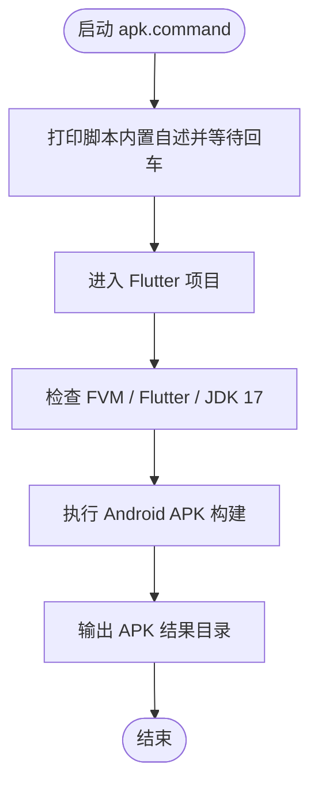

# apk.command


<!-- jobs-toc:start -->
<!-- jobs-toc:source {"v":2,"token":"[toc]"} -->
<details>
<summary>📚 目录（点击展开 / 收起）</summary>

- [🔥 前言](#jobs-toc-heading-1)
- [一、功能](#jobs-toc-heading-2)
- [二、运行](#jobs-toc-heading-3)
- [三、结构约定](#jobs-toc-heading-4)
- [四、流程图](#jobs-toc-heading-5)
- [五、日志文件](#jobs-toc-heading-6)

</details>
<!-- jobs-toc:end -->

## <span id="jobs-toc-heading-1" data-jobs-toc="v2">🔥 <font id=前言>前言</font></span><!-- jobs-toc:heading-end -->

- 采用 Shell 脚本的原因：Shell 来自 [**macOS**](https://www.apple.com/macos/) 原生系统底层，虽然写法相对繁琐冗杂，但执行效率高，并且不需要额外介入 [**Ruby**](https://www.ruby-lang.org)、[**Python**](https://www.python.org) 等第三方运行环境，因此具备更好的移植性。

## <span id="jobs-toc-heading-2" data-jobs-toc="v2">一、功能 <a href="#前言" style="font-size:17px; color:green;"><b>🔼</b></a> <a href="#🔚" style="font-size:17px; color:green;"><b>🔽</b></a></span><!-- jobs-toc:heading-end -->

检查 Flutter / FVM / JDK 17 后构建 Android APK。

| 功能步骤 | 默认行为与结果 |
| --- | --- |
| 项目选择 | 当前目录须有 `lib/` 和 `pubspec.yaml`；不符合时循环询问路径，输入 `q` 退出 |
| 构建准备 | 自动调用 `buildCheck -y`，执行清理、按锁文件时间判断是否 `pub get`，并运行 doctor |
| Flutter 版本 | 读取项目 FVM 配置；未绑定时获取 stable 版本列表，菜单选择或使用最新项，并写入 `.fvmrc`、`.fvm/fvm_config.json`、`.fvm/version` |
| 工具准备 | 缺少 FVM 时用 Dart 全局激活；随后运行 `fvm install` / `fvm use --force`。要求已安装 JDK 17 和 jenv，写项目 `.java-version` 并设置当前构建 Java 环境 |
| 子插件 | 存在 `plugins/htprotect/pubspec.yaml` 时额外在该插件执行 `pub get`，否则提示跳过 |
| 产物 | 固定执行 `build apk --release`；成功后打开工程 `build/app/outputs/` |

此入口会联网、清理项目产物、准备 SDK / 依赖及写入项目版本绑定；不是只读体检。构建模式固定为 release，没有在此入口实现 flavor 或额外构建参数解析。实际签名和 Android 构建配置由目标工程负责。

该脚本适合 `.command` 双击运行，也可以在终端中执行。启动后的说明展示、依赖检查和核心流程都写在脚本内部。

## <span id="jobs-toc-heading-3" data-jobs-toc="v2">二、运行 <a href="#前言" style="font-size:17px; color:green;"><b>🔼</b></a> <a href="#🔚" style="font-size:17px; color:green;"><b>🔽</b></a></span><!-- jobs-toc:heading-end -->

```zsh
./apk.command
```

如果已经自行加入 `PATH`，也可以执行：

```zsh
apk
```

## <span id="jobs-toc-heading-4" data-jobs-toc="v2">三、结构约定 <a href="#前言" style="font-size:17px; color:green;"><b>🔼</b></a> <a href="#🔚" style="font-size:17px; color:green;"><b>🔽</b></a></span><!-- jobs-toc:heading-end -->

运行时说明和核心流程已经写在 `apk.command` 内部，不依赖同级 `README.md`。

本 README 只用于源码浏览、维护说明和当前流程说明。

## <span id="jobs-toc-heading-5" data-jobs-toc="v2">四、流程图 <a href="#前言" style="font-size:17px; color:green;"><b>🔼</b></a> <a href="#🔚" style="font-size:17px; color:green;"><b>🔽</b></a></span><!-- jobs-toc:heading-end -->



## <span id="jobs-toc-heading-6" data-jobs-toc="v2">五、日志文件 <a href="#前言" style="font-size:17px; color:green;"><b>🔼</b></a> <a href="#🔚" style="font-size:17px; color:green;"><b>🔽</b></a></span><!-- jobs-toc:heading-end -->

运行日志默认写入 `$TMPDIR`，文件名通常来自脚本名去掉扩展名：

```shell
$TMPDIR/apk.log
```

<a id="🔚" href="#前言" style="font-size:17px; color:green; font-weight:bold;">我是有底线的➤点我回到首页</a>
