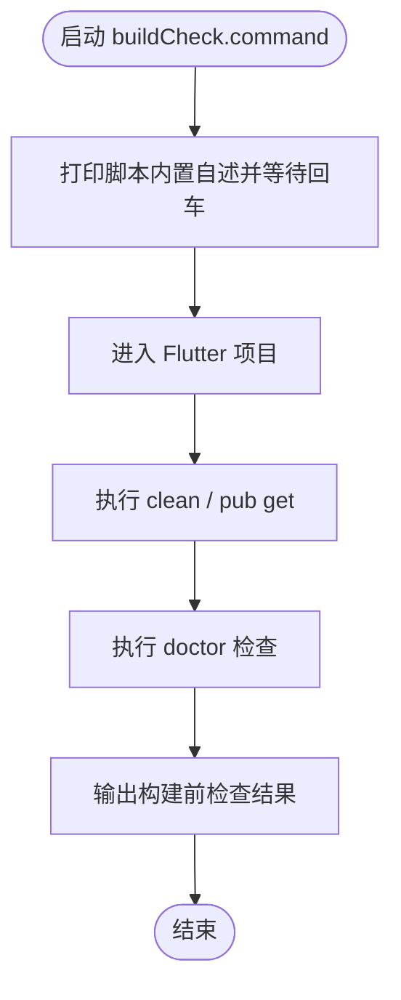

# buildCheck.command


<!-- jobs-toc:start -->
<!-- jobs-toc:source {"v":2,"token":"[toc]"} -->
<details>
<summary>📚 目录（点击展开 / 收起）</summary>

- [🔥 前言](#jobs-toc-heading-1)
- [一、功能](#jobs-toc-heading-2)
- [二、运行](#jobs-toc-heading-3)
- [三、结构约定](#jobs-toc-heading-4)
- [四、流程图](#jobs-toc-heading-5)
- [五、日志文件](#jobs-toc-heading-6)

</details>
<!-- jobs-toc:end -->

## <span id="jobs-toc-heading-1" data-jobs-toc="v2">🔥 <font id=前言>前言</font></span><!-- jobs-toc:heading-end -->

- 采用 Shell 脚本的原因：Shell 来自 [**macOS**](https://www.apple.com/macos/) 原生系统底层，虽然写法相对繁琐冗杂，但执行效率高，并且不需要额外介入 [**Ruby**](https://www.ruby-lang.org)、[**Python**](https://www.python.org) 等第三方运行环境，因此具备更好的移植性。

## <span id="jobs-toc-heading-2" data-jobs-toc="v2">一、功能 <a href="#前言" style="font-size:17px; color:green;"><b>🔼</b></a> <a href="#🔚" style="font-size:17px; color:green;"><b>🔽</b></a></span><!-- jobs-toc:heading-end -->

执行 Flutter 构建前的清理、`pub get` 和 `doctor` 检查。

默认从当前目录识别 Flutter 项目；缺少 `lib/` 或 `pubspec.yaml` 时提示输入其它路径，`q` 退出。解析真实 Flutter 执行器后，回车执行、任意非空输入跳过本组准备。它会删除构建缓存并可能联网获取依赖，不是只读检查。

| 参数 | 默认值与作用 |
| --- | --- |
| `-y` / `--yes` | 默认关闭；开启后跳过本组操作确认，仍保留入口自身的自述规则 |
| `--no-clean` | 默认执行 clean；此参数跳过 |
| `--no-get` | 默认按需执行 pub get；此参数跳过 |
| `--no-doctor` | 默认执行 doctor；此参数跳过 |
| `--force-get` | 默认关闭；忽略锁文件时间判断，强制需要 pub get |
| `--skip-lock-check` | 默认关闭；跳过时间判断，保留依赖获取步骤 |

默认仅在 `pubspec.lock` 比 `pubspec.yaml` 新时跳过 `pub get`；该判断只依据时间，不校验依赖内容。各步骤通过辅助函数显示失败，不能将终端最后一项成功当作所有准备均成功。

该脚本适合 `.command` 双击运行，也可以在终端中执行。启动后的说明展示、依赖检查和核心流程都写在脚本内部。

## <span id="jobs-toc-heading-3" data-jobs-toc="v2">二、运行 <a href="#前言" style="font-size:17px; color:green;"><b>🔼</b></a> <a href="#🔚" style="font-size:17px; color:green;"><b>🔽</b></a></span><!-- jobs-toc:heading-end -->

```zsh
./buildCheck.command
```

如果已经自行加入 `PATH`，也可以执行：

```zsh
buildCheck
buildCheck [参数...]
```

## <span id="jobs-toc-heading-4" data-jobs-toc="v2">三、结构约定 <a href="#前言" style="font-size:17px; color:green;"><b>🔼</b></a> <a href="#🔚" style="font-size:17px; color:green;"><b>🔽</b></a></span><!-- jobs-toc:heading-end -->

运行时说明和核心流程已经写在 `buildCheck.command` 内部，不依赖同级 `README.md`。

本 README 只用于源码浏览、维护说明和当前流程说明。

## <span id="jobs-toc-heading-5" data-jobs-toc="v2">四、流程图 <a href="#前言" style="font-size:17px; color:green;"><b>🔼</b></a> <a href="#🔚" style="font-size:17px; color:green;"><b>🔽</b></a></span><!-- jobs-toc:heading-end -->



## <span id="jobs-toc-heading-6" data-jobs-toc="v2">五、日志文件 <a href="#前言" style="font-size:17px; color:green;"><b>🔼</b></a> <a href="#🔚" style="font-size:17px; color:green;"><b>🔽</b></a></span><!-- jobs-toc:heading-end -->

运行日志默认写入 `$TMPDIR`，文件名通常来自脚本名去掉扩展名：

```shell
$TMPDIR/buildCheck.log
```

<a id="🔚" href="#前言" style="font-size:17px; color:green; font-weight:bold;">我是有底线的➤点我回到首页</a>
