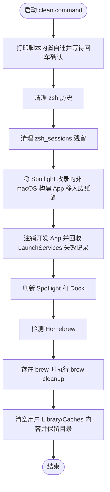

# `clean.command`


<!-- jobs-toc:start -->
<!-- jobs-toc:source {"v":2,"token":"[toc]"} -->
<details>
<summary>📚 目录（点击展开 / 收起）</summary>

- [🔥 前言](#jobs-toc-heading-1)
- [一、功能](#jobs-toc-heading-2)
- [二、运行](#jobs-toc-heading-3)
- [三、结构约定](#jobs-toc-heading-4)
- [四、失效 App 图标清理边界](#jobs-toc-heading-5)
- [五、流程图](#jobs-toc-heading-6)
- [六、日志文件](#jobs-toc-heading-7)
- [七、风险说明](#jobs-toc-heading-8)

</details>
<!-- jobs-toc:end -->

---

## <span id="jobs-toc-heading-1" data-jobs-toc="v2">🔥 <font id=前言>前言</font></span><!-- jobs-toc:heading-end -->

- 采用 Shell 脚本的原因：Shell 来自 [**macOS**](https://www.apple.com/macos/) 原生系统底层，虽然写法相对繁琐冗杂，但执行效率高，并且不需要额外介入 [**Ruby**](https://www.ruby-lang.org)、[**Python**](https://www.python.org) 等第三方运行环境，因此具备更好的移植性。

Homebrew 发现和健康检查封装在当前脚本内部，不依赖外置模块。仅复用能通过 `--version` 和真实前缀检查的已有安装；缺失或损坏时跳过对应的可选能力，不安装或升级管理器。

## <span id="jobs-toc-heading-2" data-jobs-toc="v2">一、功能 <a href="#前言" style="font-size:17px; color:green;"><b>🔼</b></a> <a href="#🔚" style="font-size:17px; color:green;"><b>🔽</b></a></span><!-- jobs-toc:heading-end -->

该脚本会连续完成五类清理：

- 清空 zsh 历史和 `zsh_sessions` 残留。
- 将 Spotlight 已收录的 iPhone、Apple TV、Apple Watch 和 Apple Vision 构建 App 移入废纸篓，从文件源头清理带禁止标记、无法在 [**macOS**](https://www.apple.com/macos/) 打开的图标。
- 定向注销 `LaunchServices` 中的非 macOS 构建 App 和 iOS Simulator App 记录。
- 检测到 [**Homebrew**](https://brew.sh/) 时执行 `brew cleanup`。
- 清空当前用户 `Library/Caches` 内的文件、子目录和隐藏项，保留 `Caches` 目录本身。

如果当前 Homebrew 开启 tap trust 策略，脚本会在清理前自动信任已安装的 `leoafarias/fvm` tap，避免 `brew cleanup` 反复输出 `Skipping fvm: tap formula is not trusted` 警告。

该脚本适合 `.command` 双击运行，也可以在终端中执行。启动后的说明展示、依赖检查和核心流程都写在脚本内部。

## <span id="jobs-toc-heading-3" data-jobs-toc="v2">二、运行 <a href="#前言" style="font-size:17px; color:green;"><b>🔼</b></a> <a href="#🔚" style="font-size:17px; color:green;"><b>🔽</b></a></span><!-- jobs-toc:heading-end -->

```zsh
./clean.command
```

如果已经自行加入 `PATH`，也可以执行：

```zsh
clean
clean [参数...]
```

脚本先展示清理范围，按回车继续，按 `Ctrl+C` 取消；非交互环境直接退出。用户缓存直接删除，不经过废纸篓。

## <span id="jobs-toc-heading-4" data-jobs-toc="v2">三、结构约定 <a href="#前言" style="font-size:17px; color:green;"><b>🔼</b></a> <a href="#🔚" style="font-size:17px; color:green;"><b>🔽</b></a></span><!-- jobs-toc:heading-end -->

运行时说明和核心流程已经写在 `clean.command` 内部，不依赖同级 `README.md`。

本 README 只用于源码浏览、维护说明和当前流程说明。

## <span id="jobs-toc-heading-5" data-jobs-toc="v2">四、失效 App 图标清理边界 <a href="#前言" style="font-size:17px; color:green;"><b>🔼</b></a> <a href="#🔚" style="font-size:17px; color:green;"><b>🔽</b></a></span><!-- jobs-toc:heading-end -->

- 只移动 Spotlight 已收录、位于当前用户目录内、且路径符合 Xcode `Build/Products` / `build` 输出特征的 iPhone、Apple TV、Apple Watch 和 Apple Vision `.app`。
- 构建 App 不直接删除，而是按原绝对路径结构移入废纸篓中的 `JobsClean-DevelopmentApps-*` 目录，可手动恢复；也可以通过 Xcode / Flutter 重新构建。
- `CoreSimulator` 设备容器中的 App 只注销 `LaunchServices` 记录，不移动实体；`Applications` 里的正常 App 始终排除。
- 完成后会短暂重启 `Spotlight`、`corespotlightd`、`sharedfilelistd` 和 `Dock`，图标列表会重新加载，Dock 可能闪烁一次。
- 后续重新运行 Xcode 或 Simulator 时，开发 App 可能被系统再次登记；再次执行 `clean` 即可清理。

## <span id="jobs-toc-heading-6" data-jobs-toc="v2">五、流程图 <a href="#前言" style="font-size:17px; color:green;"><b>🔼</b></a> <a href="#🔚" style="font-size:17px; color:green;"><b>🔽</b></a></span><!-- jobs-toc:heading-end -->



## <span id="jobs-toc-heading-7" data-jobs-toc="v2">六、日志文件 <a href="#前言" style="font-size:17px; color:green;"><b>🔼</b></a> <a href="#🔚" style="font-size:17px; color:green;"><b>🔽</b></a></span><!-- jobs-toc:heading-end -->

运行日志默认写入 `$TMPDIR`，文件名通常来自脚本名去掉扩展名：

```shell
$TMPDIR/clean.log
```

## <span id="jobs-toc-heading-8" data-jobs-toc="v2">七、风险说明 <a href="#前言" style="font-size:17px; color:green;"><b>🔼</b></a> <a href="#🔚" style="font-size:17px; color:green;"><b>🔽</b></a></span><!-- jobs-toc:heading-end -->

- zsh 历史会被清空，无法从脚本自动恢复。
- 当前用户 `Library/Caches` 内容会直接删除，应用后续可能重新生成缓存；目录缺失时跳过，`Library` 或 `Caches` 为符号链接时跳过。缓存内容中的符号链接只删除链接本身，不清理其外部目标。
- 无权限删除的缓存会保留并记录失败路径，后续清理与清屏继续执行；详细系统错误写入日志，不使用 `sudo` 提权。
- 非 macOS 构建 `.app` 会离开原构建目录；它们属于可重新生成的构建产物，可从废纸篓恢复或重新构建。
- LaunchServices 只注销符合开发输出路径特征的非 macOS App，不使用全局 `-kill` 重建，避免扰动正常 App 的打开方式关联。

<a id="🔚" href="#前言" style="font-size:17px; color:green; font-weight:bold;">我是有底线的➤点我回到首页</a>
