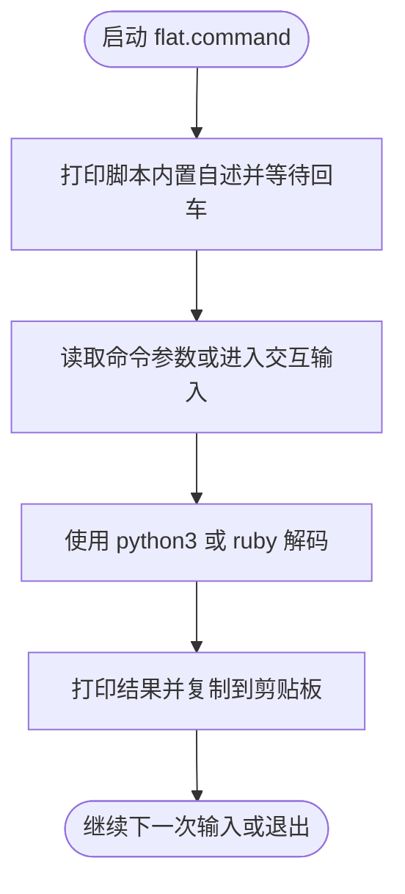

# flat.command


[toc]

> **Python 环境预检**：实际调用 [**Python**](https://www.python.org/) 前使用本文件内嵌的环境预检函数，通过 [**Homebrew**](https://brew.sh/) 管理运行时；脚本可单文件复制运行，不需要旁边的支持目录。终端自述确认后执行 `brew update` 更新本体及公式索引；只在指定公式 `python@3.13` 缺失、损坏或版本不满足 `3.11+` 时安装或修复，健康运行时直接复用。缺失 Homebrew 时强提示选安装路径：精确大写 `YES` 选系统标准目录，其它输入或回车选用户目录；失败停止，不自动换路。必需安装或修复直接回车执行，任意非空输入（含空格）取消。预检不执行全局 `brew upgrade`。

## 🔥 <font id=前言>前言</font>

- 脚本入口使用 macOS 原生 Shell；其中的解析、转换或服务功能需要下述已验证的 Python 运行时。


## 一、功能 <a href="#前言" style="font-size:17px; color:green;"><b>🔼</b></a> <a href="#🔚" style="font-size:17px; color:green;"><b>🔽</b></a>

URL 百分号编码去乱码 / 解码工具；支持参数直接解码和交互输入，结果会自动复制到剪贴板。

该脚本适合 `.command` 双击运行，也可以在终端中执行。启动后的说明展示、依赖检查和核心流程都写在脚本内部。

## 二、运行 <a href="#前言" style="font-size:17px; color:green;"><b>🔼</b></a> <a href="#🔚" style="font-size:17px; color:green;"><b>🔽</b></a>

```zsh
./flat.command
```

如果已经自行加入 `PATH`，也可以执行：

```zsh
flat
flat [参数...]
flat "%E4%BD%A0%E5%A5%BD"
flat --plus "hello+world%21"
```

## 三、交互规则 <a href="#前言" style="font-size:17px; color:green;"><b>🔼</b></a> <a href="#🔚" style="font-size:17px; color:green;"><b>🔽</b></a>

`--plus` 会把 `+` 一并解析为空格，适合表单编码文本。`-h` / `--help` 只显示帮助，不进入解码流程。

## 四、结构约定 <a href="#前言" style="font-size:17px; color:green;"><b>🔼</b></a> <a href="#🔚" style="font-size:17px; color:green;"><b>🔽</b></a>

运行时说明和核心流程已经写在 `flat.command` 内部，不依赖同级 `README.md`。

本 README 只用于源码浏览、维护说明和当前流程说明。

## 五、流程图 <a href="#前言" style="font-size:17px; color:green;"><b>🔼</b></a> <a href="#🔚" style="font-size:17px; color:green;"><b>🔽</b></a>



## 六、日志文件 <a href="#前言" style="font-size:17px; color:green;"><b>🔼</b></a> <a href="#🔚" style="font-size:17px; color:green;"><b>🔽</b></a>

运行日志默认写入 `$TMPDIR`，文件名通常来自脚本名去掉扩展名：

```shell
$TMPDIR/flat.log
```

<a id="🔚" href="#前言" style="font-size:17px; color:green; font-weight:bold;">我是有底线的➤点我回到首页</a>
