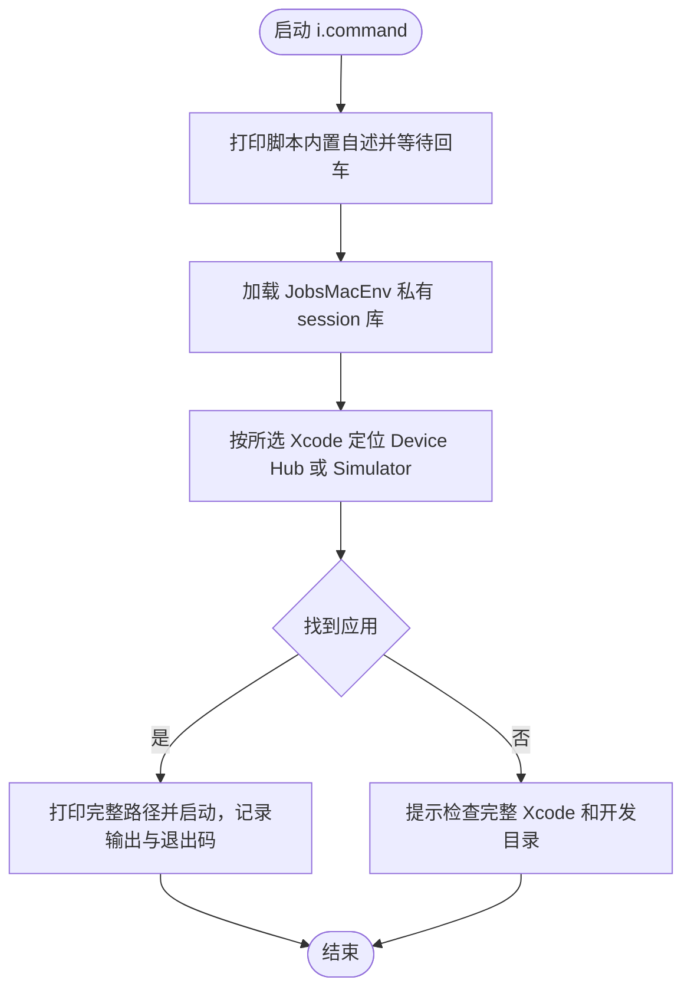

# i.command


<!-- jobs-toc:start -->
<!-- jobs-toc:source {"v":2,"token":"[toc]"} -->
<details>
<summary>📚 目录（点击展开 / 收起）</summary>

- [🔥 前言](#jobs-toc-heading-1)
- [一、功能](#jobs-toc-heading-2)
- [二、运行](#jobs-toc-heading-3)
- [三、结构约定](#jobs-toc-heading-4)
- [四、流程图](#jobs-toc-heading-5)
- [五、日志文件](#jobs-toc-heading-6)
- [六、常见问题与影响范围](#jobs-toc-heading-7)

</details>
<!-- jobs-toc:end -->

## <span id="jobs-toc-heading-1" data-jobs-toc="v2">🔥 <font id=前言>前言</font></span><!-- jobs-toc:heading-end -->

- 采用 Shell 脚本的原因：Shell 来自 [**macOS**](https://www.apple.com/macos/) 原生系统底层，虽然写法相对繁琐冗杂，但执行效率高，并且不需要额外介入 [**Ruby**](https://www.ruby-lang.org)、[**Python**](https://www.python.org) 等第三方运行环境，因此具备更好的移植性。

## <span id="jobs-toc-heading-2" data-jobs-toc="v2">一、功能 <a href="#前言" style="font-size:17px; color:green;"><b>🔼</b></a> <a href="#🔚" style="font-size:17px; color:green;"><b>🔽</b></a></span><!-- jobs-toc:heading-end -->

打开所选 [**Xcode**](https://developer.apple.com/xcode/) 对应的模拟器应用：Xcode 27 使用 [**Device Hub**](https://developer.apple.com/documentation/xcode/managing-your-simulated-and-physical-devices-in-device-hub)，旧版使用 Simulator。

| 环境 | 原启动方式 | 当前启动结果 |
| --- | --- | --- |
| Xcode 27 | `open -a Simulator` 查找不存在的旧应用，报无法找到应用 | 定位 Xcode 内的 `Contents/Applications/DeviceHub.app` 并按完整路径打开 |
| 旧版 Xcode | 依赖系统按应用名称定位 | 定位 `Contents/Developer/Applications/Simulator.app` 并按完整路径打开 |

优先遵循 `DEVELOPER_DIR`，未设置时读取 `xcode-select -p`，再检查系统和用户 Applications 中的常见 Xcode 安装目录。显式指定的 `DEVELOPER_DIR` 无效时直接报错，避免意外启动另一版 Xcode。

该脚本适合 `.command` 双击运行，也可以在终端中执行。启动后的说明展示、依赖检查和核心流程都写在脚本内部。

## <span id="jobs-toc-heading-3" data-jobs-toc="v2">二、运行 <a href="#前言" style="font-size:17px; color:green;"><b>🔼</b></a> <a href="#🔚" style="font-size:17px; color:green;"><b>🔽</b></a></span><!-- jobs-toc:heading-end -->

```zsh
./i.command
```

如果已经自行加入 `PATH`，也可以执行：

```zsh
i
i [参数...]
```

`i` 自身只确认一次；从 `list` 进入时，菜单确认仍独立保留。参数原样传给系统 `open -a <已定位的应用路径>`；直接运行 `i` 即可打开。临时指定其它 Xcode 时，可在命令前设置 `DEVELOPER_DIR`，支持 Xcode 应用根目录或 `Contents/Developer` 路径，不修改全局开发目录。

## <span id="jobs-toc-heading-4" data-jobs-toc="v2">三、结构约定 <a href="#前言" style="font-size:17px; color:green;"><b>🔼</b></a> <a href="#🔚" style="font-size:17px; color:green;"><b>🔽</b></a></span><!-- jobs-toc:heading-end -->

运行时说明和核心流程已经写在 `i.command` 内部，不依赖同级 `README.md`。

入口负责自述、确认和日志；应用定位及启动由相邻 `../_lib/jobs_session_lib.zsh` 实现。旧 Flutter 私有入口也复用该实现，移动脚本时需保留相邻私有库。

本 README 只用于源码浏览、维护说明和当前流程说明。

## <span id="jobs-toc-heading-5" data-jobs-toc="v2">四、流程图 <a href="#前言" style="font-size:17px; color:green;"><b>🔼</b></a> <a href="#🔚" style="font-size:17px; color:green;"><b>🔽</b></a></span><!-- jobs-toc:heading-end -->



## <span id="jobs-toc-heading-6" data-jobs-toc="v2">五、日志文件 <a href="#前言" style="font-size:17px; color:green;"><b>🔼</b></a> <a href="#🔚" style="font-size:17px; color:green;"><b>🔽</b></a></span><!-- jobs-toc:heading-end -->

运行日志写入系统临时目录中的 `i.log`；优先采用 `TMPDIR`，未设置时回退到系统 `/tmp`。确认后初始化日志，记录选中的应用完整路径及启动错误。日志位置可在终端查询：

```shell
printf '%s/i.log\n' "${TMPDIR:-/tmp}"
```

## <span id="jobs-toc-heading-7" data-jobs-toc="v2">六、常见问题与影响范围 <a href="#前言" style="font-size:17px; color:green;"><b>🔼</b></a> <a href="#🔚" style="font-size:17px; color:green;"><b>🔽</b></a></span><!-- jobs-toc:heading-end -->

- 找不到应用：检查完整 Xcode 是否安装，以及 `DEVELOPER_DIR` 和 `xcode-select -p`；只有 Command Line Tools 无法提供模拟器应用。
- Device Hub 已打开但没有可用的 iOS 系统：按 Xcode 的组件设置或 [`simios`](../simios.command/README.md) 的独立确认流程补齐运行时。`i` 不负责下载运行时。
- 启动失败：查看日志中的应用路径和 `open` 退出码；脚本保留失败状态，便于菜单和终端排查。
- 本入口只启动应用并写入自身临时日志，不安装组件、不修改项目、不切换全局 `xcode-select`。确认前按 Ctrl+C 或输入结束会退出；没有交互终端时停止并提示重新运行。

<a id="🔚" href="#前言" style="font-size:17px; color:green; font-weight:bold;">我是有底线的➤点我回到首页</a>
