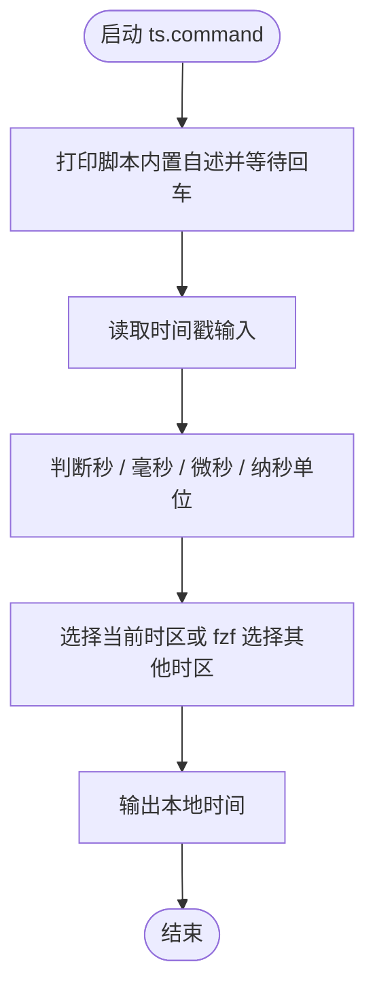

# ts.command


<!-- jobs-toc:start -->
<!-- jobs-toc:source {"v":2,"token":"[toc]"} -->
<details>
<summary>📚 目录（点击展开 / 收起）</summary>

- [🔥 前言](#jobs-toc-heading-1)
- [一、功能](#jobs-toc-heading-2)
- [二、运行](#jobs-toc-heading-3)
- [三、交互规则](#jobs-toc-heading-4)
- [四、结构约定](#jobs-toc-heading-5)
- [五、流程图](#jobs-toc-heading-6)
- [六、日志文件](#jobs-toc-heading-7)

</details>
<!-- jobs-toc:end -->

> **Python 环境预检**：实际调用 [**Python**](https://www.python.org/) 前使用本文件内嵌的环境预检函数，通过 [**Homebrew**](https://brew.sh/) 管理运行时；脚本可单文件复制运行，不需要旁边的支持目录。终端自述确认后执行 `brew update` 更新本体及公式索引；只在指定公式 `python@3.13` 缺失、损坏或版本不满足 `3.11+` 时安装或修复，健康运行时直接复用。缺失 Homebrew 时强提示选安装路径：精确大写 `YES` 选系统标准目录，其它输入或回车选用户目录；失败停止，不自动换路。必需安装或修复直接回车执行，任意非空输入（含空格）取消。预检不执行全局 `brew upgrade`。

## <span id="jobs-toc-heading-1" data-jobs-toc="v2">🔥 <font id=前言>前言</font></span><!-- jobs-toc:heading-end -->

- 脚本入口使用 macOS 原生 Shell；其中的解析、转换或服务功能需要下述已验证的 Python 运行时。


## <span id="jobs-toc-heading-2" data-jobs-toc="v2">一、功能 <a href="#前言" style="font-size:17px; color:green;"><b>🔼</b></a> <a href="#🔚" style="font-size:17px; color:green;"><b>🔽</b></a></span><!-- jobs-toc:heading-end -->

识别秒 / 毫秒 / 微秒 / 纳秒级 Unix 时间戳，并转换为本地时间。

该脚本适合 `.command` 双击运行，也可以在终端中执行。启动后的说明展示、依赖检查和核心流程都写在脚本内部。

## <span id="jobs-toc-heading-3" data-jobs-toc="v2">二、运行 <a href="#前言" style="font-size:17px; color:green;"><b>🔼</b></a> <a href="#🔚" style="font-size:17px; color:green;"><b>🔽</b></a></span><!-- jobs-toc:heading-end -->

```zsh
./ts.command
```

如果已经自行加入 `PATH`，也可以执行：

```zsh
ts
ts [参数...]
```

## <span id="jobs-toc-heading-4" data-jobs-toc="v2">三、交互规则 <a href="#前言" style="font-size:17px; color:green;"><b>🔼</b></a> <a href="#🔚" style="font-size:17px; color:green;"><b>🔽</b></a></span><!-- jobs-toc:heading-end -->

时区默认使用当前系统时区；需要改时区时可进入 fzf 时区选择。

## <span id="jobs-toc-heading-5" data-jobs-toc="v2">四、结构约定 <a href="#前言" style="font-size:17px; color:green;"><b>🔼</b></a> <a href="#🔚" style="font-size:17px; color:green;"><b>🔽</b></a></span><!-- jobs-toc:heading-end -->

运行时说明和核心流程已经写在 `ts.command` 内部，不依赖同级 `README.md`。

本 README 只用于源码浏览、维护说明和当前流程说明。

## <span id="jobs-toc-heading-6" data-jobs-toc="v2">五、流程图 <a href="#前言" style="font-size:17px; color:green;"><b>🔼</b></a> <a href="#🔚" style="font-size:17px; color:green;"><b>🔽</b></a></span><!-- jobs-toc:heading-end -->



## <span id="jobs-toc-heading-7" data-jobs-toc="v2">六、日志文件 <a href="#前言" style="font-size:17px; color:green;"><b>🔼</b></a> <a href="#🔚" style="font-size:17px; color:green;"><b>🔽</b></a></span><!-- jobs-toc:heading-end -->

运行日志默认写入 `$TMPDIR`，文件名通常来自脚本名去掉扩展名：

```shell
$TMPDIR/ts.log
```

<a id="🔚" href="#前言" style="font-size:17px; color:green; font-weight:bold;">我是有底线的➤点我回到首页</a>
