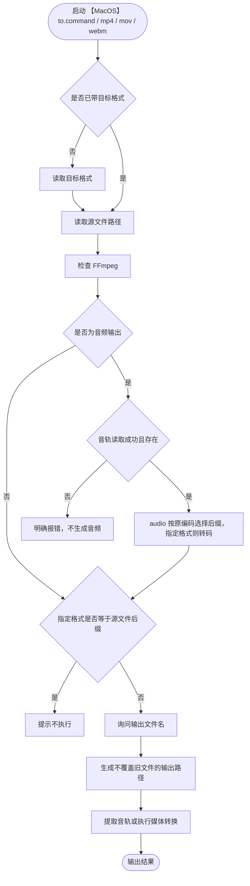

# 【MacOS】to.command


<!-- jobs-toc:start -->
<!-- jobs-toc:source {"v":2,"token":"[toc]"} -->
<details>
<summary>📚 目录（点击展开 / 收起）</summary>

- [🔥 前言](#jobs-toc-heading-1)
- [一、适用场景](#jobs-toc-heading-2)
- [二、运行方式](#jobs-toc-heading-3)
  - [2.1、终端短命令](#jobs-toc-heading-4)
  - [2.2、通用命令](#jobs-toc-heading-5)
  - [2.3、通过 list 菜单执行](#jobs-toc-heading-6)
  - [2.4、双击 .command](#jobs-toc-heading-7)
  - [2.5、从视频提取音轨](#extract-audio)
- [三、执行前检查](#jobs-toc-heading-9)
- [四、脚本执行命令](#jobs-toc-heading-10)
- [五、流程图](#jobs-toc-heading-11)
- [六、日志文件](#jobs-toc-heading-12)
- [七、风险说明](#jobs-toc-heading-13)
- [八、验证范围](#jobs-toc-heading-14)

</details>
<!-- jobs-toc:end -->

---

## <span id="jobs-toc-heading-1" data-jobs-toc="v2">🔥 <font id=前言>前言</font></span><!-- jobs-toc:heading-end -->

- 采用 Shell 脚本的原因：Shell 来自 [**macOS**](https://www.apple.com/macos/) 原生系统底层，虽然写法相对繁琐冗杂，但执行效率高，并且不需要额外介入 [**Ruby**](https://www.ruby-lang.org)、[**Python**](https://www.python.org) 等第三方运行环境，因此具备更好的移植性。

`【MacOS】to.command` 是基于 [**FFmpeg**](https://ffmpeg.org/) 的视频音轨提取与媒体格式转换入口。`to audio 视频文件` 直接提取首条原音轨，不重新编码；`mp3`、`m4a` 等命令则提取后转为指定音频格式。

它只维护一个真实脚本，但可以通过 `to mp4 文件`、`mp4 文件`、`mov 文件`、`webm 文件`、`mp3 文件` 这类短命令调用，避免为每一种格式复制一份脚本。

当前入口内嵌完整的 [**Homebrew**](https://brew.sh/) 健康发现、必要安装及 `shellenv` 激活函数，可单独复制脚本运行，不依赖外置环境模块。健康环境直接复用；必须安装管理器时输入精确大写 `YES` 选择系统目录，其他输入选择用户目录；安装或复检失败立即停止。原软件安装确认保持“回车跳过，任意字符执行”，不升级无关公式。

## <span id="jobs-toc-heading-2" data-jobs-toc="v2">一、适用场景 <a href="#前言" style="font-size:17px; color:green;"><b>🔼</b></a> <a href="#🔚" style="font-size:17px; color:green;"><b>🔽</b></a></span><!-- jobs-toc:heading-end -->

| 场景 | 推荐命令 |
| --- | --- |
| `webm` 转 `mp4` | `mp4 文件.webm` |
| 视频转 `mov` | `mov 文件.webm` |
| 视频转 `webm` | `webm 文件.mp4` |
| 提取视频原音轨，保留原编码 | `to audio 文件.mp4` |
| 视频提取 `mp3` | `mp3 文件.mp4` |
| 通用写法 | `to 目标格式 文件` |
| 生成 `gif` | `to gif 文件` |

> `gif` 在 JobsMacEnv 里已经是终端 / 屏幕录制入口，所以本工具不抢占 `gif` 短命令。需要转换 GIF 时使用 `to gif 文件`。

## <span id="jobs-toc-heading-3" data-jobs-toc="v2">二、运行方式 <a href="#前言" style="font-size:17px; color:green;"><b>🔼</b></a> <a href="#🔚" style="font-size:17px; color:green;"><b>🔽</b></a></span><!-- jobs-toc:heading-end -->

### <span id="jobs-toc-heading-4" data-jobs-toc="v2">2.1、终端短命令 <a href="#前言" style="font-size:17px; color:green;"><b>🔼</b></a> <a href="#🔚" style="font-size:17px; color:green;"><b>🔽</b></a></span><!-- jobs-toc:heading-end -->

```zsh
mp4 ~/Desktop/input.webm
```

也可以先只输入目标格式，再回车拖入文件：

```zsh
mp4
```

脚本会提示：

```text
👉 请拖入或输入源文件路径；多个文件可连续拖入后回车，输入 q 取消：
```

这时从 Finder 把文件拖进终端即可。脚本会自动还原 macOS 拖入路径里的反斜杠转义，例如空格、中文、括号、方括号。

拿到源文件后会继续提示：

```text
👉 请输入输出文件名，不带 .mp4；直接回车沿用原文件名：
```

直接回车会沿用源文件名，例如：

```text
input.mp4
```

输入：

```text
goodbye-happiness
```

会输出：

```text
goodbye-happiness.mp4
```

### <span id="jobs-toc-heading-5" data-jobs-toc="v2">2.2、通用命令 <a href="#前言" style="font-size:17px; color:green;"><b>🔼</b></a> <a href="#🔚" style="font-size:17px; color:green;"><b>🔽</b></a></span><!-- jobs-toc:heading-end -->

```zsh
to mp4 ~/Desktop/input.webm
```

也可以一次传入多个文件：

```zsh
mp4 ~/Desktop/a.webm ~/Desktop/b.webm ~/Desktop/c.mov
```

脚本会逐个询问输出文件名。

### <span id="jobs-toc-heading-6" data-jobs-toc="v2">2.3、通过 `list` 菜单执行 <a href="#前言" style="font-size:17px; color:green;"><b>🔼</b></a> <a href="#🔚" style="font-size:17px; color:green;"><b>🔽</b></a></span><!-- jobs-toc:heading-end -->

执行：

```zsh
list
```

在 [**fzf**](https://github.com/junegunn/fzf) 菜单里可以直接选择 `mp4`、`mov`、`webm`、`mp3` 等格式入口。

这些入口全部回到 `【MacOS】to.command`，例如选择 `mp4` 等价于：

```zsh
to mp4
```

随后脚本会要求拖入或输入源文件路径。

### <span id="jobs-toc-heading-7" data-jobs-toc="v2">2.4、双击 `.command` <a href="#前言" style="font-size:17px; color:green;"><b>🔼</b></a> <a href="#🔚" style="font-size:17px; color:green;"><b>🔽</b></a></span><!-- jobs-toc:heading-end -->

双击 `【MacOS】to.command` 时，会先展示脚本内置自述，按回车后进入交互模式：

- 输入 `audio` 提取原音轨，或输入目标格式，例如 `mp4`。
- 拖入或输入源文件路径。
- 输入输出文件名；直接回车沿用原文件名。

### 2.5、<span id="extract-audio">从视频提取音轨</span> <a href="#前言" style="font-size:17px; color:green;"><b>🔼</b></a> <a href="#🔚" style="font-size:17px; color:green;"><b>🔽</b></a>

保留原始声音、不重新压缩：

```zsh
to audio "$HOME/Desktop/视频.mp4"
```

也可以运行 `to audio` 后拖入视频。检查到音轨后，脚本会显示原编码和输出后缀，再询问文件名；回车沿用原名。输出放在源文件同目录，保留原视频。没有 `to` 短命令时，可直接运行本目录的真实脚本：

```zsh
./【MacOS】to.command audio "$HOME/Desktop/视频.mp4"
```

| 原音轨编码 | 自动输出 |
| --- | --- |
| AAC / ALAC | `.m4a` |
| MP3 | `.mp3` |
| FLAC | `.flac` |
| Vorbis | `.ogg` |
| Opus | `.opus` |
| 其它编码 | `.mka`，保留原编码的音频容器 |

只提取首条音轨，不混音；视频画面、字幕、封面及数据流不进入输出。指定 `mp3 视频.mp4` 则会将首条音轨重新编码为 MP3；转为 WAV / FLAC 也不会恢复源文件已经损失的音质。

源文件没有音轨时会明确提示“源文件没有音轨，无法提取声音”，不询问输出文件名、不生成空音频。录屏需在录制时启用所需的系统声音或麦克风；提取工具无法补回未录入的声音。文件损坏或读取失败与“没有音轨”分开报告，错误详情写入日志。

音频先生成在源目录下的私有临时目录，完成后再保存到最终文件名；重名自动编号。优先使用硬链接一次发布，不支持硬链接的磁盘采用独占新建文件后复制，复制期间可能看见未写完的最终文件。普通失败或可捕获中断会清理本次半成品，保留源文件和既有输出；强制终止可能留下临时目录或半成品。

## <span id="jobs-toc-heading-9" data-jobs-toc="v2">三、执行前检查 <a href="#前言" style="font-size:17px; color:green;"><b>🔼</b></a> <a href="#🔚" style="font-size:17px; color:green;"><b>🔽</b></a></span><!-- jobs-toc:heading-end -->

脚本会检查 [**FFmpeg**](https://ffmpeg.org/) 是否可用。

音轨提取及指定音频格式输出还需要同包的 `ffprobe` 检查真实音轨；优先使用 `ffmpeg` 同目录的探测器，并验证其可运行。探测器不可用时停止音频处理，提示检查安装。

- 如果已安装：直接执行转换。
- 如果未安装，但检测到 [**Homebrew**](https://brew.sh/)：会询问是否执行 `brew install ffmpeg`。
- 如果 [**Homebrew**](https://brew.sh/) 也不存在：脚本停止，并提示手动安装命令。

普通安装动作遵循 Jobs 交互规则：

```text
直接回车跳过；输入任意字符后回车执行
```

## <span id="jobs-toc-heading-10" data-jobs-toc="v2">四、脚本执行命令 <a href="#前言" style="font-size:17px; color:green;"><b>🔼</b></a> <a href="#🔚" style="font-size:17px; color:green;"><b>🔽</b></a></span><!-- jobs-toc:heading-end -->

| 命令 | 说明 |
| --- | --- |
| `to mp4 文件` | 通用写法，转换为 `mp4` |
| `to audio 文件` | 提取首条原音轨，不重新编码，自动选择音频后缀 |
| `mp4 文件` | 快捷写法，转换为 `mp4` |
| `mov 文件` | 快捷写法，转换为 `mov` |
| `webm 文件` | 快捷写法，转换为 `webm` |
| `mkv 文件` | 快捷写法，转换为 `mkv` |
| `avi 文件` | 快捷写法，转换为 `avi` |
| `m4v 文件` | 快捷写法，转换为 `m4v` |
| `mp3 文件` | 提取或转换为 `mp3` |
| `m4a 文件` | 提取或转换为 `m4a` |
| `aac 文件` | 提取或转换为 `aac` |
| `wav 文件` | 提取或转换为 `wav` |
| `flac 文件` | 提取或转换为 `flac` |
| `ogg 文件` | 提取或转换为 `ogg` |
| `opus 文件` | 提取或转换为 `opus` |
| `to gif 文件` | 转换为 `gif`，不占用 `gif` 录制命令 |

## <span id="jobs-toc-heading-11" data-jobs-toc="v2">五、流程图 <a href="#前言" style="font-size:17px; color:green;"><b>🔼</b></a> <a href="#🔚" style="font-size:17px; color:green;"><b>🔽</b></a></span><!-- jobs-toc:heading-end -->



## <span id="jobs-toc-heading-12" data-jobs-toc="v2">六、日志文件 <a href="#前言" style="font-size:17px; color:green;"><b>🔼</b></a> <a href="#🔚" style="font-size:17px; color:green;"><b>🔽</b></a></span><!-- jobs-toc:heading-end -->

日志会写入 `$TMPDIR/命令名.log`。

常见示例：

```text
$TMPDIR/to.log
$TMPDIR/mp4.log
$TMPDIR/mov.log
```

## <span id="jobs-toc-heading-13" data-jobs-toc="v2">七、风险说明 <a href="#前言" style="font-size:17px; color:green;"><b>🔼</b></a> <a href="#🔚" style="font-size:17px; color:green;"><b>🔽</b></a></span><!-- jobs-toc:heading-end -->

- 不覆盖已有文件；如果目标文件已存在，会自动追加 `_1`、`_2`。
- 明确指定的格式和源文件后缀相同会停止；`audio` 模式按原编码提取，允许同后缀并通过编号避免覆盖。
- 只输入 `mp4`、`mov`、`webm` 等快捷命令时，会进入源文件路径交互输入。
- 交互输入源文件时，支持 Finder 拖入产生的 `\ `、`\[`、`\]` 等转义路径。
- 交互输入源文件时，输入 `q` / `quit` / `exit` 可以取消。
- 转换失败时，会清理本次生成的半成品输出文件。
- 脚本不会删除源文件。

## <span id="jobs-toc-heading-14" data-jobs-toc="v2">八、验证范围 <a href="#前言" style="font-size:17px; color:green;"><b>🔼</b></a> <a href="#🔚" style="font-size:17px; color:green;"><b>🔽</b></a></span><!-- jobs-toc:heading-end -->

本机已实际从含 AAC 双声道音轨的视频提取约 49.67 秒的 M4A，输出仅含音频流，原视频与输出音频的压缩音频包 SHA-256 一致，证明音频内容未重新编码。已验证中文空格及方括号路径、重名编号、MP3 指定格式、双音轨仅取首条、PCM 原样保存为 MKA、无音轨与损坏文件的不同错误，以及硬链接故障注入下的复制回退、转码失败清理和脚本语法。完整视频格式转码、其它机器及真实外置磁盘未在本任务验证。

**终端配色保护：** 独立运行时，在支持完整保存与恢复配色的交互终端中临时使用黑底白字及统一强调色；正常结束、失败或可捕获中断后恢复进入前的配色，不修改终端全局偏好或 Shell 启动配置。不支持完整保护、无交互终端、`NO_COLOR`、既有纯文本模式和 Sourcetree 场景不切换配色，并沿用纯文本输出约定。强制终止（如 `kill -9`）无法由脚本自身保证恢复，请使用运行时显示的独立恢复入口。

必需 Homebrew 的获取沿用本入口已有授权和安装路径选择：系统安装器按已声明官方 URL 轮询；用户目录只获取固定官方 release tag，在本轮私有暂存仓复用已收 Git 对象。临时网络错误持续退避（上限 30 秒），按 Ctrl+C 取消；本地、权限、认证、证书、版本及日志写入确定错误停止。获取成功后安装或业务只执行一次，不重放整个入口；终端显示真实进度，日志保持纯文本。

<a id="🔚" href="#前言" style="font-size:17px; color:green; font-weight:bold;">我是有底线的➤点我回到首页</a>
