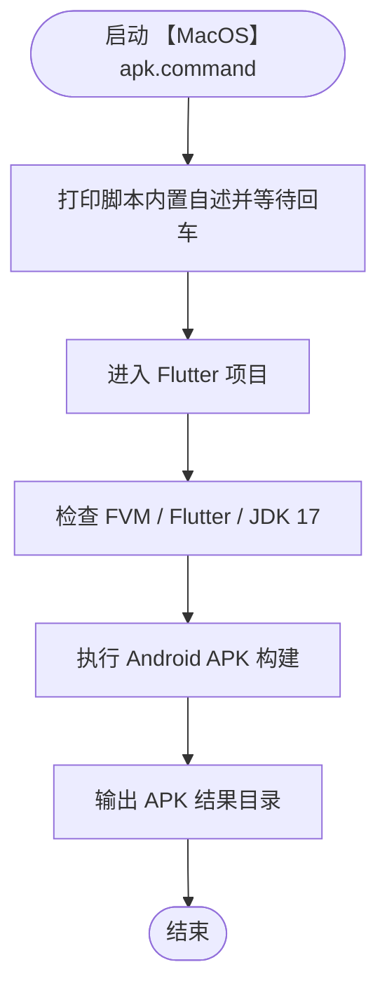

# 【MacOS】apk.command


[toc]

## 🔥 <font id=前言>前言</font>

- 采用 Shell 脚本的原因：Shell 来自 [**macOS**](https://www.apple.com/macos/) 原生系统底层，虽然写法相对繁琐冗杂，但执行效率高，并且不需要额外介入 [**Ruby**](https://www.ruby-lang.org)、[**Python**](https://www.python.org) 等第三方运行环境，因此具备更好的移植性。

## 一、功能 <a href="#前言" style="font-size:17px; color:green;"><b>🔼</b></a> <a href="#🔚" style="font-size:17px; color:green;"><b>🔽</b></a>

检查 Flutter / FVM / JDK 17 后构建 Android APK。

| 功能步骤 | 默认行为与结果 |
| --- | --- |
| 项目选择 | 当前目录须有 `lib/` 和 `pubspec.yaml`；不符合时循环询问路径，输入 `q` 退出 |
| 构建准备 | 自动调用 `buildCheck -y`，执行清理、按锁文件时间判断是否 `pub get`，并运行 doctor |
| Flutter 版本 | 读取项目 FVM 配置；未绑定时获取 stable 版本列表，菜单选择或使用最新项，并写入 `.fvmrc`、`.fvm/fvm_config.json`、`.fvm/version` |
| 工具准备 | 缺少 FVM 时用 Dart 全局激活；随后运行 `fvm install` / `fvm use --force`。要求已安装 JDK 17 和 jenv，写项目 `.java-version` 并设置当前构建 Java 环境 |
| 子插件 | 存在 `plugins/htprotect/pubspec.yaml` 时额外在该插件执行 `pub get`，否则提示跳过 |
| 产物 | 固定执行 `build apk --release`；成功后打开工程 `build/app/outputs/` |

此入口会联网、清理项目产物、准备 SDK / 依赖及写入项目版本绑定；不是只读体检。构建模式固定为 release，没有在此入口实现 flavor 或额外构建参数解析。实际签名和 Android 构建配置由目标工程负责。

该脚本适合 `.command` 双击运行，也可以在终端中执行。启动后的说明展示、依赖检查和核心流程都写在脚本内部。

## 二、运行 <a href="#前言" style="font-size:17px; color:green;"><b>🔼</b></a> <a href="#🔚" style="font-size:17px; color:green;"><b>🔽</b></a>

```zsh
./【MacOS】apk.command
```

如果已经自行加入 `PATH`，也可以执行：

```zsh
apk
```

## 三、结构约定 <a href="#前言" style="font-size:17px; color:green;"><b>🔼</b></a> <a href="#🔚" style="font-size:17px; color:green;"><b>🔽</b></a>

运行时说明和核心流程已经写在 `【MacOS】apk.command` 内部，不依赖同级 `README.md`。

本 README 只用于源码浏览、维护说明和当前流程说明。

## 四、流程图 <a href="#前言" style="font-size:17px; color:green;"><b>🔼</b></a> <a href="#🔚" style="font-size:17px; color:green;"><b>🔽</b></a>



## 五、日志文件 <a href="#前言" style="font-size:17px; color:green;"><b>🔼</b></a> <a href="#🔚" style="font-size:17px; color:green;"><b>🔽</b></a>

运行日志默认写入 `$TMPDIR`，文件名通常来自脚本名去掉扩展名：

```shell
$TMPDIR/apk.log
```

**终端配色保护：** 独立运行时，在支持完整保存与恢复配色的交互终端中临时使用黑底白字及统一强调色；正常结束、失败或可捕获中断后恢复进入前的配色，不修改终端全局偏好或 Shell 启动配置。不支持完整保护、无交互终端、`NO_COLOR`、既有纯文本模式和 Sourcetree 场景不切换配色，并沿用纯文本输出约定。强制终止（如 `kill -9`）无法由脚本自身保证恢复，请使用运行时显示的独立恢复入口。

<a id="🔚" href="#前言" style="font-size:17px; color:green; font-weight:bold;">我是有底线的➤点我回到首页</a>
