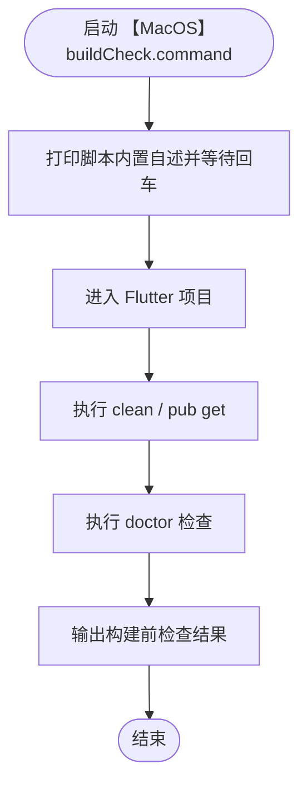

# 【MacOS】buildCheck.command


[toc]

## 🔥 <font id=前言>前言</font>

- 采用 Shell 脚本的原因：Shell 来自 [**macOS**](https://www.apple.com/macos/) 原生系统底层，虽然写法相对繁琐冗杂，但执行效率高，并且不需要额外介入 [**Ruby**](https://www.ruby-lang.org)、[**Python**](https://www.python.org) 等第三方运行环境，因此具备更好的移植性。

## 一、功能 <a href="#前言" style="font-size:17px; color:green;"><b>🔼</b></a> <a href="#🔚" style="font-size:17px; color:green;"><b>🔽</b></a>

执行 Flutter 构建前的清理、`pub get` 和 `doctor` 检查。

默认从当前目录识别 Flutter 项目；缺少 `lib/` 或 `pubspec.yaml` 时提示输入其它路径，`q` 退出。解析真实 Flutter 执行器后，回车执行、任意非空输入跳过本组准备。它会删除构建缓存并可能联网获取依赖，不是只读检查。

| 参数 | 默认值与作用 |
| --- | --- |
| `-y` / `--yes` | 默认关闭；开启后跳过本组操作确认，仍保留入口自身的自述规则 |
| `--no-clean` | 默认执行 clean；此参数跳过 |
| `--no-get` | 默认按需执行 pub get；此参数跳过 |
| `--no-doctor` | 默认执行 doctor；此参数跳过 |
| `--force-get` | 默认关闭；忽略锁文件时间判断，强制需要 pub get |
| `--skip-lock-check` | 默认关闭；跳过时间判断，保留依赖获取步骤 |

默认仅在 `pubspec.lock` 比 `pubspec.yaml` 新时跳过 `pub get`；该判断只依据时间，不校验依赖内容。各步骤通过辅助函数显示失败，不能将终端最后一项成功当作所有准备均成功。

该脚本适合 `.command` 双击运行，也可以在终端中执行。启动后的说明展示、依赖检查和核心流程都写在脚本内部。

## 二、运行 <a href="#前言" style="font-size:17px; color:green;"><b>🔼</b></a> <a href="#🔚" style="font-size:17px; color:green;"><b>🔽</b></a>

```zsh
./【MacOS】buildCheck.command
```

如果已经自行加入 `PATH`，也可以执行：

```zsh
buildCheck
buildCheck [参数...]
```

## 三、结构约定 <a href="#前言" style="font-size:17px; color:green;"><b>🔼</b></a> <a href="#🔚" style="font-size:17px; color:green;"><b>🔽</b></a>

运行时说明和核心流程已经写在 `【MacOS】buildCheck.command` 内部，不依赖同级 `README.md`。

本 README 只用于源码浏览、维护说明和当前流程说明。

## 四、流程图 <a href="#前言" style="font-size:17px; color:green;"><b>🔼</b></a> <a href="#🔚" style="font-size:17px; color:green;"><b>🔽</b></a>



## 五、日志文件 <a href="#前言" style="font-size:17px; color:green;"><b>🔼</b></a> <a href="#🔚" style="font-size:17px; color:green;"><b>🔽</b></a>

运行日志默认写入 `$TMPDIR`，文件名通常来自脚本名去掉扩展名：

```shell
$TMPDIR/buildCheck.log
```

**终端配色保护：** 独立运行时，在支持完整保存与恢复配色的交互终端中临时使用黑底白字及统一强调色；正常结束、失败或可捕获中断后恢复进入前的配色，不修改终端全局偏好或 Shell 启动配置。不支持完整保护、无交互终端、`NO_COLOR`、既有纯文本模式和 Sourcetree 场景不切换配色，并沿用纯文本输出约定。强制终止（如 `kill -9`）无法由脚本自身保证恢复，请使用运行时显示的独立恢复入口。

<a id="🔚" href="#前言" style="font-size:17px; color:green; font-weight:bold;">我是有底线的➤点我回到首页</a>
