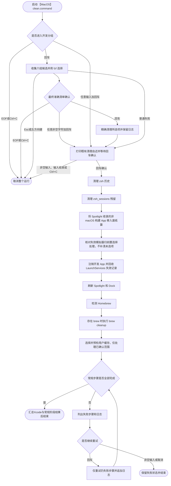

# `【MacOS】clean.command`


[toc]

---

## 🔥 <font id=前言>前言</font>

- 采用 Shell 脚本的原因：Shell 来自 [**macOS**](https://www.apple.com/macos/) 原生系统底层，虽然写法相对繁琐冗杂，但执行效率高，并且不需要额外介入 [**Ruby**](https://www.ruby-lang.org)、[**Python**](https://www.python.org) 等第三方运行环境，因此具备更好的移植性。

Homebrew 发现和健康检查封装在当前脚本内部，不依赖外置模块。仅复用能通过 `--version` 和真实前缀检查的已有安装；缺失或损坏时跳过对应的可选能力，不安装或升级管理器。

## 一、功能 <a href="#前言" style="font-size:17px; color:green;"><b>🔼</b></a> <a href="#🔚" style="font-size:17px; color:green;"><b>🔽</b></a>

该脚本先询问是否进行 Cleaner for Xcode 对应的开发分组清理：回车继续，任意输入加回车跳过；只有继续才收集资料。Device Support、Simulators、SwiftUI Previews、DerivedData、Archives、Caches 六组分别通过 fzf 选择，第一项及默认焦点为“清理当前组全部”，下面可以单选／多选真实子项，展示最终范围并确认后才执行。以下六类既有能力继续保留；其中失效模拟器统一由前置组选择，其它常规步骤在开发阶段后执行：

- 清空 zsh 历史和 `zsh_sessions` 残留。
- 将 Spotlight 已收录的 iPhone、Apple TV、Apple Watch 和 Apple Vision 构建 App 移入废纸篓，从文件源头清理带禁止标记、无法在 [**macOS**](https://www.apple.com/macos/) 打开的图标。
- 定向注销 `LaunchServices` 中的非 macOS 构建 App 和 iOS Simulator App 记录。
- 在前置 Simulators 组列出 CoreSimulator 中目录或 `device.plist` 已缺失的登记，选定后备份残留数据并按 UUID 注销；后续常规步骤不补清跳过或未选的设备。
- 检测到 [**Homebrew**](https://brew.sh/) 时执行 `brew cleanup`。
- 枚举当前用户 `Library/Caches` 的实际候选，明确勾选、预检并核对最终范围后才清理，保留未选项和根目录。

开发分组以当前用户 `Library/Developer` 为基准：

| 分组 | 候选与处理 |
| --- | --- |
| Device Support | Xcode 的 iOS／watchOS／tvOS／macOS DeviceSupport 版本子项，确认后移除，后续调试可能重新准备。 |
| Simulators | 正常设备和实体缺失的残留登记，按名字、状态、Runtime 与 UUID 区分；只处理选中的精确 UUID，不删除共享 Runtime。残留登记沿用备份／复检规则。 |
| SwiftUI Previews | `Xcode/UserData/Previews/Simulator Devices` 的预览设备，使用其独立设备集。 |
| DerivedData | `Xcode/DerivedData` 的实际子项，后续构建／索引可能重建。 |
| Archives | `Xcode/Archives` 的具体归档，可恢复地移入私有废纸篓目录；未清空废纸篓前不计为立即释放容量。 |
| Caches | `CoreSimulator/Caches/dyld` 的实际子项，确认后删除可再生缓存。 |

fzf 首行默认当前组全部，↑／↓／Tab 移动，Enter 勾选／取消，Space 确认；每组还可跳过，Esc／← 中止整个运行。全部选择结束后展示精确清单，**回车确认清理，任意非空字符加回车跳过 Xcode 清理并进入常规流程**；EOF／`Ctrl+C` 中止整个运行。未选择的受管设备或构建输出不会被后续通用流程补清，失效模拟器登记也统一由前置 Simulators 组选择。Xcode 或构建进程仍运行、路径／内容变化、链接或读取异常时保留对应内容并报告；普通失败仍进入常规清理，最后分别汇总两个阶段并保留失败退出码。

如果当前 Homebrew 开启 tap trust 策略，脚本会在清理前自动信任已安装的 `leoafarias/fvm` tap，避免 `brew cleanup` 反复输出 `Skipping fvm: tap formula is not trusted` 警告。

该脚本适合 `.command` 双击运行，也可以在终端中执行。启动后的说明展示、依赖检查和核心流程都写在脚本内部。

## 二、运行 <a href="#前言" style="font-size:17px; color:green;"><b>🔼</b></a> <a href="#🔚" style="font-size:17px; color:green;"><b>🔽</b></a>

```zsh
./【MacOS】clean.command
```

如果已经自行加入 `PATH`，也可以执行：

```zsh
clean
clean [参数...]
```

脚本先询问开发分组，回车进入扫描和选择、任意输入加回车跳过；该阶段需要已有健康的 fzf，缺失或不健康时保留开发数据并报告阶段失败。开发阶段完成、明确跳过或普通失败后，再展示与右键版相同的完整常规自述并按回车继续，任意非空输入、`Ctrl+C` 或输入结束取消；非交互环境直接退出。只有已选、预检通过并核对最终范围的用户缓存候选才直接删除，不经过废纸篓。

常规清理出现失败时，显示未完成步骤和日志位置，并询问：**回车继续重试，任意非空输入加回车停止**。每轮仅重试仍失败的常规步骤，已成功步骤不再重复；仍失败时再次询问，没有自动重试次数上限。重试沿用路径、身份和备份检查，不自动提权或修改权限，权限问题未解决时仍可能失败。非空输入停止后返回失败状态；EOF／`Ctrl+C` 取消，不将读取失败当成回车。前置 Xcode 分组不纳入常规重试循环；其普通失败不会阻断常规清理，也不会被常规成功覆盖或清屏抹去。

## 三、结构约定 <a href="#前言" style="font-size:17px; color:green;"><b>🔼</b></a> <a href="#🔚" style="font-size:17px; color:green;"><b>🔽</b></a>

运行时说明和核心流程已经写在 `【MacOS】clean.command` 内部，不依赖同级 `README.md`。

本 README 只用于源码浏览、维护说明和当前流程说明。

## 四、失效 App 图标清理边界 <a href="#前言" style="font-size:17px; color:green;"><b>🔼</b></a> <a href="#🔚" style="font-size:17px; color:green;"><b>🔽</b></a>

- 只移动 Spotlight 已收录、位于当前用户目录内、且路径符合 Xcode `Build/Products` / `build` 输出特征的 iPhone、Apple TV、Apple Watch 和 Apple Vision `.app`。
- 构建 App 不直接删除，而是按原绝对路径结构移入废纸篓中的 `JobsClean-DevelopmentApps-*` 目录，可手动恢复；也可以通过 Xcode / Flutter 重新构建。
- 正常 `CoreSimulator` 设备容器中的 App 只注销 `LaunchServices` 记录，不移动实体；实体已缺失的设备按[残留登记规则](#simulator-orphans)另行备份并注销，`Applications` 里的正常 App 始终排除。
- 完成后会短暂重启 `Spotlight`、`corespotlightd`、`sharedfilelistd` 和 `Dock`，图标列表会重新加载，Dock 可能闪烁一次。
- 后续重新运行 Xcode 或 Simulator 时，开发 App 可能被系统再次登记；再次执行 `clean` 即可清理。

## 五、<span id="simulator-orphans">iOS 模拟器残留登记</span> <a href="#前言" style="font-size:17px; color:green;"><b>🔼</b></a> <a href="#🔚" style="font-size:17px; color:green;"><b>🔽</b></a>

第三方清理工具直接移除模拟器文件后，CoreSimulator 服务仍可能列出原设备。这里的“残留”是系统设备登记，不是普通文件快捷方式；脚本通过当前 Xcode 的 `simctl` 注销，避免只删磁盘文件后留下失配记录。

残留登记纳入前置 Simulators 组，与正常设备一同供单选／多选；没有选择该阶段或该设备时保留登记，后续常规清理不自主注销。

- 只处理当前用户默认 `Library/Developer/CoreSimulator/Devices` 设备集中的 iOS 设备，先校验 JSON、UUID、状态和精确 `dataPath`。
- 只有设备目录或 `device.plist` 确认不存在才进入清理。完整设备、仅 Runtime 不可用的设备，以及保留 `device.plist` 但尚无 `data` 目录的设备均保留；软链接、无读取权限、查询失败或不明确状态会跳过并记录。
- 写操作前重新读取清单和磁盘状态。损坏设备若仍标为 `Booted`，只按该 UUID 关闭，再复检。整台设备目录完全不存在时，即使关闭命令失败、超时或设备卡在 `Shutting Down`，仍在复检后尝试按 UUID 注销；每次复检都要求目录仍完全缺失，且设备仍为 `Shutdown`、`Booted` 或 `Shutting Down`。目录恢复、状态未知或查询失败时保留，不沿用旧快照。
- 仍有残留目录时，只在确认设备为 `Shutdown` 后备份并注销；关闭失败或仍为 `Shutting Down` 时保留数据并报告未完成，待设备关闭完成后重试。正在创建、启动的设备继续保留，不关闭其它设备或重启整个 CoreSimulator 服务。
- 首个待注销项出现时，在 `$HOME/.Trash/JobsClean-SimulatorOrphans-*` 保存原设备清单。仍存在的设备目录先完整备份并逐项比较，删除前再次确认数据未变化；备份或复检失败就保留源数据。缺失的旧文件无法通过这份备份还原，备份仅保存本次清理前仍存在的内容。
- 最后逐个执行 `simctl --set <默认设备集> delete <UUID>`，并确认该 UUID 已从新清单消失。不使用 `delete all` / `delete unavailable`，不删除共享 Runtime，也不重启 CoreSimulator 服务。
- 关闭失败不等于注销失败：仅在整台目录缺失且最终注销、清单复检均成功时计为完成；系统拒绝注销或登记仍存在则明确报错。取消信号对应的退出码不会进入关闭失败后的注销分支。
- 未安装可用的 Xcode `simctl` 时跳过。单次系统调用限时 30 秒；注销失败、查询异常或备份校验失败会进入日志，并使 `clean` 最终返回非零状态，原有其它清理步骤继续执行。

Device Hub 中看不到设备时，也要检查过滤器是否为 `All Devices` / `Simulators`，并展开设备分组；“仅真机”会隐藏模拟器，界面空白不代表磁盘或系统登记已清空。

## 六、流程图 <a href="#前言" style="font-size:17px; color:green;"><b>🔼</b></a> <a href="#🔚" style="font-size:17px; color:green;"><b>🔽</b></a>



## 七、日志文件 <a href="#前言" style="font-size:17px; color:green;"><b>🔼</b></a> <a href="#🔚" style="font-size:17px; color:green;"><b>🔽</b></a>

常规清理确认后才在系统临时目录通过 `mktemp` 创建本轮独立私有日志；模板的随机段 `X` 放在末尾，实际路径由终端打印。每次运行使用不同文件，避免覆盖或混入其它清理进程的记录；创建失败时停止常规阶段，不继续执行清理。

模拟器扫描与逐设备复检 JSON 保存在日志中打印的系统临时目录 `JobsClean-SimulatorScan.*`；有注销候选时，原清单与残留目录备份保存在前述废纸篓目录。

常规清理的重试轮次、失败步骤、退出码和停止原因追加到本轮同一日志，不因重试清空前面的错误。

删除、移动、备份或查询命令的具体错误同时打印到终端并写日志，例如 `Permission denied`（权限不足）及其对应路径。JSON／NUL 清单等机器输出单独保存，终端只展示诊断，不将错误文字混入候选数据。Xcode 动作失败或取消时显示该动作本次追加的详细日志，不重复回放此前错误。命令失败及取消保留原退出码，日志写入失败也不能冒充成功。

常规阶段发生失败并重试后，即使最终成功，也不清除本轮已显示的失败原因，便于在终端回看。

用户缓存先完整枚举再明确选择，默认跳过；未勾选不删除，选中后展示最终准确范围并确认。通用预检按实际内容和权限判断，包含开发依赖／源码标记、只读内容、链接、异盘或无法在扫描预算内完整检查的候选整体保留，不依赖用户名、仓库位置或某个开发环境目录名。重试仅处理首轮已确认、实际删除仍失败的候选并复检原身份；保护项出队，新生成、同名重建或替换项保留。首次缓存枚举未完成时不扩大扫描。Homebrew 失败步骤仍按其自身 `cleanup` 策略重试。

用户缓存选择器使用 `↑↓`／`Tab` 导航、`Enter` 勾选／取消、`Space` 确认已勾选项；首行是“全选用户缓存”，第二行“跳过用户缓存清理”为默认焦点。勾选全选再按空格确认展开本轮完整候选，搜索不缩小全选范围；同时勾选跳过时优先跳过，空选不取当前高亮项。通过预检的准确清单再次展示，回车确认删除、非空输入跳过，EOF／取消停止。单候选扫描预算为 10,000 项、64 层及操作间 5 秒检查；超过或检查不完整即保留，不承诺抢占单次阻塞的系统 I/O。标记如 `go.mod`、`package.json`、`pyvenv.cfg`、`package.xml` 会触发整候选保护；这是一项保守保护，用户仍应核对所选目录的实际用途。实际删除只逐个处理授权快照中的原成员，目录仅在空时移除，不再次对当前树递归全删。

## 八、风险说明 <a href="#前言" style="font-size:17px; color:green;"><b>🔼</b></a> <a href="#🔚" style="font-size:17px; color:green;"><b>🔽</b></a>

- zsh 历史会被清空，无法从脚本自动恢复。
- 只有已明确选择、预检通过并确认的缓存候选才直接删除，应用后续可能重新生成缓存；`Library`／`Caches` 链接入口和子树链接均保留，不沿链接清理其它目录。
- 开发依赖、只读或检查不完整等保护项会解释原因并保留，不进入删除失败重试队列。实际删除仍可能因系统隐私保护或并发变化失败，错误同时打印并落盘，不使用 `sudo` 或修改权限强删。
- 非 macOS 构建 `.app` 会离开原构建目录；它们属于可重新生成的构建产物，可从废纸篓恢复或重新构建。
- LaunchServices 只注销符合开发输出路径特征的非 macOS App，不使用全局 `-kill` 重建，避免扰动正常 App 的打开方式关联。
- 注销实体已缺失的模拟器会移除其设备登记；残留数据只有备份成功后才删除。正常设备、真机和共享 Runtime 保留，清空废纸篓前请自行核对备份。

## 九、<span id="validation">隔离验证</span> <a href="#前言" style="font-size:17px; color:green;"><b>🔼</b></a> <a href="#🔚" style="font-size:17px; color:green;"><b>🔽</b></a>

在本目录运行[模拟器登记回归](./Tests/【MacOS】SimulatorOrphanTests.zsh/README.md)：

```shell
/bin/zsh './Tests/【MacOS】SimulatorOrphanTests.zsh/【MacOS】SimulatorOrphanTests.zsh'
```

用例使用临时 HOME、合成 JSON 和假 `simctl`，覆盖完整设备保留、残留登记注销、关闭失败／超时后的精确注销、卡在 `Shutting Down`、残留数据保护、备份失败、并发恢复、工具假成功、权限与软链接、取消、幂等及失败传播；不会执行真实 `clean` 的缓存／历史清理，也不会变更真实设备和 Runtime。这些测试不代表真实 CoreSimulator 服务端到端验收。

六组选择和并发保护另由[双端 Mac Xcode 阶段回归](../../../../OS@Extension/MacOS@Extension/JobsDiskSpaceInfo/Tests/XcodeCleanupTests.rb/README.md)验证：临时 HOME、假系统接口及真实 fzf 按键夹具，核对原终端与右键脚本的内联块一致；不执行真实清理。后续修改需同步该回归和两端菜单对应检查，不能只验证一处函数。

[通用缓存范围回归](./Tests/CacheScopeTests.rb/README.md)使用不含个人环境目录名的临时 HOME、中文空格路径、普通缓存和合成依赖树，验证显式选择、保护标记、权限、预算、并发新增／改写、失败重试与取消；真实 fzf 仅连接临时夹具，不运行真实用户清理。

常规失败重试由[双入口清理回归](../../../../OS@Extension/MacOS@Extension/JobsDiskSpaceInfo/Tests/DiskCleanupTests.rb/README.md)使用真实 PTY 和假命令验证，覆盖多轮失败队列缩减、成功步骤不重跑、非空／EOF／取消、日志保留、缓存原候选与身份保护，以及重试变更后的应用列表刷新；该重试用例已分别针对原终端与右键源码运行，不代表真实数据清理验收。

询问提示的题干使用青色粗体，回车选项绿色粗体，任意字符／非空输入选项红色粗体；分隔符普通，结束复位。普通日志、自述和 URL 不追加题干样式；中文渲染仅在 formatter 子进程使用 UTF-8 locale，不修改调用者语言环境；非交互、`NO_COLOR`（含空值）、`TERM=dumb` 和 Sourcetree 保持纯文本，落盘日志不含 ANSI。详见[提示样式隔离回归](./Tests/PromptStyleTests.rb/README.md)。

**终端配色保护：** 独立运行时，在支持完整保存与恢复配色的交互终端中临时使用黑底白字及统一强调色；正常结束、失败或可捕获中断后恢复进入前的配色，不修改终端全局偏好或 Shell 启动配置。不支持完整保护、无交互终端、`NO_COLOR`、既有纯文本模式和 Sourcetree 场景不切换配色，并沿用纯文本输出约定。强制终止（如 `kill -9`）无法由脚本自身保证恢复，请使用运行时显示的独立恢复入口。

## 十、<span id="context-menu-symmetry">终端与双端右键清理联动</span> <a href="#前言" style="font-size:17px; color:green;"><b>🔼</b></a> <a href="#🔚" style="font-size:17px; color:green;"><b>🔽</b></a>

本终端入口与 [macOS 右键清理](../../../../OS@Extension/MacOS@Extension/JobsDiskSpaceInfo/README.md)、[WindowsOS 右键清理](../../../../OS@Extension/WindowsOS@Extension/JobsDiskSpaceInfo/README.md) 按同一功能清单对称维护。这里新增、删除或调整清理功能、范围、默认值、保护及失败处理时，同一任务必须同步两端右键版的独立代码、内置说明、README 和隔离验证，不能只更新其中一处。

三处各自携带完整实现，运行时不相互引用；平台专属能力按可核实的本地等价项或明确差异处理，不用无效占位宣称支持。当前功能映射、入口代码和验证边界集中在[磁盘空间信息资产盘点](../../../../OS@Extension/项目相关报告/磁盘空间信息资产盘点.md)。仅右键宿主通信等入口差异不改变原终端版清理语义，验证仍使用隔离夹具，不自动执行真实清理或安装。

<a id="🔚" href="#前言" style="font-size:17px; color:green; font-weight:bold;">我是有底线的➤点我回到首页</a>
