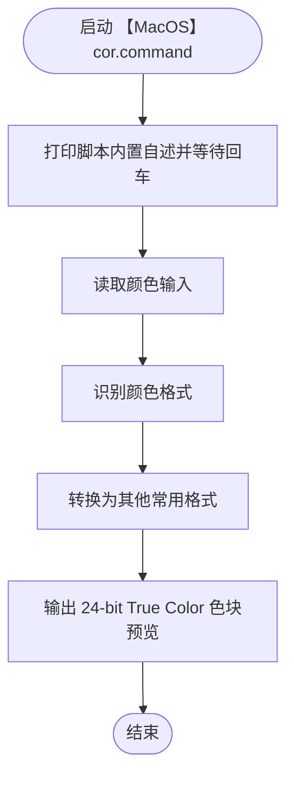

# 【MacOS】cor.command


[toc]

## 🔥 <font id=前言>前言</font>

- 采用 Shell 脚本的原因：Shell 来自 [**macOS**](https://www.apple.com/macos/) 原生系统底层，虽然写法相对繁琐冗杂，但执行效率高，并且不需要额外介入 [**Ruby**](https://www.ruby-lang.org)、[**Python**](https://www.python.org) 等第三方运行环境，因此具备更好的移植性。

## 一、功能 <a href="#前言" style="font-size:17px; color:green;"><b>🔼</b></a> <a href="#🔚" style="font-size:17px; color:green;"><b>🔽</b></a>

转换 HEX / RGB / RGBA / `0xAARRGGBB` 等颜色格式，并在 macOS 终端输出真实色块预览。

Terminal.app、iTerm2、VS Code 终端和 WezTerm 默认使用 24-bit ANSI 色彩输出；其它终端根据 `COLORTERM` / `TERM` 判断能力，必要时使用兼容色彩预览。输出包含颜色各通道及格式转换结果，透明度参与数值转换，色块按 RGB 原色显示。

## 二、支持输入 <a href="#前言" style="font-size:17px; color:green;"><b>🔼</b></a> <a href="#🔚" style="font-size:17px; color:green;"><b>🔽</b></a>

```zsh
./【MacOS】cor.command '#D2D4DE'
./【MacOS】cor.command D2D4DE
./【MacOS】cor.command '#D2D4DE80'
./【MacOS】cor.command D2D4DE80
./【MacOS】cor.command '#ABC'
./【MacOS】cor.command '#ABCF'
./【MacOS】cor.command 'rgb(210,212,222)'
./【MacOS】cor.command 'rgba(210,212,222,0.5)'
./【MacOS】cor.command '0x80D2D4DE'
./【MacOS】cor.command '0xD2D4DE'
```

说明：

- `#RRGGBBAA` / 裸 `RRGGBBAA` 按 `RRGGBBAA` 解析。
- `0xAARRGGBB` 按 Apple / UIKit 常见的 `AARRGGBB` 解析。
- 终端无法真实显示透明背景，Alpha 只参与格式转换；色块按 RGB 原色显示。
- 在 zsh 里直接输入 `#D2D4DE` 会被当作注释，建议加引号，或直接输入裸色值 `D2D4DE`。

## 三、运行 <a href="#前言" style="font-size:17px; color:green;"><b>🔼</b></a> <a href="#🔚" style="font-size:17px; color:green;"><b>🔽</b></a>

双击 `.command` 或终端执行：

```zsh
./【MacOS】cor.command
```

如果已经加入 `PATH`，也可以执行：

```zsh
cor
cor D2D4DE
```

## 四、结构约定 <a href="#前言" style="font-size:17px; color:green;"><b>🔼</b></a> <a href="#🔚" style="font-size:17px; color:green;"><b>🔽</b></a>

运行时说明和核心流程已经写在 `【MacOS】cor.command` 内部，不依赖同级 `README.md`。

本 README 只用于源码浏览、维护说明和当前流程说明。

## 五、流程图 <a href="#前言" style="font-size:17px; color:green;"><b>🔼</b></a> <a href="#🔚" style="font-size:17px; color:green;"><b>🔽</b></a>



## 六、日志文件 <a href="#前言" style="font-size:17px; color:green;"><b>🔼</b></a> <a href="#🔚" style="font-size:17px; color:green;"><b>🔽</b></a>

运行日志默认写入 `$TMPDIR`，文件名通常来自脚本名去掉扩展名：

```shell
$TMPDIR/cor.log
```

**终端配色保护：** 独立运行时，在支持完整保存与恢复配色的交互终端中临时使用黑底白字及统一强调色；正常结束、失败或可捕获中断后恢复进入前的配色，不修改终端全局偏好或 Shell 启动配置。不支持完整保护、无交互终端、`NO_COLOR`、既有纯文本模式和 Sourcetree 场景不切换配色，并沿用纯文本输出约定。强制终止（如 `kill -9`）无法由脚本自身保证恢复，请使用运行时显示的独立恢复入口。

<a id="🔚" href="#前言" style="font-size:17px; color:green; font-weight:bold;">我是有底线的➤点我回到首页</a>
