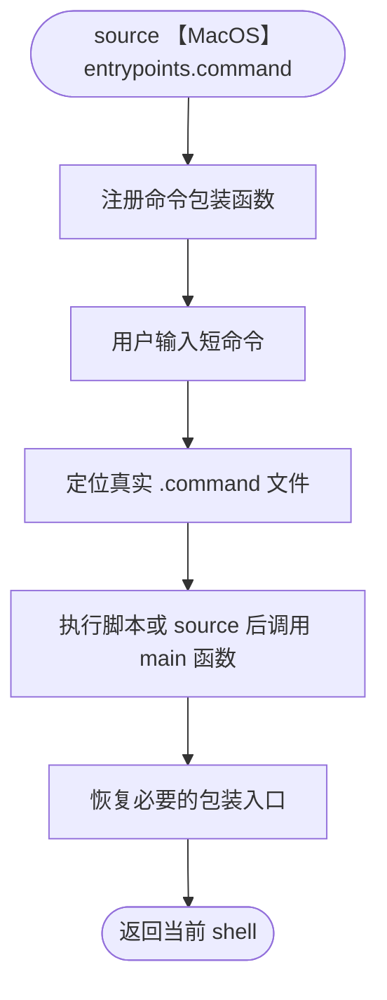

# 【MacOS】entrypoints.command


[toc]

## 🔥 <font id=前言>前言</font>

- 采用 Shell 脚本的原因：Shell 来自 [**macOS**](https://www.apple.com/macos/) 原生系统底层，虽然写法相对繁琐冗杂，但执行效率高，并且不需要额外介入 [**Ruby**](https://www.ruby-lang.org)、[**Python**](https://www.python.org) 等第三方运行环境，因此具备更好的移植性。

## 一、功能 <a href="#前言" style="font-size:17px; color:green;"><b>🔼</b></a> <a href="#🔚" style="font-size:17px; color:green;"><b>🔽</b></a>

注册终端短命令包装器。真实命令实现统一位于 `Scripts/<脚本全名>/<脚本全名>`；多数脚本全名为 `<命令>.command`，`jsplit` 与 `jmerge` 分别映射到 `【MacOS】split.command` 与 `【MacOS】merge.command`。

`jrecord` 映射到[窗口录屏完整包](../【MacOS】jrecord.command/README.md)。从源码目录或部署目录加载本模块时，优先定位本模块相邻的完整包，再查用户运行目录；调用参数和退出码原样透传。原生 `Core/` 必须随包保留，`~/.local/bin/jrecord` 使用转发器。

`orc`、`orC`、`oRc`、`oRC`、`Orc`、`OrC`、`ORc`、`ORC` 均映射到[离线 OCR 包](../【MacOS】orc.command/README.md)，参数与退出码原样透传。source 只定义函数，不安装 [**Indra OCR**](https://pypi.org/project/indra-ocr/) 或下载模型；第一次实际识别才按业务入口确认并准备。

该文件主要作为 JobsMacEnv 的 shell 函数模块 / 入口注册模块使用，通常由 shell 配置或上层脚本 `source` 加载。

`frun` 映射到 [Flutter Demo 运行包](../【MacOS】frun.command/README.md)：无参等待输入 / 拖入一个 Dart main，按所属工程的 SDK 运行，退出后继续等待。短命令采用完整包转发器，保留相邻 `_lib` SDK 资源；不会在 source 阶段启动 Flutter。

## 二、运行 <a href="#前言" style="font-size:17px; color:green;"><b>🔼</b></a> <a href="#🔚" style="font-size:17px; color:green;"><b>🔽</b></a>

```zsh
source Scripts/【MacOS】entrypoints.command/【MacOS】entrypoints.command
```

## 三、功能清单 <a href="#前言" style="font-size:17px; color:green;"><b>🔼</b></a> <a href="#🔚" style="font-size:17px; color:green;"><b>🔽</b></a>

当前注册的终端入口如下：

```text
list
frun
m5c
jsplit
jmerge
jrecord
flat
trs
orc / orC / oRc / oRC / Orc / OrC / ORc / ORC
gif
simios
pods
clean
df
cor
decode
ts
download
codemap
to
mp4
mov
webm
mkv
avi
m4v
mp3
m4a
aac
wav
flac
ogg
opus
install
update
shell
zz
x
save
rb
a
b
i
fixfvm
check1
check
c
d
buildCheck
apk
ipa
config
```

## 四、交互规则 <a href="#前言" style="font-size:17px; color:green;"><b>🔼</b></a> <a href="#🔚" style="font-size:17px; color:green;"><b>🔽</b></a>

该文件主要被 shell 配置 source 加载，不是普通一次性执行脚本。它只负责注册入口函数，不承载真实业务实现。

`jsplit` 由[文件拆分](../【MacOS】split.command/README.md)执行，`jmerge` 由[分卷合并](../【MacOS】merge.command/README.md)执行；两个命令均不接收路径参数，每次运行后手动输入或拖入目标。空输入、无效路径或没有可处理文件时持续重问；合并至少需要一组连续完整的两卷以上文件。最终执行菜单默认取消，源文件和分卷默认保留，删除必须精确输入 `YES`。短命令使用 `j` 前缀，不覆盖系统 `split`。

`jrecord` 默认交互选择浏览器窗口，先体检依赖、按需修复并编译原生内核，再确认录制；`--doctor` 只体检，`--prepare` 只准备，`--list` 只列窗口。`--window-id`、输出、时长、帧率和声音参数直接交给真实入口解析；本模块只负责转发，不跳过真实入口的确认与体检。

`codemap` 由 [【MacOS】codemap.command](../【MacOS】codemap.command/README.md) 执行；不传参数时构建当前目录，传入一个或多个手工输入、拖入的目录时分别构建。入口模块仅注册函数，实际运行时由主脚本展示内置自述并等待回车。 `mp4` / `mov` / `webm` / `mp3` 等媒体格式短命令不单独维护脚本，统一复用 `Scripts/【MacOS】to.command/【MacOS】to.command`。`gif` 已作为录制入口保留；需要转换 GIF 时使用 `to gif 文件`。

## 五、结构约定 <a href="#前言" style="font-size:17px; color:green;"><b>🔼</b></a> <a href="#🔚" style="font-size:17px; color:green;"><b>🔽</b></a>

该文件位于 `Scripts/【MacOS】entrypoints.command/【MacOS】entrypoints.command`。

同级 `README.md` 只用于源码浏览、维护说明和当前流程说明，不参与运行时加载。

## 六、流程图 <a href="#前言" style="font-size:17px; color:green;"><b>🔼</b></a> <a href="#🔚" style="font-size:17px; color:green;"><b>🔽</b></a>



## 七、日志文件 <a href="#前言" style="font-size:17px; color:green;"><b>🔼</b></a> <a href="#🔚" style="font-size:17px; color:green;"><b>🔽</b></a>

运行日志默认写入 `$TMPDIR`，文件名通常来自脚本名去掉扩展名：

```shell
$TMPDIR/entrypoints.log
```

<a id="🔚" href="#前言" style="font-size:17px; color:green; font-weight:bold;">我是有底线的➤点我回到首页</a>
