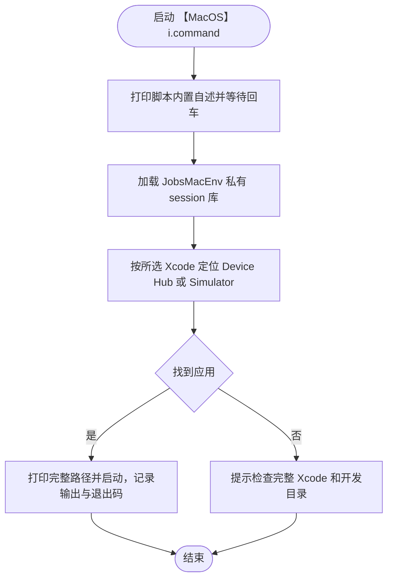

# 【MacOS】i.command


[toc]

## 🔥 <font id=前言>前言</font>

- 采用 Shell 脚本的原因：Shell 来自 [**macOS**](https://www.apple.com/macos/) 原生系统底层，虽然写法相对繁琐冗杂，但执行效率高，并且不需要额外介入 [**Ruby**](https://www.ruby-lang.org)、[**Python**](https://www.python.org) 等第三方运行环境，因此具备更好的移植性。

## 一、功能 <a href="#前言" style="font-size:17px; color:green;"><b>🔼</b></a> <a href="#🔚" style="font-size:17px; color:green;"><b>🔽</b></a>

打开所选 [**Xcode**](https://developer.apple.com/xcode/) 对应的模拟器应用：Xcode 27 使用 [**Device Hub**](https://developer.apple.com/documentation/xcode/managing-your-simulated-and-physical-devices-in-device-hub)，旧版使用 Simulator。

| 环境 | 原启动方式 | 当前启动结果 |
| --- | --- | --- |
| Xcode 27 | `open -a Simulator` 查找不存在的旧应用，报无法找到应用 | 定位 Xcode 内的 `Contents/Applications/DeviceHub.app` 并按完整路径打开 |
| 旧版 Xcode | 依赖系统按应用名称定位 | 定位 `Contents/Developer/Applications/Simulator.app` 并按完整路径打开 |

优先遵循 `DEVELOPER_DIR`，未设置时读取 `xcode-select -p`，再检查系统和用户 Applications 中的常见 Xcode 安装目录。显式指定的 `DEVELOPER_DIR` 无效时直接报错，避免意外启动另一版 Xcode。

该脚本适合 `.command` 双击运行，也可以在终端中执行。启动后的说明展示、依赖检查和核心流程都写在脚本内部。

## 二、运行 <a href="#前言" style="font-size:17px; color:green;"><b>🔼</b></a> <a href="#🔚" style="font-size:17px; color:green;"><b>🔽</b></a>

```zsh
./【MacOS】i.command
```

如果已经自行加入 `PATH`，也可以执行：

```zsh
i
i [参数...]
```

`i` 自身只确认一次；从 `list` 进入时，菜单确认仍独立保留。参数原样传给系统 `open -a <已定位的应用路径>`；直接运行 `i` 即可打开。临时指定其它 Xcode 时，可在命令前设置 `DEVELOPER_DIR`，支持 Xcode 应用根目录或 `Contents/Developer` 路径，不修改全局开发目录。

## 三、结构约定 <a href="#前言" style="font-size:17px; color:green;"><b>🔼</b></a> <a href="#🔚" style="font-size:17px; color:green;"><b>🔽</b></a>

运行时说明和核心流程已经写在 `【MacOS】i.command` 内部，不依赖同级 `README.md`。

入口负责自述、确认和日志；应用定位及启动由相邻 `../_lib/【MacOS】jobs_session_lib.zsh/【MacOS】jobs_session_lib.zsh` 实现。旧 Flutter 私有入口也复用该实现，移动脚本时需保留相邻私有库。

本 README 只用于源码浏览、维护说明和当前流程说明。

## 四、流程图 <a href="#前言" style="font-size:17px; color:green;"><b>🔼</b></a> <a href="#🔚" style="font-size:17px; color:green;"><b>🔽</b></a>



## 五、日志文件 <a href="#前言" style="font-size:17px; color:green;"><b>🔼</b></a> <a href="#🔚" style="font-size:17px; color:green;"><b>🔽</b></a>

运行日志写入系统临时目录中的 `i.log`；优先采用 `TMPDIR`，未设置时回退到系统 `/tmp`。确认后初始化日志，记录选中的应用完整路径及启动错误。日志位置可在终端查询：

```shell
printf '%s/i.log\n' "${TMPDIR:-/tmp}"
```

## 六、常见问题与影响范围 <a href="#前言" style="font-size:17px; color:green;"><b>🔼</b></a> <a href="#🔚" style="font-size:17px; color:green;"><b>🔽</b></a>

- 找不到应用：检查完整 Xcode 是否安装，以及 `DEVELOPER_DIR` 和 `xcode-select -p`；只有 Command Line Tools 无法提供模拟器应用。
- Device Hub 已打开但没有可用的 iOS 系统：按 Xcode 的组件设置或 [`simios`](../【MacOS】simios.command/README.md) 的独立确认流程补齐运行时。`i` 不负责下载运行时。
- 启动失败：查看日志中的应用路径和 `open` 退出码；脚本保留失败状态，便于菜单和终端排查。
- 本入口只启动应用并写入自身临时日志，不安装组件、不修改项目、不切换全局 `xcode-select`。确认前按 Ctrl+C 或输入结束会退出；没有交互终端时停止并提示重新运行。

**终端配色保护：** 独立运行时，在支持完整保存与恢复配色的交互终端中临时使用黑底白字及统一强调色；正常结束、失败或可捕获中断后恢复进入前的配色，不修改终端全局偏好或 Shell 启动配置。不支持完整保护、无交互终端、`NO_COLOR`、既有纯文本模式和 Sourcetree 场景不切换配色，并沿用纯文本输出约定。强制终止（如 `kill -9`）无法由脚本自身保证恢复，请使用运行时显示的独立恢复入口。

<a id="🔚" href="#前言" style="font-size:17px; color:green; font-weight:bold;">我是有底线的➤点我回到首页</a>
