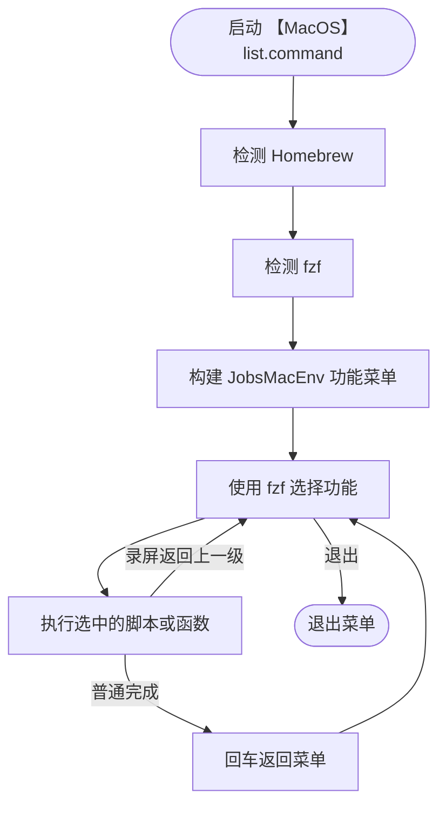
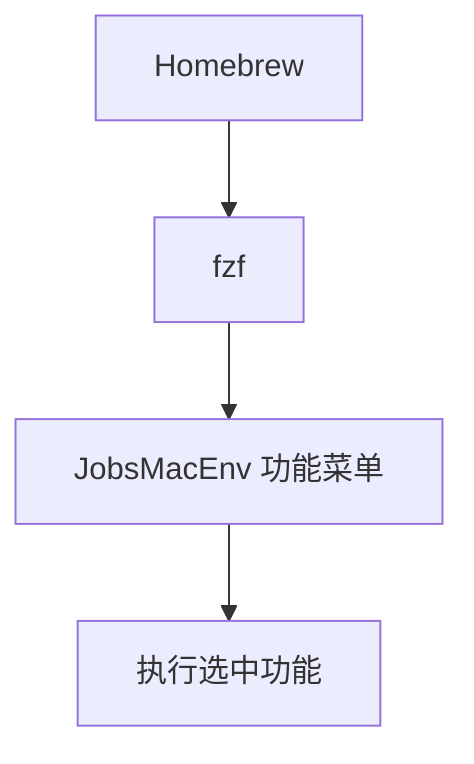

# 【MacOS】list.command


[toc]

## 🔥 <font id=前言>前言</font>

- 采用 Shell 脚本的原因：Shell 来自 [**macOS**](https://www.apple.com/macos/) 原生系统底层，虽然写法相对繁琐冗杂，但执行效率高，并且不需要额外介入 [**Ruby**](https://www.ruby-lang.org)、[**Python**](https://www.python.org) 等第三方运行环境，因此具备更好的移植性。

## 一、功能 <a href="#前言" style="font-size:17px; color:green;"><b>🔼</b></a> <a href="#🔚" style="font-size:17px; color:green;"><b>🔽</b></a>

打开 JobsMacEnv 功能菜单，集中展示并执行各个 `.command` 兄弟脚本。

该脚本适合 `.command` 双击运行，也可以在终端中执行。启动后的说明展示、依赖检查和核心流程都写在脚本内部。

菜单中的 `Flutter Demo · frun` 打开[源码独立运行](../【MacOS】frun.command/README.md)的备战状态，再输入 / 拖入一个含 main 的 `.dart` 并回车运行；源码包和运行副本都使用相邻完整脚本包。

进入具体功能的自述确认界面后，按 `←` 立即回到原来的 `list` 菜单，按回车继续，`Esc` 或 `Ctrl+C` 取消本轮。返回时不会执行该功能，也不需要再按一次回车；格式转换别名和 Flutter 函数入口同样支持。独立运行某个短命令仍沿用其原确认方式，不会额外打开菜单。

隔离交互验证见[菜单返回测试](./Tests/【MacOS】ListConfirmTests.zsh/README.md)，覆盖实际方向键和真实 [**fzf**](https://github.com/junegunn/fzf) 父层重画，不执行安装、更新、清理或录屏。

## 二、运行 <a href="#前言" style="font-size:17px; color:green;"><b>🔼</b></a> <a href="#🔚" style="font-size:17px; color:green;"><b>🔽</b></a>

```zsh
./【MacOS】list.command
```

如果已经自行加入 `PATH`，也可以执行：

```zsh
list
list [参数...]
```

## 三、菜单顺序 <a href="#前言" style="font-size:17px; color:green;"><b>🔼</b></a> <a href="#🔚" style="font-size:17px; color:green;"><b>🔽</b></a>

当前菜单按显示顺序从上到下排列：

```text
文件校验：m5c
文件拆分：jsplit
分卷合并：jmerge
去乱码：flat
翻译：trs
本地朗读：tts（【MacOS】tts.command）
离线 OCR：orc（【MacOS】orc.command）
录制 / GIF：gif
窗口录屏：jrecord
iOS 模拟器：simios
本地 Pod 自检：pods
终端清理：clean
App 打开修复：dq
目录共享：df
颜色转换：cor
URL 解码：decode
时间戳：ts
格式转换：to
转 MP4：mp4
转 MOV：mov
转 WebM：webm
转 MKV：mkv
转 AVI：avi
转 M4V：m4v
转 MP3：mp3
转 M4A：m4a
转 AAC：aac
转 WAV：wav
转 FLAC：flac
转 OGG：ogg
转 OPUS：opus
转 GIF：to gif
媒体下载：download
VS Code：code
代码地图：codemap
环境安装：install
环境更新：update
Shell 切换：shell
跳转路径：zz
执行文件：x
重载配置：save
重启 Shell：rb
打开 bash 配置：a
打开 zsh 配置：b
打开模拟器：i
Flutter：【MacOS】flutter_project.command
修复 FVM：fixfvm
Flutter 检查：check1
Flutter Doctor：check
项目清理：c
打开项目：d
构建检查：buildCheck
构建 APK：apk
构建 IPA：ipa
项目配置：config
退出菜单：quit
```

## 四、交互规则 <a href="#前言" style="font-size:17px; color:green;"><b>🔼</b></a> <a href="#🔚" style="font-size:17px; color:green;"><b>🔽</b></a>

菜单优先使用 Homebrew 安装的 fzf。缺少 Homebrew 或 fzf 时，会按普通工具流程询问是否安装；无法进入 fzf 时退回文本清单。`list` 这个入口名称很通用，存在与系统或第三方命令冲突的风险。

选择[窗口录屏](../【MacOS】jrecord.command/README.md)后，执行相邻的完整录屏包。真实入口先展示用途并体检所需依赖，再用可返回的菜单选择浏览器 / 应用窗口及配置；取消不开始录制，默认无声音，输出为不覆盖的独立 MP4。窗口按真实身份再次验证，不按菜单位置选择，也不回退到整屏录制。系统录屏权限仍须由本人在系统设置中授予。

录屏配置中的 `←` 返回窗口选择；帧率／声音子菜单中的 `←` 返回配置，手动帧率输入中的 `←` 返回帧率菜单。窗口选择中的 `←` 直接回到当前 `list` 功能菜单，不取消整个菜单，也不额外要求按回车。Esc 保留取消本轮的含义。录制完成后的目录询问按 `←` 同样回到功能菜单，已经保存的文件保留且不重复录制。

选择[文件拆分](../【MacOS】split.command/README.md)或[分卷合并](../【MacOS】merge.command/README.md)后，由对应脚本展示自述并等待确认，再要求手动输入或拖入目标。两个功能不接收路径参数，也不默认处理当前目录；空输入、无效路径或没有可处理文件时持续询问。拆分支持文件及第一层目录文件，合并要求至少一组完整的两卷以上分卷；最终执行菜单默认取消，可用 `←` 返回上一选择层。源文件和分卷默认保留，删除仅接受精确 `YES`。

选择[离线 OCR](../【MacOS】orc.command/README.md)后，转交 [**Indra OCR**](https://pypi.org/project/indra-ocr/) 包；首屏 `←` 返回本菜单，回车继续后可输入或拖入图片／PDF。缺工具时另行确认准备独立虚拟环境，首次识别按需下载模型；工具和完整模型就绪后可从终端使用 `orc --offline` 离线运行。菜单本身只负责转发，不在读取清单时安装依赖或获取模型。

## 五、结构约定 <a href="#前言" style="font-size:17px; color:green;"><b>🔼</b></a> <a href="#🔚" style="font-size:17px; color:green;"><b>🔽</b></a>

运行时说明和核心流程已经写在 `【MacOS】list.command` 内部，不依赖同级 `README.md`。

本 README 只用于源码浏览、维护说明和当前流程说明。

## 六、流程图 <a href="#前言" style="font-size:17px; color:green;"><b>🔼</b></a> <a href="#🔚" style="font-size:17px; color:green;"><b>🔽</b></a>



菜单依赖处理顺序：



## 附：媒体转换入口 <a href="#前言" style="font-size:17px; color:green;"><b>🔼</b></a> <a href="#🔚" style="font-size:17px; color:green;"><b>🔽</b></a>

`list` 菜单已拆分展示媒体转换快捷入口：`to`、`mp4`、`mov`、`webm`、`mkv`、`avi`、`m4v`、`mp3`、`m4a`、`aac`、`wav`、`flac`、`ogg`、`opus`、`to gif`。

这些菜单项全部复用 `【MacOS】to.command`，没有复制业务逻辑。选择 `mp4` 时等价于执行：

```zsh
to mp4
```

进入后继续拖入或输入源文件路径，再按提示输入输出文件名。`gif` 仍保留为录制入口，GIF 转换在菜单中显示为 `to gif`。

## 七、日志文件 <a href="#前言" style="font-size:17px; color:green;"><b>🔼</b></a> <a href="#🔚" style="font-size:17px; color:green;"><b>🔽</b></a>

运行日志默认写入 `$TMPDIR`，文件名通常来自脚本名去掉扩展名：

```shell
$TMPDIR/list.log
```

[**Homebrew**](https://brew.sh/) 安装路径由用户选择：已有可运行安装时复用；确实需要安装时先强提示，只有精确输入大写 `YES` 才选择系统标准目录，其它输入或直接回车选择当前用户的 `.local/homebrew`。`YES` 只表示选择路径，权限与密码由官方安装器实际处理；有管理员权限也可以选用户目录。选定路径失败立即停止，不自动切换；`Ctrl+C` / 输入结束取消整个任务。

**终端配色保护：** 独立运行时，在支持完整保存与恢复配色的交互终端中临时使用黑底白字及统一强调色；正常结束、失败或可捕获中断后恢复进入前的配色，不修改终端全局偏好或 Shell 启动配置。不支持完整保护、无交互终端、`NO_COLOR`、既有纯文本模式和 Sourcetree 场景不切换配色，并沿用纯文本输出约定。强制终止（如 `kill -9`）无法由脚本自身保证恢复，请使用运行时显示的独立恢复入口。

必需 Homebrew 的获取沿用本入口已有授权和安装路径选择：系统安装器按已声明官方 URL 轮询；用户目录只获取固定官方 release tag，在本轮私有暂存仓复用已收 Git 对象。临时网络错误持续退避（上限 30 秒），按 Ctrl+C 取消；本地、权限、认证、证书、版本及日志写入确定错误停止。获取成功后安装或业务只执行一次，不重放整个入口；终端显示真实进度，日志保持纯文本。

<a id="🔚" href="#前言" style="font-size:17px; color:green; font-weight:bold;">我是有底线的➤点我回到首页</a>

## 搜索说明 <a href="#前言" style="font-size:17px; color:green;"><b>🔼</b></a> <a href="#🔚" style="font-size:17px; color:green;"><b>🔽</b></a>

搜索说明：`list` 菜单搜索会匹配功能名、短命令、说明和脚本目标，例如输入 `tts` 可匹配本地朗读，输入 `orc`、`OCR` 或“文字识别”可匹配离线 OCR。
