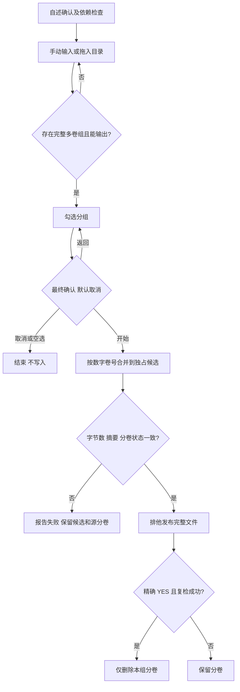

# Jobs 文件合并 · `jmerge`


[toc]

---

## 🔥 <span id="前言">前言</span>

在 [**MacOS**](https://www.apple.com/macos/) 还原 [jsplit](../【MacOS】split.command/README.md) 生成的 `原文件名@序号of总数` 分卷。每次手动输入或拖入一个目录，只有发现完整的多卷组才进入选择。

## 一、功能与边界 <a href="#前言" style="font-size:17px; color:green;"><b>🔼</b></a> <a href="#🔚" style="font-size:17px; color:green;"><b>🔽</b></a>

| 能力 | 行为 |
| --- | --- |
| 手动目录 | 支持中文、空格、引号和拖入转义；不接受命令行路径参数，不执行用户输入中的代码。 |
| 持续校验 | 空输入、目录不存在、不可读 / 不可进入、符号链接，或没有可合并的完整组时持续询问；EOF 或 Ctrl+C 终止。 |
| 扫描范围 | 本层和一级普通子目录；跳过隐藏、`node_modules`、`Pods`、`ManualBy*Pods@Pods`、`PodsManual`、`build`、`DerivedData`，不深入递归。 |
| 分组 | 按所在目录和完整原文件名分组，支持原名含 `@`、多扩展名、数字卷号补零；`.partial` 不参与。 |
| 合法组 | 至少 2 个可读、非空普通分卷，总数一致、编号唯一且从 1 连续到总数；缺卷、重号、非法卷号及单卷排除。 |
| 输出条件 | 输出目录可写，目标名未被文件、目录或链接占用；无可用组则重新输入。 |
| 还原与校验 | 按数值卷号串联，检查字节数、SHA-256 复制一致性及分卷状态；临时文件校验通过后用硬链接排他发布，拒绝覆盖并发产生的目标。 |
| 删除 | 默认保留所有分卷；只有合并成功后精确输入 `YES` 且复检通过，才删除该组清单；其它文件保留，只尝试移除空的分卷子目录。 |

SHA-256 复制一致性不等于来源认证；没有可信原文件摘要时，不能据此证明下载文件来自可信发布者。

## 二、运行与操作 <a href="#前言" style="font-size:17px; color:green;"><b>🔼</b></a> <a href="#🔚" style="font-size:17px; color:green;"><b>🔽</b></a>

从本目录运行，也可双击脚本：

```shell
zsh './【MacOS】merge.command'
```

通过仓库环境同步入口部署后：

```shell
jmerge
```

- 阅读内置自述并回车确认，再手动输入或拖入一个分卷目录或父目录。
- 路径、分卷内容和输出条件不满足时明确显示原因并重新询问；两个任意文件不视为分卷。
- 分组多选面板用 ↑/↓ 或 Tab 移动，回车勾选 / 取消；“全选”“清空”“取消本轮”均可用方向键定位并回车操作。Ctrl+A / Ctrl+D 是全选 / 清空快捷键；在真实分组行按空格确认，空选和 Esc 不执行。
- 显示每组来源与目标后进入最终确认，默认选中“取消本轮”；选中“开始合并并校验”后回车才写入，`←` 返回分组选择，Esc 取消。
- 合并后逐组询问删除：直接回车保留，只有精确 `YES` 才删除；Ctrl+C 可随时终止。失败或中断保留已存在文件和未确认删除的分卷，候选位置写入日志。

## 三、输出位置与依赖 <a href="#前言" style="font-size:17px; color:green;"><b>🔼</b></a> <a href="#🔚" style="font-size:17px; color:green;"><b>🔽</b></a>

例如以下目录，输入 `资料/镜像/` 或其父目录 `资料/`，均还原到 `资料/镜像.iso`：

```text
资料/
└── 镜像/
    ├── 镜像.iso@1of3
    ├── 镜像.iso@2of3
    └── 镜像.iso@3of3
```

若输入目录本层直接含分卷，本层组输出到其父目录；输入目录内一级子目录的组则输出到输入目录。多组同名输出的冲突会保留先完成的目标并报告后续失败，不覆盖。

`jsplit` 默认保留原文件，因此原文件仍在时，`jmerge` 会拒绝同名还原；可先把原文件移到其它目录保管，再测试合并。不需要删除原件来验证结果。

解释器为系统 zsh，依赖系统 `find`、`stat`、`cat`、`tee`、`shasum`、`mktemp`、`link`、`rm`、`rmdir`，交互使用 [**fzf**](https://github.com/junegunn/fzf)。只检查工具，不自动安装或升级，不修改 Shell 配置。缺少 fzf 可自行通过 [**Homebrew**](https://brew.sh/) 安装：

```shell
brew install fzf
```

完整同名目录可独立复制，从工程外工作目录执行。临时候选为输出目录中的 `.merge.随机后缀`，失败时保留；日志在系统临时目录中的 `【MacOS】merge.log`，始终为纯文本。支持的终端临时设置黑底白字并在退出恢复；未知终端、非 TTY、`NO_COLOR` 等场景纯文本降级。强制杀进程使用运行时显示的独立配色恢复入口。

## 四、流程与验证 <a href="#前言" style="font-size:17px; color:green;"><b>🔼</b></a> <a href="#🔚" style="font-size:17px; color:green;"><b>🔽</b></a>

流程保留 [**Mermaid**](https://mermaid.js.org) 源码：



两端协作的隔离回归见 [测试说明](../【MacOS】split.command/Tests/【MacOS】FilePartsTests.zsh/README.md)；测试只操作临时数据。

<a id="🔚" href="#前言" style="font-size:17px; color:green; font-weight:bold;">我是有底线的➤点我回到首页</a>
