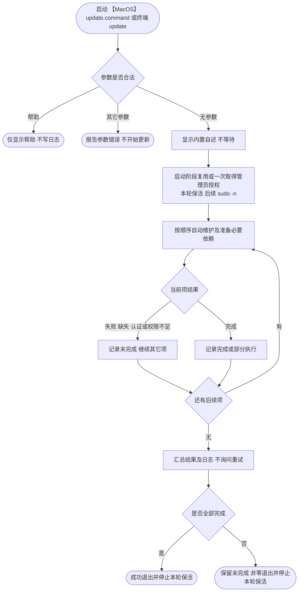
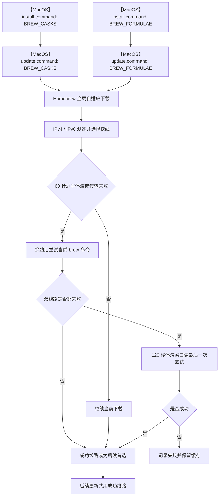

# `【MacOS】update.command`


[toc]

---

> **Python 环境预检**：实际调用 [**Python**](https://www.python.org/) 前使用本文件内嵌的环境预检函数，通过 [**Homebrew**](https://brew.sh/) 管理运行时；Python 预检不依赖外置环境库，完整更新入口还需携带文末说明的 `_lib/` SDK 网络资源。执行 Python 项时更新本体及公式索引，复用本轮已经成功的结果，不重复执行裸 `brew update`；索引失败则停止依赖它的升级。只在指定公式 `python@3.13` 缺失、损坏或版本不满足 `3.11+` 时自动安装或修复并复检，健康运行时直接复用，不逐次询问。预检不执行全局 `brew upgrade`。
> 无参数 `update` 默认自动维护必要运行时，不借用系统 Python 绕过检查；缺失 Homebrew 时报告未完成，由安装入口配置安装路径，不在更新中询问路径或自动换路。
## 🔥 <font id=前言>前言</font>

- 脚本入口使用 macOS 原生 Shell；其中的解析、转换或服务功能需要下述已验证的 Python 运行时。

`【MacOS】update.command` 用于升级和维护 `【MacOS】install.command` 已安装 / 初始化过的 [**macOS**](https://www.apple.com/macos/) 开发环境。

核心原则：

```text
【MacOS】update.command 维护 【MacOS】install.command 已安装 / 初始化的开发工具和依赖，不拉取或克隆工作区源码仓库。
```

该脚本适合 `.command` 双击运行，也可以在终端直接输入 `update`。无参数默认低打扰：显示内置自述后自动按顺序维护，最多启动阶段系统密码，不等待开场回车、逐项确认或收尾重试输入。

**桌面右键入口：** [JobsEnvironmentUpdater](../../../../OS@Extension/MacOS@Extension/JobsEnvironmentUpdater/README.md) 将本脚本及其私有依赖完整随 App 打包。在 [Finder 扩展管理面板](../../../../OS@Extension/MacOS@Extension/README.md) 的“文件与通用工具”中勾选“更新开发环境（update）”安装／更新后，系统桌面空白处提供“🔄 更新开发环境（update）”。点击新建 Terminal 会话无参数运行包内副本，与终端直接输入 `update` 一样默认低打扰，自动维护并直接汇总，最多启动阶段系统密码。菜单安装／卸载只管理右键入口，不执行升级或删除已有工具。此入口独立于终端 `update` 的 alias／PATH 和本源码目录；两份脚本遵循同一默认交互约定，保留已有业务差异。维护本脚本或 `_lib/` 依赖后，应同步菜单包并更新安装，源码更新不代表已安装菜单已经变化。范围、差异和验证见[资产盘点](../../../../OS@Extension/项目相关报告/update桌面菜单资产盘点.md)。

## 一、运行方式 <a href="#前言" style="font-size:17px; color:green;"><b>🔼</b></a> <a href="#🔚" style="font-size:17px; color:green;"><b>🔽</b></a>

进入 `【MacOS】update.command` 所在目录后执行：

```zsh
./【MacOS】update.command
```

如果已经自行加入 `PATH`，也可以执行：

```zsh
【MacOS】update.command
【MacOS】update.command [参数...]
```

已部署 JobsMacEnv 短命令时直接执行：

```zsh
update
update --help
```

直接运行即自动执行维护，不需要 `-t`。脚本在 [**Homebrew**](https://brew.sh/) `Do you want to proceed with the upgrade? [y/n]` 这类已知确认点定点输入 `y`。Homebrew 的 IPv4 / IPv6 测速仅决定 curl 尝试顺序，停滞保护使用 `1 B/s`，允许慢速下载继续；失败后有限重试。脚本每 `20` 秒输出下载缓存观察结果，增长只代表仍有传输，最终成败以该轮命令结果为准。

管理员授权集中在启动阶段：有可用缓存时直接执行；在交互终端中缺少缓存时调用一次 `sudo -v`，完成授权后即可离开。脚本每 45 秒以 `sudo -n -v` 刷新本轮授权，结束或中断后停止保活。密码只由系统 sudo 接收，脚本不保存、不传递密码，也不修改 `sudoers`；不撤销用户此前已有的凭证。

后续提权命令统一使用 `sudo -n`。后台无终端时不询问密码，仍允许已有缓存或精确 `NOPASSWD` 命令授权；授权不足明确计入未完成并继续其它项目。外部认证策略若要求重新验证，也会如实报告，不能靠脚本绕过。不自动打开手动下载网页；需要额外认证或未知输入的工具报告未完成，不等待手工填写。

## 二、交互规则 <a href="#前言" style="font-size:17px; color:green;"><b>🔼</b></a> <a href="#🔚" style="font-size:17px; color:green;"><b>🔽</b></a>

终端 `update`、直接运行脚本和桌面右键使用同一默认交互约定：

- 自述只展示，不等待回车，按既定顺序自动执行各项维护及必要依赖准备。
- 启动阶段可能需要一次系统管理员密码；本轮保活，后续提权命令只使用 `sudo -n`。无交互终端不询问密码，授权不足计入未完成。
- 普通子命令以输入结束运行，已知确认点定点自动回答；不把未知输入等待交给用户，不自动打开手动下载页。
- 单项失败、缺失或无权限后继续其它独立项目；`Ctrl+C` 可中止本轮，已完成更新不自动回滚。
- 收尾直接列出未完成项、汇总与日志路径，不询问重试，也不循环重跑整组。处理阻塞后，需要再试时重新运行 `update`；既有命令内部的下载／网络重试保留。

命令退出码、明确错误输出和必要的更新后核验共同决定结果；第三方返回 `0` 但输出明确失败时也不会标记完成。每组区分完成、部分执行、跳过和失败；任务有失败或明确跳过时返回非零。纯健康告警独立统计，不冒充升级失败。

工具不存在时，`【MacOS】update.command` 默认只提示，不静默补装整套工具。更新所需的已声明运行时依赖可自动准备并复检；需要补装其它工具请回到 `【MacOS】install.command`。

参数只保留帮助：

```zsh
-h, --help  # 只显示参数说明，不初始化日志或运行更新。
```

`-t`、`--trust`、`--unattended` 不再接受，传入时报告参数错误且不开始更新。默认流程已经无需这些开关。首屏仍展示用途、影响和取消方式，`JOBS_MAC_ENV_SKIP_README` 不再用于启用免确认。低打扰约定覆盖脚本自身交互；普通命令的输入结束与非交互环境不能保证任意第三方安装器绝不弹出独立系统授权或自行读取终端，实际要求以该安装器行为为准，不绕过权限。

## 三、与 `【MacOS】install.command` 的对应关系 <a href="#前言" style="font-size:17px; color:green;"><b>🔼</b></a> <a href="#🔚" style="font-size:17px; color:green;"><b>🔽</b></a>

当前 `【MacOS】update.command` 已对齐 `【MacOS】install.command` 的这些安装 / 初始化项，并且按 `【MacOS】update.command` 实际执行顺序排列：

- [**Xcode Command Line Tools**](https://developer.apple.com/xcode/resources/) / [`softwareupdate`](https://support.apple.com/guide/terminal/install-system-software-updates-apdc2ebf20d5/mac)
  - 对应更新：检查 CLT、接受 [**Xcode**](https://developer.apple.com/xcode/) License、执行 `softwareupdate --install --all`
- [**Xcode**](https://developer.apple.com/xcode/) iOS 平台组件
  - 对应更新：清理 Xcode / CoreSimulator 缓存，执行 `xcodebuild -downloadPlatform iOS -verbose`
- [**Oh My Zsh**](https://ohmyz.sh/)
  - 对应更新：执行已有安装内的官方 `tools/upgrade.sh`，随后独立读取实际跟踪分支的远端提交，核验本地 HEAD 已包含它；远端不可达或本地落后时明确未完成，不受上游脚本成功横幅影响。使用当前 `ZSH` 目录，未设置时使用默认安装目录。
- [**Homebrew**](https://brew.sh/)
  - 对应更新：执行 `brew update`、`brew upgrade`、`brew upgrade --cask`、`brew cleanup`、`brew doctor`、`brew -v`
  - 容错处理：`brew update` 遇到 `formulae.brew.sh/api` 或 `.jws.json` 下载失败时，自动使用 `HOMEBREW_NO_INSTALL_FROM_API=1 brew update` 降级重试
  - 信任处理：全局 `brew upgrade` 前会先处理脚本维护的第三方 tap，避免 Homebrew 扫描阶段提前跳过 `fvm` 等非官方 formula
  - 自动确认：对 `brew upgrade` / `brew upgrade --cask` 的已知 `[y/n]` 确认定点输入 `y`
  - 网络处理：`brew update`、全局及逐项 formula / cask 升级、Python 必需公式准备和 CocoaPods 本体统一复用下载重试；索引按真实 Brew 路径在本轮缓存结果。更新索引失败时停止相应升级；升级失败时跳过 cleanup，保留已完成包与下载缓存。
  - 类型与健康状态：公式升级显式使用 `--formula`；`go-task` 使用 `homebrew/core/go-task`，避免同名第三方 cask 歧义。`brew doctor` 的已识别健康警告单独计数并保留原文，不冒充升级失败；明确错误、异常退出或日志写入失败仍记未完成。不会自动删除废弃软件、根证书或强制覆盖链接。
  - `brew cask`：由 `BREW_CASKS` 自动生成逐项升级入口
  - `brew formula`：由 `BREW_FORMULAE` 自动生成逐项升级入口
  - `github-store`：升级前确认 `OpenHub-Store/tap`，升级后对 `$APPLICATIONS_DIR/GitHub-Store.app` 执行 `xattr -dr com.apple.quarantine`
- [**Rosetta 2**](https://support.apple.com/en-us/102527)
  - 对应更新：检查安装状态；Rosetta 2 通常跟随 [**macOS**](https://www.apple.com/macos/) 系统更新维护
- [**FVM**](https://fvm.app/) / [**Flutter**](https://flutter.dev/)
  - 对应更新：只维护已安装的 FVM 工具和已配置的独立全局 Flutter SDK；两者缺失时正常跳过，不安装。FVM 工具优先复用 `brew formula` 升级逻辑，已安装的 Dart pub 版才重新激活。全局 SDK 执行 `flutter upgrade` 获取当前频道最新版本，通常为 stable；沿用现有频道和来源，不自动切换。升级失败后停止该 SDK 的隔离标记处理与 doctor。参见 [Flutter 官方升级说明](https://docs.flutter.dev/install/upgrade)。doctor 的纯 `Network resources` 连通性告警单独计为健康警告；升级、组件下载和其它命令错误仍计入未完成。
  - 全局发现：依次检查 PATH 中的候选、`FLUTTER_ROOT`、`FLUTTER_HOME` 以及 Homebrew 实际前缀下的 `share/flutter`，解析符号链接并核对 SDK 内部文件。PATH 前面的项目 FVM 或未知包装命令不会阻断后续全局 SDK 查找；不执行未知包装命令，也不扫描硬盘或补装 Flutter。找到首个有效独立 SDK 后仅维护该环境。
  - 执行目录：全局升级在 SDK 自身目录内执行，避免从某个项目调用 `update` 时被 `flutter upgrade` 顺带更新该项目依赖；调用方工作目录保持不变。
  - Android 依赖自愈：以 doctor 报告的 SDK 与 JDK 为准，实际验证 `sdkmanager --version`；缺失时复用已有引导工具，包括 SDK 内非标准目录的健康工具，否则通过 Homebrew 官方 `android-commandlinetools` cask 补齐引导，再安装目标 SDK 中 Flutter 可识别的 `cmdline-tools;latest`。引导与目标修复各最多一次，安装后复检，再接受许可并重新运行 doctor。默认自动回答已知许可提示；安装或许可的网络错误、目录不可写、修复失败明确未完成，普通设备离线提示保留为健康警告。环境变量仅在本次维护作用域生效；不改项目 SDK 配置。参见 [Android sdkmanager](https://developer.android.com/tools/sdkmanager)。
  - 等待时限：每段 SDK 安装 / 许可命令默认总时限 600 秒，`JOBS_ANDROID_SDK_TIMEOUT` 可设置为 `1`～`1800` 秒；超时终止本次进程树并报告未完成。
  - 项目隔离：工程内 SDK、`.fvm/flutter_sdk`、FVM 数字版本及 stable / beta 等频道缓存均不原地升级；`fvm/default` 指向这些缓存时同样保护。仅有 FVM 缓存不视为已配置独立全局环境；不修改 `.fvmrc`、项目 SDK 链接或 `fvm global`。项目声明与实际 SDK 不符属于项目绑定问题，由项目 FVM 流程处理；更新全局 SDK不会自动修复该绑定。参见 [FVM 官方说明](https://fvm.app/documentation/getting-started/faq)。
  - 隔离处理：`brew cask：flutter` 和 `flutter upgrade` 完成后，先验证 SDK 内 Dart 二进制文件的 `FLUTTER.IO LLC (S8QB4VV633)` 官方签名；仅在签名有效且签名方匹配时，定向解除 Flutter SDK 的 `com.apple.quarantine` 标记，避免 macOS 将可验证的 `dart` 误报为“已损坏”
- [**Node.js**](https://nodejs.org/) / [**Corepack**](https://nodejs.org/api/corepack.html) / [**npm**](https://www.npmjs.com/) / [**pnpm**](https://pnpm.io/)
  - 对应更新：兼容 [**nvm**](https://github.com/nvm-sh/nvm) LTS 维护，启用 `corepack`，升级 `npm`
- `npm` 全局包：[**quicktype**](https://quicktype.io/)
  - 对应更新：检测已安装后执行 `npm update -g quicktype`；目标包目录可写时使用当前用户，历史遗留的 root 所有目录进入统一提权策略
- `npm` 全局包：[**OpenCLI**](https://www.npmjs.com/package/@jackwener/opencli)
  - 对应更新：确认 [**Node.js**](https://nodejs.org/) 版本不低于 21，检测已安装后执行 `npm install -g @jackwener/opencli@latest`；按目标包目录权限动态选择当前用户或统一提权策略，并提示 `opencli doctor`
- `npm` 全局包：[**CodeGraph**](https://github.com/colbymchenry/codegraph)
  - 对应更新：检测已安装后执行 `npm install -g @colbymchenry/codegraph@latest`，输出版本，并执行 `codegraph install --yes` 刷新 Agent 配置
- [**Ruby**](https://www.ruby-lang.org/) / [**RubyGems**](https://rubygems.org/) / [**rbenv**](https://github.com/rbenv/rbenv)
  - 对应更新：刷新 `rbenv` 初始化配置并 rehash。Homebrew / 系统 Ruby 的 RubyGems 本体由原包管理器维护，不执行 `gem update --system`；其它自管 Ruby 先检查实际目标权限。
  - Gem 权限与运行时：扩展检查、Gem 环境读取及升级使用同一个已选定的 Ruby，通过该运行时直接执行 RubyGems，不依赖 PATH 中另一个 `gem` 的 shebang。检查安装目录、插件及 bin 等实际写入位置。共享目录不完整可写时，只在用户 Gem 目录位于当前 HOME 内、可写且当前 Ruby 确认可加载时执行 `gem update --user-install`；更新后复检搜索路径，用户 bin 仅追加到本次进程 PATH，已有命令保持原来源优先。失败明确返回，不自动 sudo 或改所有权。参见 [RubyGems 安装说明](https://guides.rubygems.org/gem-installation-and-loading/)。
  - 文档生成：Gem 更新统一使用 `--no-document`，只升级所选包或 RubyGems 本体，不生成本地 ri / RDoc 文档；实际下载、安装和升级错误仍按未完成报告。
  - 原生扩展：更新前后检查当前 CocoaPods 所用 Ruby，仅对缺失的已安装扩展版本备份重建；健康版本直接跳过，详见 [原生扩展修复](#gem-native-extensions)。
- [**CocoaPods**](https://cocoapods.org/) 工具与公共规格源
  - 工具更新：按当前 PATH 中 `pod` 的实际路径判断是否由 Homebrew 管理，命中时先通过统一索引门禁，再沿用下载重试；本轮逐项 formula 阶段已成功升级则跳过重复升级。活跃命令不属于该 formula、但当前 RubyGems 已安装时，复用上述 Gem 目标权限检查与用户目录回退。归属无法确认或工具未登记时明确提示，不自动补装或切换活跃 Homebrew pod 来源。
  - 规格刷新：先复用工程相同的网络模块验证原链路及已有代理，再让同一子流程中的 CDN / GitHub Specs 实测与定向刷新继承选中环境；只按源的实际本地名称刷新，双源失败保留缓存并记录未完成。具体边界见 [CocoaPods 网络选路](#cocoapods-network)。
- [**Python**](https://www.python.org/) / [**pip**](https://pip.pypa.io/) / [**uv**](https://docs.astral.sh/uv/)
  - 对应更新：先执行内嵌运行时预检，再按已安装工具执行 `pyenv update`、`pyenv rehash`、`pipx upgrade-all`；pip 使用预检选定的解释器。检测到 `EXTERNALLY-MANAGED` 时只检查 pip 版本，其升级随 Homebrew Python 公式维护，避免触发 [PEP 668](https://peps.python.org/pep-0668/)；不绕过系统包管理保护。
- [**Dart**](https://dart.dev/) `pub` 缓存
  - 对应更新：执行 `dart pub global list`，按当前 `dart pub cache repair --help` 决定是否添加 `--all`；`No pubspec.yaml found` 等错误即使返回零也按失败处理。
- [**Git LFS**](https://git-lfs.com/) 初始化
  - 对应更新：执行 `git lfs install`，刷新 `core.compression`、`http.postBuffer` 等大文件相关 [**Git**](https://git-scm.com/) 参数
- 手动下载 / 更新页面
  - [**Visual Studio Code**](https://code.visualstudio.com/)
  - [**Android Studio**](https://developer.android.com/studio?hl=zh-cn)
  - [**Python Downloads**](https://www.python.org/downloads/)

## 四、Homebrew 第三方配置 <a href="#前言" style="font-size:17px; color:green;"><b>🔼</b></a> <a href="#🔚" style="font-size:17px; color:green;"><b>🔽</b></a>

`【MacOS】update.command` 内部保留与 `【MacOS】install.command` 同源的数组。

### 4.1、`brew cask` <a href="#前言" style="font-size:17px; color:green;"><b>🔼</b></a> <a href="#🔚" style="font-size:17px; color:green;"><b>🔽</b></a>

当前 `BREW_CASKS`：

```zsh
readonly -a BREW_CASKS=(
  hammerspoon
  flutter
  trex
  vlc
  jdownloader
  codex-app
  codex
  github-store
  jtool2
  motrix
  onlyoffice
  pot
  qlcolorcode
  temurin@17
)
```

| cask | 说明 |
| --- | --- |
| [**hammerspoon**](https://www.hammerspoon.org/) | 自动化与快捷键工具 |
| [**flutter**](https://flutter.dev/) | Flutter SDK / 桌面开发工具链 |
| [**trex**](https://formulae.brew.sh/cask/trex) | OCR / 取词相关工具 |
| [**vlc**](https://www.videolan.org/vlc/) | 视频播放器 |
| [**jdownloader**](https://formulae.brew.sh/cask/jdownloader) | 下载管理工具 |
| [**codex-app**](https://formulae.brew.sh/cask/codex-app) | Codex 图形化应用入口 |
| [**codex**](https://formulae.brew.sh/cask/codex) | Codex 相关图形化入口 |
| `github-store` | GitHub-Store 图形化应用入口；来自 `OpenHub-Store/tap` |
| `jtool2` | iOS / Mach-O 辅助工具 |
| [**motrix**](https://motrix.app/) | 下载管理工具 |
| [**onlyoffice**](https://www.onlyoffice.com/) | Office 文档套件 |
| [**pot**](https://pot-app.com/) | 翻译工具 |
| [**qlcolorcode**](https://github.com/sbarex/QLColorCode) | Quick Look 代码预览 |
| `temurin@17` | Eclipse Temurin JDK 17 |

### 4.2、`brew formula` <a href="#前言" style="font-size:17px; color:green;"><b>🔼</b></a> <a href="#🔚" style="font-size:17px; color:green;"><b>🔽</b></a>

当前 `BREW_FORMULAE`：

```zsh
readonly -a BREW_FORMULAE=(
  agg
  asciinema
  caddy
  cloudflared
  git-lfs
  gh
  nushell
  rbenv
  ruby
  node
  jenv
  openjdk
  openjdk@17
  openjdk@21
  fvm
  pnpm
  python
  python3
  python-tk@3.14
  pyinstaller
  pyside
  cocoapods
  fastlane
  mysql
  hugo
  yt-dlp
  ffmpeg
  cmake
  graphviz
  sevenzip
  go-task
  uv
  fzf
  glow
  lazygit
  dufs
  git-filter-repo
  nginx
  radare2
)
```

| formula | 说明 |
| --- | --- |
| [**agg**](https://github.com/asciinema/agg) | asciinema 录制转 GIF / 视频 |
| [**asciinema**](https://asciinema.org/) | 终端录制工具 |
| [**caddy**](https://caddyserver.com/) | Web 服务器 / 反向代理 |
| [**cloudflared**](https://github.com/cloudflare/cloudflared) | Cloudflare Tunnel 工具 |
| [**git-lfs**](https://git-lfs.com/) | Git 大文件支持 |
| [**gh**](https://cli.github.com/) | GitHub CLI |
| [**nushell**](https://www.nushell.sh/) | 结构化 Shell |
| [**rbenv**](https://github.com/rbenv/rbenv) | Ruby 版本管理 |
| [**ruby**](https://www.ruby-lang.org/) | Ruby 运行环境 |
| [**node**](https://nodejs.org/) | Node.js 运行环境 |
| [**jenv**](https://www.jenv.be/) | Java 版本管理 |
| [**openjdk**](https://openjdk.org/) | Java 开发工具包 |
| [**openjdk@17**](https://openjdk.org/projects/jdk/17/) | Java 17 开发工具包 |
| `openjdk@21` | Java 21 开发工具包 |
| [**fvm**](https://fvm.app/) | Flutter 版本管理 |
| [**pnpm**](https://pnpm.io/) | Node.js 包管理器 |
| [**python**](https://www.python.org/) | Python 运行环境 |
| [**python3**](https://www.python.org/) | Python 3 运行环境 |
| `python-tk@3.14` | Python Tk 运行组件 |
| [**pyinstaller**](https://pyinstaller.org/) | Python 应用打包工具 |
| [**pyside**](https://formulae.brew.sh/formula/pyside) | Qt 官方 Python 绑定；代码中使用 `PySide6` 导入 |
| [**cocoapods**](https://cocoapods.org/) | iOS 依赖管理工具 |
| [**fastlane**](https://fastlane.tools/) | 移动端自动化发布工具 |
| [**mysql**](https://www.mysql.com/) | MySQL 数据库 |
| [**hugo**](https://gohugo.io/) | 静态站点生成器 |
| [**yt-dlp**](https://github.com/yt-dlp/yt-dlp) | 视频下载工具 |
| [**ffmpeg**](https://ffmpeg.org/) | 音视频处理工具 |
| [**cmake**](https://cmake.org/) | 跨平台构建工具 |
| [**graphviz**](https://graphviz.org/) | Graphviz 图形渲染工具 |
| [**sevenzip**](https://formulae.brew.sh/formula/sevenzip) | 7-Zip 压缩 / 解压工具 |
| [**go-task**](https://taskfile.dev/) | 任务运行器 |
| [**uv**](https://docs.astral.sh/uv/) | Python 包与项目管理工具 |
| [**fzf**](https://github.com/junegunn/fzf) | 命令行模糊查找工具 |
| [**glow**](https://github.com/charmbracelet/glow) | 终端 Markdown 阅读器 |
| [**lazygit**](https://github.com/jesseduffield/lazygit) | Git 终端 UI |
| [**dufs**](https://github.com/sigoden/dufs) | 文件服务器工具 |
| [**git-filter-repo**](https://formulae.brew.sh/formula/git-filter-repo) | Git 仓库历史重写 / 清理工具 |
| [**nginx**](https://nginx.org/) | Web 服务器 / 反向代理 |
| [**radare2**](https://www.radare.org/n/) | 逆向分析工具 |

维护规则：

```text
【MacOS】install.command 增加 brew cask / formula 后，【MacOS】update.command 的同名数组必须同步增加；对应 README.md 也必须同步更新。
```

少数特殊 `cask` 的 tap 与更新后置动作已经适配：

- `github-store`：升级前执行 `brew tap OpenHub-Store/tap` 确认 tap；检测已安装后执行 `brew upgrade --cask github-store`；升级后执行 `xattr -dr com.apple.quarantine $APPLICATIONS_DIR/GitHub-Store.app`
- [**Flutter**](https://flutter.dev/)：升级后先使用 `codesign` 校验 SDK 内 Dart 的官方签名，通过后才定向解除 Flutter SDK 的 `com.apple.quarantine` 标记；签名无效或签名方变更时保留隔离标记并输出警告。
- `vlc`：Homebrew 未登记、但本机已有 `/Applications/VLC.app` 时，只读核对官方 cask 元数据与 App 版本；对象、App 路径及简单稳定版本严格一致才记为已完成，不接管或覆盖 App。版本不等、独立构建号、多段版本、`latest` 或无效元数据仍明确跳过，不能仅凭 App 存在宣称已更新。

少数特殊 `formula` 的更新后置动作已经适配：

- [**fvm**](https://fvm.app/)：自动确认 `leoafarias/fvm` tap；如果当前 Homebrew 开启 tap trust 策略，会先执行 `brew trust leoafarias/fvm`
- [**go-task**](https://taskfile.dev/)：使用官方 core 公式 `brew upgrade --formula homebrew/core/go-task`，不依赖第三方同名 cask 的 tap
- [**rbenv**](https://github.com/rbenv/rbenv)：升级后刷新 `rbenv` 初始化配置
- [**jenv**](https://www.jenv.be/)：升级后刷新 `jenv` 初始化配置
- [**openjdk**](https://openjdk.org/) / [**openjdk@17**](https://openjdk.org/projects/jdk/17/)：升级后输出 Java 配置提示
- [**fzf**](https://github.com/junegunn/fzf)：升级后刷新 `fzf` shell 配置

### 4.3、Homebrew 全局自适应下载 <a href="#前言" style="font-size:17px; color:green;"><b>🔼</b></a> <a href="#🔚" style="font-size:17px; color:green;"><b>🔽</b></a>

`【MacOS】update.command` 对所有由 Homebrew `curl` 执行的更新下载使用同一组无人值守策略，不再只针对某个 cask 或 formula。

1、首次进入 Homebrew 下载前，使用 Homebrew 官方 API 文件对 IPv4 和 IPv6 各做一次最多 `1 MiB`、最长 `8` 秒的小流量测速。

2、正式下载先使用测速更快的协议。测速来自 API 小文件，不能代表 GHCR bottle 的线路、并发带宽或后续速度，因此不据此抬高最低下载速度；连续 `60` 秒低于 `1 B/s` 时才终止近乎停滞的下载。

3、Homebrew 通过日志管道运行时会隐藏 curl 原生进度条；脚本每 `20` 秒检查一次未完成下载缓存，有增长时输出最近增长量。该观察可能包含其它并发资源，不能证明每个包均成功，也不代替最终命令结果；支持自定义 `HOMEBREW_CACHE`。

4、某条线路执行成功后，它会成为本轮后续 Homebrew 下载的首选，避免每个包重复猜测。

5、首轮网络失败后切换另一 curl 协议，仍失败则回到原首选做最后一次尝试；末轮停滞窗口为 `120` 秒、门槛仍为 `1 B/s`。每条命令最多三轮，Homebrew 内部 curl 额外重试设为 `0`，避免多层叠加。权限、认证、证书或安装错误不会靠换线重试。前轮失败而后轮成功时以最终成功为准，不将已恢复的错误累计为最终失败。

6、策略通过系统临时目录里的 `HOMEBREW_CURLRC` 及单条命令的环境变量生效，API 下载同时设置 Homebrew 自身的速度参数。主流程正常结束或收到中断信号时回收临时文件与后台进度进程，精确还原原 `HOMEBREW_CURLRC` 的未设置、空值或文件路径。网络策略不改 Shell 配置、原 curl 配置或 macOS 系统代理；既有 Homebrew shellenv 维护仍可能更新用户 Shell 配置。

7、同轮的索引成功 / 失败按实际 Brew 可执行文件缓存；Python 与 CocoaPods 共用结果。索引失败时停止依赖该索引的公式或 cask 升级，保留日志，修复网络后重新运行。下载命令关闭自动 cleanup；仅本组升级全部完成后运行显式 cleanup，避免失败后清走重试所需内容。

- `brew update` 明确报告锁占用时，检查当前 Brew 前缀下的实际系统锁，最多等待 `120` 秒；释放后在原线路额外补试一次。可通过 `JOBS_UPDATE_BREW_LOCK_TIMEOUT_SECONDS=1~600` 调整等待秒数。不会删除锁文件、终止原任务或把锁冲突当成网络换线；仍被占用时保留真实失败。
- 随包 Jobs Git 入口存在、且用户未显式设置 `HOMEBREW_GIT_PATH` 时，传入该入口；`brew update` 另通过 `GIT_EXECUTABLE` 让内部 Shell fetch 确实复用既有选路。显式变量（包括空值）优先保留。代理仅传给当前 Git 子进程，脱敏审计沿用 Jobs Git 日志；不修改全局配置。Homebrew 可能优先采用自己的 Git，不能只凭 `HOMEBREW_GIT_PATH` 宣称所有下载均经代理。

边界：[Homebrew 官方配置说明](https://docs.brew.sh/Manpage#environment)明确区分 curl 下载与 Git 传输。上述入口修复覆盖 `brew update` 的 Shell Git 拉取；其它 Git 下载仍由 Homebrew 的工具选择和既有配置决定。额外传入当前子命令的低速保护与禁止凭据交互参数；curl 的 IPv4 / IPv6 切换不控制 Git 出口。`softwareupdate`、`npm`、`gem`、`pod`、`dart`、`flutter` 各有自己的下载器。完全不可达的 GitHub、GHCR 或 Flutter 存储服务仍会失败，脚本会如实记录，不能通过切换 IP 协议恢复不存在的网络链路。

## 五、更新顺序总览 <a href="#前言" style="font-size:17px; color:green;"><b>🔼</b></a> <a href="#🔚" style="font-size:17px; color:green;"><b>🔽</b></a>

`【MacOS】update.command` 当前按以下顺序自动维护；手动下载页不自动打开：

1. [**Xcode Command Line Tools**](https://developer.apple.com/xcode/resources/) / `softwareupdate`
2. [**Xcode**](https://developer.apple.com/xcode/) iOS 平台组件
3. [**Oh My Zsh**](https://ohmyz.sh/)
4. [**Homebrew**](https://brew.sh/)
5. `brew cask` 批量升级
6. `brew formula` 批量升级
7. [**Rosetta 2**](https://support.apple.com/en-us/102527) 状态检查
8. [**FVM**](https://fvm.app/) / [**Flutter**](https://flutter.dev/)
9. [**Node.js**](https://nodejs.org/) / `corepack` / `npm`
10. `npm` 全局包：[**quicktype**](https://quicktype.io/)
11. `npm` 全局包：[**OpenCLI**](https://www.npmjs.com/package/@jackwener/opencli)
12. `npm` 全局包：[**CodeGraph**](https://github.com/colbymchenry/codegraph)
13. [**Ruby**](https://www.ruby-lang.org/) / [**RubyGems**](https://rubygems.org/)
14. [**CocoaPods**](https://cocoapods.org/)
15. [**Python**](https://www.python.org/) / `pip`
16. [**Dart**](https://dart.dev/) `pub` 缓存
17. [**Git LFS**](https://git-lfs.com/) 初始化刷新
18. 手动下载 / 更新页面：默认跳过，不弹出浏览器

### 5.1、CodeGraph 升级说明 <a href="#前言" style="font-size:17px; color:green;"><b>🔼</b></a> <a href="#🔚" style="font-size:17px; color:green;"><b>🔽</b></a>

[**CodeGraph**](https://github.com/colbymchenry/codegraph) 通过 `npm` 安装时，升级方式采用覆盖安装到最新版本：

```zsh
npm install -g @colbymchenry/codegraph@latest
codegraph --version
codegraph install --yes
```

其中 `codegraph install --yes` 用于刷新 Claude Code / Cursor / Codex CLI / opencode / Hermes Agent 等 Agent 的 MCP 配置和说明文件；项目内 `.codegraph/codegraph.db` 不会在全局升级时强制重建，需要进入具体项目后按需执行：

```zsh
codegraph index --force
```

### 5.2、<span id="cocoapods-network">CocoaPods 网络选路与受限网络排查</span> <a href="#前言" style="font-size:17px; color:green;"><b>🔼</b></a> <a href="#🔚" style="font-size:17px; color:green;"><b>🔽</b></a>

工具本体升级、公共 Specs 索引刷新和具体 Pod 源码下载是三个独立步骤。Homebrew 本体升级继续使用第 4.3 节的 IPv4 / IPv6 策略；以下选源只用于公共规格源刷新，不会把 CDN 地址当作 Gem 下载地址，也不会修改工程的 `Podfile`、`Podfile.lock` 或 `Pods/`。

| 环节 | 实际执行 |
| --- | --- |
| 选已有网络链路 | 内嵌完整 `JobsCocoaPodsNetwork` 模块及 update 专用交接策略，用 CocoaPods 所用 Ruby 验证显式设置、系统已启用代理及当前链路 |
| 环境交接 | 仅把选中代理和新增 Git 配置写入权限 `0600` 的临时 NUL 键值载荷；Shell 校验完整受控键名后按字面值导出，不执行载荷代码，不输出 URL / 凭据 |
| 后续 Specs 请求 | 同一个子 Shell 内的 GET、Git 协议检查及 `pod repo add-cdn` / `pod repo update` 全部继承本次选中配置；返回后父 Shell 环境不变，私有载荷删除 |

1、保留显式 `JOBS_POD_PROXY_URL`、代理环境变量及目标 URL 的 Git 代理设置，包括显式空值。自动模式先读取 macOS 已开启的 HTTPS / HTTP / SOCKS 手工代理并发验证，把选中的代理真正传给本次 CDN、Git 与 pod 子进程；已有代理不可用时再验证原链路。不能仅因 PATH 中的 Git 包装器自行选路成功，就认定后续 CDN 已继承代理。update 专用策略验证真实 CocoaPods CDN podspec JSON 或 Specs Git 协议，任一可达即可将环境交给下一步双源实测，不因无关仓库失败而拒绝可用 CDN。单个 HTTP / Git 探测默认限时 `6` 秒，系统配置读取另限时 `1` 秒；不运行 PAC、不扫描端口、不猜代理、不安装软件。选路失败或 Ruby 不可用时，告警并保留原环境，继续独立判断 Specs 是否可达。此顺序只用于 update 的公共源维护，共用工程网络模块原文保持独立。

2、同时从 `https://cdn.cocoapods.org/` 和 GitHub Raw 获取同一个 `AFNetworking 4.0.1` podspec，验证完整 JSON、名称和版本。GitHub 候选额外执行 `git ls-remote` 检查 Specs 仓库协议，并访问真正刷新还会调用的 `https://api.github.com/repos/CocoaPods/Specs/commits/master`，使用 CocoaPods 的 SHA 响应协议严格校验提交号；仅 Raw 和 Git 可达不代表 GitHub API 可用。每个候选默认整体限时 `8` 秒，包含 HTTP、API 和 Git 子进程。该额外请求来自 [CocoaPods Core 的 GitHub 预检实现](https://raw.githubusercontent.com/CocoaPods/Core/1.17.0/lib/cocoapods-core/github.rb)。

3、只选通过探测的源；两者可用时，GitHub GET 必须比 CDN 快超过 `15%` 且已有对应的本地 Git Specs，才优先选 Git，避免相近测量导致选源反复变化或引发首次大仓库克隆。Git 尚未登记、但 CDN 测通时，自动模式改用 CDN。小文件探测成功不保证完整大仓库或具体 Pod 下载成功。

4、读取 `pod repo list --no-ansi` 获取 CocoaPods 实际配置的源名称，兼容自定义别名和仓库目录；只定向刷新所选官方公共源，保留私有源、原 Git Specs 和缓存。CDN 尚未登记时新增独立的 `jobs-public-cdn`，同名已占用则追加 `-cdn` 避让；不覆盖已有名称。Git 源尚未登记时提示未完成，不在全局升级中冷克隆巨大 Specs 仓库。

5、双源不可用、明确指定的源未通过探测或源清单不可读时，该项返回失败，由总流程告警后继续。真实的源登记 / 刷新命令各自默认整体限时 `120` 秒，超时终止本次进程树；正常结束回收计时器时不会生成超时标记。仅自动选源模式下，初选源实际刷新超时或本次命令输出明确的连接／传输失败，且另一官方源已登记时，重新实测另一源，通过才额外刷新一次；包括 CocoaPods 的 GitHub API 连接错误返回 `1`，不只处理超时 `124`。分类只读取该次命令的私有临时输出，不扫描全局旧日志。显式 `cdn` / `git`、取消、认证、证书、权限、运行时异常、未知错误、无可用备用源或再次刷新失败均保留真实失败，不删除缓存、不冷克隆、不切换未验证的源。保留缓存不表示刷新成功。刷新使用 `--verbose` 同步显示真实请求进度；本次 pod 命令默认设置 `COCOAPODS_CDN_MAX_CONCURRENCY=8`，避免默认高并发挤占代理连接，已有显式值原样保留，不写入 Shell 配置。

| 环境变量 | 默认值 | 用途 |
| --- | --- | --- |
| `JOBS_POD_NETWORK_ADAPT` | 开启 | `0` 关闭已有代理探测 / 继承，保留 Specs 实测 |
| `JOBS_POD_PROXY_URL` | 未设置 | 可选已有 HTTP / HTTPS / SOCKS5 / SOCKS5H 代理，真实验证通过后仅用于本次子流程；不要将凭据写入仓库或共享日志 |
| `JOBS_POD_NETWORK_PROBE_TIMEOUT` | `6` | 选路中单个 HTTP / Git 探测秒数，范围 `1..30`；HTTP 不可用时才继续 Git 探测 |
| `JOBS_SPECS_SOURCE` | `auto` | `auto` 实测选源；`cdn` / `git` 明确指定源，仍需该源通过探测 |
| `JOBS_SPECS_PROBE_TIMEOUT` | `8` | 单个候选 HTTP + API + Git 整体秒数，范围 `1..30` |
| `JOBS_SPECS_CONNECT_TIMEOUT` | `2` | curl 连接秒数，范围 `1..30`，不超过候选整体时限 |
| `JOBS_SPECS_UPDATE_TIMEOUT` | `120` | 单次源登记 / 刷新整体秒数，范围 `1..900` |
| `COCOAPODS_CDN_MAX_CONCURRENCY` | 本入口未设置时使用 `8` | 仅本次 pod 命令的 CDN 并发数；显式值原样保留 |

选源和失败摘要统一写入 `$TMPDIR/update.log`；临时响应、底层工具错误、超时标记和私有网络载荷随子流程结束清理，避免将可能包含凭据的原始诊断落入公共日志。代理只覆盖本次子流程；Git 临时配置追加到原 `GIT_CONFIG_COUNT`，限定 GitHub URL 范围，保留原私有域配置和 `NO_PROXY`。curl / CocoaPods 使用进程环境代理，不写全局 Git、系统代理或 shell profile，不关闭 TLS 校验；`curl -q` 不读取个人 `.curlrc`。模块完整内嵌在 `【MacOS】update.command` 的标记块中，不依赖外置支持目录。

受限网络出现 `Error installing AMPopTip`，并在 `git clone https://github.com/andreamazz/AMPopTip.git ... --branch 4.12.0` 报 `Couldn't connect to server` / `Operation timed out` 时，失败点是源码仓库连接。源码 URL 来自 [CocoaPods podspec 的 source 字段](https://guides.cocoapods.org/syntax/podspec.html#source)，切换公共索引源不能把它变成 CDN 下载。应在失败的那台电脑确认终端 Git 能通过当前网络或已有代理连接 GitHub；浏览器可访问并不能证明该 Git 进程的链路可用。可先做只读验证：

```zsh
GIT_TERMINAL_PROMPT=0 git \
  -c http.lowSpeedLimit=1 \
  -c http.lowSpeedTime=15 \
  ls-remote \
  https://github.com/andreamazz/AMPopTip.git \
  refs/tags/4.12.0
```

返回引用只验证 Git 握手与 tag 查询，不能保证整个源码包传输成功。该命令继续超时时，应先打通终端 Git 的网络 / 代理再运行 `pod install`；不靠删除锁文件、修改第三方 podspec 或升级 CocoaPods 掩盖连接失败。CDN 探测的 `curl 35` 表示 TLS 握手阶段失败，日志本身不足以判断是证书、代理还是网络设备导致。

隔离回归通过假 `curl` / `git` / `pod` / `brew` / `gem` 验证选源、定向刷新与超时，不运行真实安装或升级。从脚本目录执行：

```zsh
/bin/zsh Tests/【MacOS】cocoapods_network_tests.zsh/【MacOS】cocoapods_network_tests.zsh
ruby Tests/cocoapods_proxy_tests.rb/cocoapods_proxy_tests.rb
```

网络与升级回归覆盖 46 项，包括响应真实性、15% 阈值、并发、HTTP / Git 协议及刷新墙钟超时、后代进程回收、私有源保留、自定义别名、同名避让、混装归属和升级失败传播；其中代理层被替换为空操作，保证不访问宿主运行时。独立代理回归使用真实内嵌 Ruby 模块、假 Git / curl / pod 与系统配置夹具，检查选中代理实际到达后续命令、原 Git 配置 / NO_PROXY 保留、父环境恢复、私有载荷权限和清理、非法载荷拒绝及日志不泄露凭据。均不执行真实联网、安装或升级；结果不替代受限网络电脑上的实际安装验收。

### 5.3、<span id="gem-native-extensions">Ruby 原生扩展的平台迁移修复</span> <a href="#前言" style="font-size:17px; color:green;"><b>🔼</b></a> <a href="#🔚" style="font-size:17px; color:green;"><b>🔽</b></a>

`Ignoring ... because its extensions are not built` 表示当前 Ruby 找不到该已安装版本的平台扩展。本机旧扩展保存在 `arm64-darwin-25/4.0.0`，当前 Ruby 需要 `arm64-darwin-27/4.0.0`。修复会使用当前 Ruby 重新编译，再用新进程精确激活原版本并实际加载原生二进制；平台名称取自当前运行时，不写死 `27`，不通过改名目录或复制完成标记绕过构建。

`update` 的 Ruby / RubyGems 项在 Gem 更新前后执行检查；CocoaPods 项在工具升级后、Specs 刷新前也会复检。优先从活跃 `pod` 的脚本及 Homebrew 包装层定位 Ruby；无法解析时使用 PATH 中的 Ruby，再检查标准 Homebrew Ruby 路径。仅处理其 Gem 搜索路径中缺失扩展的非默认 Gem，Gem 环境与更新绑定同一运行时，避免混用系统 Ruby 的目录。

每个待修目标先将完整 Gem 目录、当前平台已有扩展及原始 gemspec 备份到 `~/.JobsMacEnv/backups/gem-native-extensions/`，再通过 RubyGems 构建接口使用本机已有 `extconf.rb` 源码重编译。构建或加载验证失败时恢复该目标并保留失败材料；其它已成功目标保留。没有缺失项时不编译、不写备份。缺少编译工具链、源码或目录写权限时明确报失败，由更新总流程记录后继续其它更新项；CocoaPods 项复检失败时跳过本次 Specs 刷新。

这段修复本身不下载依赖、不安装新 Gem、不调用 sudo、不升级 Ruby，也不修改旧平台目录；原有 `gem update` / Homebrew 更新仍按原流程执行。修复结果同步写入 `$TMPDIR/update.log`。独立检查与修复入口见 [【MacOS】repair_gem_extensions.command](../【MacOS】repair_gem_extensions.command/README.md)，其实现原样内嵌，`【MacOS】update.command` 可以单文件复制运行。

2026-10-17 本机实测：Ruby `4.0.7` 下 25 个版本重建成功，`pod --version` 的 `Ignoring` 从 75 条降为 0 条，正常输出 `1.17.0`；144 个旧平台文件与 gemspec 指纹保持一致，第二次执行缺失数为 0。未执行整套 `update` 来验收此功能，避免触发无关系统升级。

从本脚本目录执行隔离回归：

```zsh
JOBS_GEM_REPAIR_SCRIPT="$PWD/【MacOS】update.command" /usr/bin/ruby ../【MacOS】repair_gem_extensions.command/Tests/native_extensions_test.rb/native_extensions_test.rb
/bin/zsh ../【MacOS】repair_gem_extensions.command/Tests/【MacOS】update_integration_test.zsh/【MacOS】update_integration_test.zsh
```

## 六、风险说明 <a href="#前言" style="font-size:17px; color:green;"><b>🔼</b></a> <a href="#🔚" style="font-size:17px; color:green;"><b>🔽</b></a>

以下步骤可能耗时较长或触发系统级行为：

```text
sudo softwareupdate --install --all
sudo xcodebuild -license accept
xcodebuild -downloadPlatform iOS -verbose
HOMEBREW_NO_INSTALL_FROM_API=1 brew update
brew trust --tap leoafarias/fvm
brew upgrade / brew upgrade --cask
xattr -dr com.apple.quarantine $APPLICATIONS_DIR/GitHub-Store.app
codesign --verify --strict $FLUTTER_ROOT/bin/cache/dart-sdk/bin/dart
xattr -dr com.apple.quarantine $FLUTTER_ROOT
gem update / npm install -g npm@latest
npm install -g @colbymchenry/codegraph@latest
codegraph install --yes
dart pub cache repair
```

直接执行 `update` 即自动维护这些项目，不等待逐项确认。在终端启动阶段集中授权并保活，后续提权命令只使用 `sudo -n`；权限不足明确记录未完成后继续。

Homebrew 换线会重新执行当前幂等的 `brew update` / `brew upgrade` 命令。Homebrew 负责管理下载缓存和已完成项；脚本不手工删除缓存，也不回滚已完成的包。

## 七、日志文件 <a href="#前言" style="font-size:17px; color:green;"><b>🔼</b></a> <a href="#🔚" style="font-size:17px; color:green;"><b>🔽</b></a>

运行日志固定写入：

```text
$TMPDIR/update.log
```

日志以纯文本落盘；交互终端按能力显示颜色，非 TTY、`TERM=dumb` 和 `NO_COLOR` 不输出 ANSI。帮助和参数错误保留上一份日志；无参数合法启动进入本轮更新后初始化日志。最终汇总区分完成、部分执行、跳过和失败，另列 Homebrew 健康告警数量，不以最后一条命令成功覆盖此前错误。

## 八、结构约定 <a href="#前言" style="font-size:17px; color:green;"><b>🔼</b></a> <a href="#🔚" style="font-size:17px; color:green;"><b>🔽</b></a>

运行时说明和核心流程已经写在 `【MacOS】update.command` 内部，不依赖同级 `README.md`。

本 README 用于源码浏览、维护说明和当前流程说明。

`【MacOS】update.command` 当前通过 `jobs_update_main` 统一收口：

```zsh
jobs_update_show_readme_and_wait
update "$@"
```

如果脚本被其他脚本 `source`，可以通过 `JOBS_MAC_ENV_SOURCE_MODE=1` 避免自动执行主流程。

### 8.1、隔离回归与检查 <a href="#前言" style="font-size:17px; color:green;"><b>🔼</b></a> <a href="#🔚" style="font-size:17px; color:green;"><b>🔽</b></a>

从本目录运行；测试使用专属临时目录与假命令，不执行真实 `update`，不安装或升级宿主工具：

```zsh
/bin/zsh -n ./【MacOS】update.command
/bin/zsh ./Tests/【MacOS】update_result_tests.zsh/【MacOS】update_result_tests.zsh
/bin/zsh ./Tests/【MacOS】homebrew_network_tests.zsh/【MacOS】homebrew_network_tests.zsh
/bin/zsh ./Tests/【MacOS】flutter_gem_tests.zsh/【MacOS】flutter_gem_tests.zsh
/bin/zsh ./Tests/【MacOS】update_audit_tests.zsh/【MacOS】update_audit_tests.zsh
/bin/zsh ./Tests/【MacOS】entrypoint_tests.zsh/【MacOS】entrypoint_tests.zsh
/bin/zsh ./Tests/【MacOS】brew_diagnostics_tests.zsh/【MacOS】brew_diagnostics_tests.zsh
/bin/zsh ./Tests/【MacOS】android_sdk_tests.zsh/【MacOS】android_sdk_tests.zsh
/bin/zsh ./Tests/【MacOS】ruby_runtime_tests.zsh/【MacOS】ruby_runtime_tests.zsh
/bin/zsh ./Tests/【MacOS】cocoapods_network_tests.zsh/【MacOS】cocoapods_network_tests.zsh
/usr/bin/ruby ./Tests/cocoapods_proxy_tests.rb/cocoapods_proxy_tests.rb
```

| 回归文件 | 验证内容 |
| --- | --- |
| `【MacOS】update_result_tests.zsh/【MacOS】update_result_tests.zsh` | 非零退出、零退出码明确错误、远端提交核验、Shell 函数环境保留、日志写入、sudo 精确授权、失败 / 部分 / 跳过汇总、未完成组汇总、不询问重试与真实退出状态、Dart 参数适配 |
| `【MacOS】homebrew_network_tests.zsh/【MacOS】homebrew_network_tests.zsh` | 停滞门槛、协议重试、恢复后的最终状态、索引共享、失败索引门禁、API 降级、缓存保留、curl 配置还原 |
| `【MacOS】flutter_gem_tests.zsh/【MacOS】flutter_gem_tests.zsh` | 全局 Flutter 发现、未安装跳过、项目及 FVM 缓存保护、SDK 失败后停止后续动作、doctor 错误、隔离标记查询失败、只读插件、用户 Gem 安装与路径边界 |
| `【MacOS】update_audit_tests.zsh/【MacOS】update_audit_tests.zsh` | 含空格路径、配置写入失败、健康发现、Python 无人值守授权与只读边界、包管理约束、信号退出与私有临时文件回收 |
| `【MacOS】entrypoint_tests.zsh/【MacOS】entrypoint_tests.zsh` | 帮助与旧参数拒绝、默认 TTY／非 TTY 无需额外输入、一次管理员授权、后台授权不足、保活回收、日志初始化与纯文本输出 |
| [Homebrew 诊断测试](./Tests/【MacOS】brew_diagnostics_tests.zsh/README.md) | doctor 健康警告与执行失败分类、go-task 官方公式及包类型、tap 失败传播 |
| [Android SDK 测试](./Tests/【MacOS】android_sdk_tests.zsh/README.md) | SDK / JDK 发现、缺少命令行工具的自动准备、许可与修复后复检、失败有界传播 |
| [Ruby 运行时测试](./Tests/【MacOS】ruby_runtime_tests.zsh/README.md) | PATH 中旧 gem 隔离、相同解释器绑定、缺少 gem 启动器及失败传播 |
| `【MacOS】cocoapods_network_tests.zsh/【MacOS】cocoapods_network_tests.zsh` / `cocoapods_proxy_tests.rb/cocoapods_proxy_tests.rb` | CocoaPods 归属、索引门禁、选源、代理继承、超时与失败保留缓存 |

原生扩展的独立回归命令见 [Ruby 原生扩展](#gem-native-extensions)。隔离回归证明分支和结果判定符合预期；真实受限网络上的整轮更新仍需在目标电脑运行，不能把假命令成功当作 GitHub / GHCR / Flutter 存储已恢复。

## 九、流程图 <a href="#前言" style="font-size:17px; color:green;"><b>🔼</b></a> <a href="#🔚" style="font-size:17px; color:green;"><b>🔽</b></a>



`brew` 数组对齐关系：



**终端配色保护：** 独立运行时，在支持完整保存与恢复配色的交互终端中临时使用黑底白字及统一强调色；正常结束、失败或可捕获中断后恢复进入前的配色，不修改终端全局偏好或 Shell 启动配置。不支持完整保护、无交互终端、`NO_COLOR`、既有纯文本模式和 Sourcetree 场景不切换配色，并沿用纯文本输出约定。强制终止（如 `kill -9`）无法由脚本自身保证恢复，请使用运行时显示的独立恢复入口。

必需 Homebrew 的获取沿用本入口已有授权和安装路径选择：系统安装器按已声明官方 URL 轮询；用户目录只获取固定官方 release tag，在本轮私有暂存仓复用已收 Git 对象。临时网络错误持续退避（上限 30 秒），按 Ctrl+C 取消；本地、权限、认证、证书、版本及日志写入确定错误停止。获取成功后安装或业务只执行一次，不重放整个入口；终端显示真实进度，日志保持纯文本。

<a id="🔚" href="#前言" style="font-size:17px; color:green; font-weight:bold;">我是有底线的➤点我回到首页</a>

### Flutter SDK获取与网络

Flutter SDK首次自举、FVM SDK安装和Flutter维护在获取前探测真实来源并选择当前任务路线，网络失败持续重试，Ctrl+C/终止信号取消。健康缓存可直接使用；run/pub/analyze/build等业务只执行一次。库被source时不下载、不更改父Shell代理或源。Brew Flutter cask通过`brew info --json=v2 --cask flutter`读取真实URL，仅比较连接路线，Brew原URL和SHA校验保留；更新入口继续沿用原双栈回退及结果统计。`update` 只维护已配置的独立全局 Flutter；全部 FVM SDK 缓存与项目绑定保持不变，未安装全局 SDK 时不补装。部署时需携带`scripts/_lib`内的`【MacOS】FlutterSDK网络入口.zsh/`、`【MacOS】FlutterSDK命令适配.sh/`、`【MacOS】FlutterSDK网络选路.zsh/`和`【MacOS】SDK获取重试.zsh/`四个模块目录；每个目录包含同名脚本和配套说明，只复制`【MacOS】update.command`会缺少运行依赖。
